# Workflow

## **Page overview**

The image below shows the workflow editor, which has the following controls:

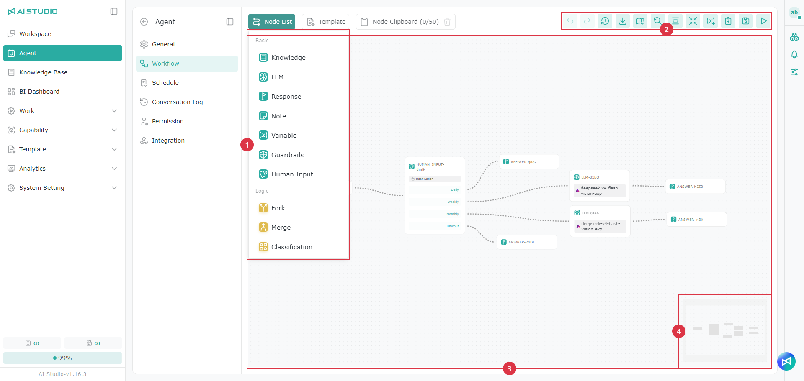

1. **Node list**: the workflow components AI Studio provides. See the Workflow Nodes page for details of the available nodes.
2. **Workflow menu**: the editor's actions; see the description below.
3. **Workflow editing area**: drag nodes here to build the workflow.
4. **Editor map**: helps you navigate quickly to a specific part of the editor.

<table data-search="false"><thead><tr><th width="183">Workflow menu items (left to right in the image above)</th><th>Description</th></tr></thead><tbody><tr><td>Undo, Redo</td><td>Go back one step, or forward one step</td></tr><tr><td>History</td><td>Manage the workflow's edit history</td></tr><tr><td>Export File</td><td>Export this workflow as a file</td></tr><tr><td>Show Minimap</td><td>Show or hide the minimap in the lower-right corner</td></tr><tr><td>Reset View</td><td>Center and fit the whole workflow</td></tr><tr><td>Collapse</td><td>Collapse every node in the editor</td></tr><tr><td>Edit Global Variables</td><td>Edit the global variables in the workflow</td></tr><tr><td>Clipboard</td><td>Store the selected nodes and reuse them at any time</td></tr><tr><td>Save</td><td>Save the changes to the workflow</td></tr><tr><td>Test Preview</td><td>Open a chat window to test the workflow (this button is not shown when editing from a workflow template)</td></tr></tbody></table>

## **Creating and editing a workflow**

> Note: We recommend opening the workflow editor from the Agent settings, so that you can test with **Test Preview** right after editing.

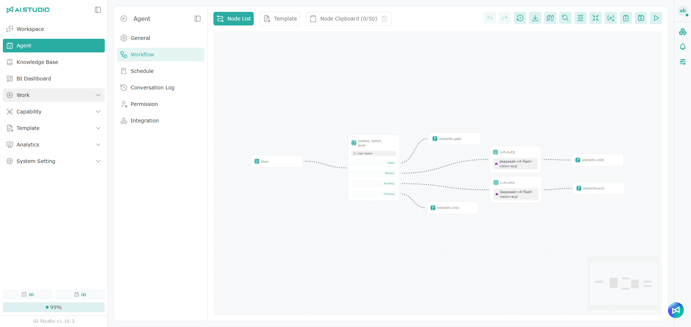

In a blank workflow, the canvas contains a **"Start"** node by default. Click it to see the basic variables:

| Variable                     | Description                                           | Value shown                                                  |
| ---------------------------- | ----------------------------------------------------- | ------------------------------------------------------------ |
| `(x)${{start}.{query}}`      | The user's input prompt                               | _User input, for example:_ `summarize the attached document` |
| `(x)${{start}.{files}}`      | The list of files the user attached in the chat input | `metadata of the files in a JSON array`                      |
| `(x)${{system}.{time}}`      | The current system time                               | `17:19:13`                                                   |
| `(x)${{system}.{date}}`      | The current system date                               | `2025-06-06 Friday`                                          |
| `(x)${{system}.{dateTime}}`  | The current system date and time                      | `2025-06-06 Friday 17:19:13`                                 |
| `(x)${{system}.{userId}}`    | The account ID of the signed-in user                  | Depends on the account                                       |
| `(x)${{system}.{sessionId}}` | The ID of the current conversation                    | Depends on the conversation                                  |
| `(x)${{system}.{account}}` | The account of the signed-in user | Depends on the account |
| `(x)${{system}.{userName}}` | The name of the signed-in user | Depends on the account |
| `(x)${{system}.{userEmail}}` | The email of the signed-in user | Depends on the account |
| `(x)${{system}.{loginProvider}}` | How the user signed in, for example an AI Studio account, Google, Azure Entra ID or AD | Depends on the sign-in method |
| `(x)${{system}.{externalUserId}}` | The user's ID in the external sign-in service | Depends on the sign-in method; may be empty when signed in with an AI Studio account |
| `(x)${{system}.{externalTenantId}}` | The tenant ID of the external sign-in service | Depends on the sign-in method; may be empty when signed in with an AI Studio account |

> System variables can also be used in a Chat Agent's instructions. For details, see [Chat Agent](liao-tian-agent.md). Inserted variables are shown as gray tags.

Once you connect an upstream node to the current node, typing "/" also lets you use that node's output variables. The LLM node is used as the example below ("node name" is shown as the actual node name):

| Variable                       | Description                                                                                                                                                                                       | Value shown                                                                            |
| ------------------------------ | ------------------------------------------------------------------------------------------------------------------------------------------------------------------------------------------------- | -------------------------------------------------------------------------------------- |
| `(x)node name.{result}`        | The node's output. For an LLM node this is the model's answer text; knowledge retrieval, classification, guardrail and other nodes also have this variable, with content that depends on the node | Depends on the node                                                                    |
| `(x)node name.{usage}`         | This node's Token usage and cost (JSON): totalTokens is the total number of Tokens, completionTokens the output Tokens, promptTokens the input Tokens, and price the cost in USD                  | `{"totalTokens":56349,"completionTokens":637,"promptTokens":55712,"price":0.148835}`   |
| `(x)node name.{executionTime}` | This node's run time (JSON), in milliseconds; totalDuration is the total time                                                                                                                     | `{"totalDuration":46600,"loadDuration":0,"promptEvalDuration":0,"evalDuration":46600}` |

Here is a simple example showing the basic workflow actions:

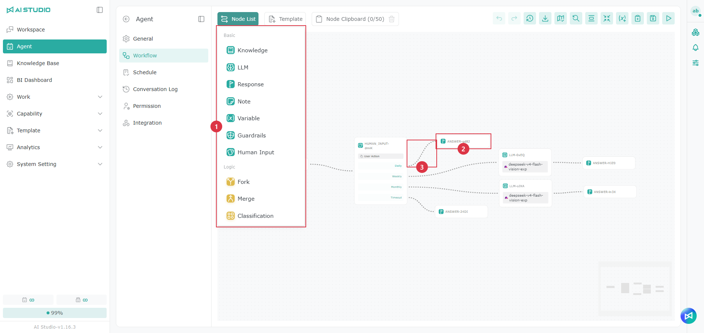

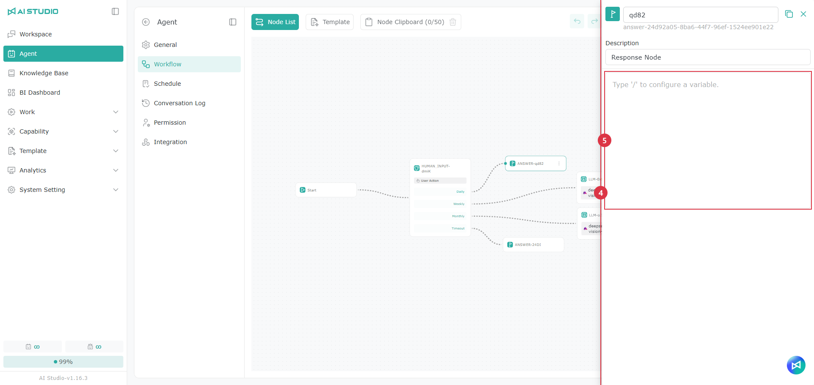

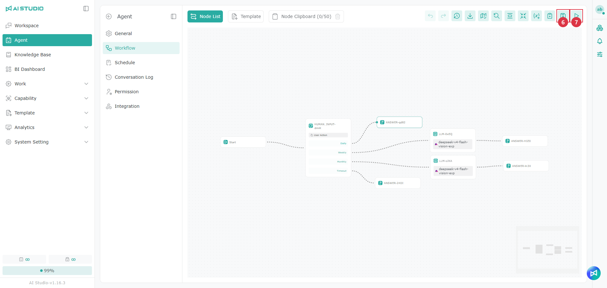

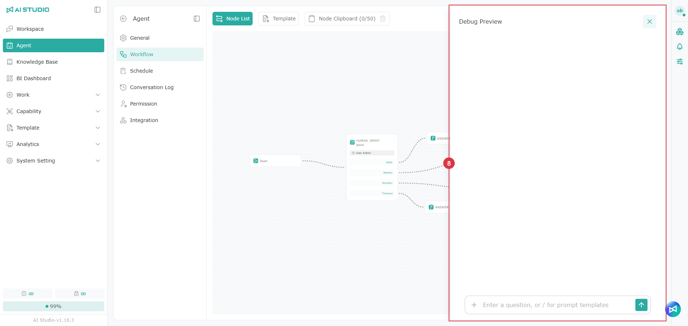

1. In a new workflow, click the "Start" node to see the basic variables.
2. Drag the "Response" node from the node list into the editing area.
3. Connect the output of the "Start" node to the input of the "Response" node.
4. This example displays the contents of the basic variables. Click the "Response" node to open its edit window and edit the Agent's response in the input area.
5. Typing "/" shows the list of available workflow variables; use the tables above to choose the variables to show in the response.
6. When you are done, click "Save" in the menu, then click "Test Preview" to test the workflow.
7. In the "Test Preview" chat area, attach a file, enter a prompt and send it to see the Agent's processing steps in real time.
8. Once the Agent finishes, you can expand the "Response" item in the chat area to review the workflow's result.

Follow the same steps with other nodes to build a workflow that fits your own needs.

### Adding a node from a handle

Besides dragging from the Node list, you can add the next node straight from a node's handle. In the image below, 1 is the source node and 2 is the node menu that opens after clicking its handle on the right:

<figure>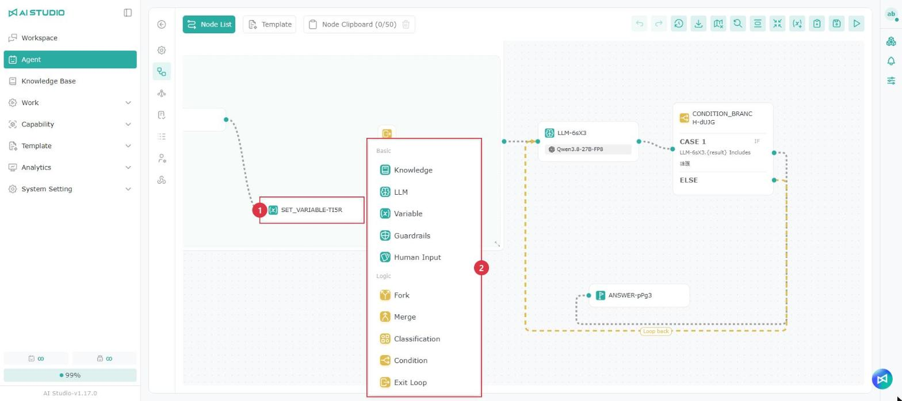<figcaption></figcaption></figure>

1. Hover over an unconnected handle on the right of a node. The handle grows and shows "+".
2. Click the handle to open the node menu next to it.
3. Choose the node to add. The new node is placed to the right and connected to that handle automatically.

* Connected handles don't open the menu; drag from them to connect as before.
* The menu doesn't offer Note, and when adding from a Fork handle it doesn't offer Merge.
* When adding from a node inside a loop, the new node is placed in the same loop and the menu only offers nodes allowed inside a loop (as in the image above). See "Loop" in [Workflow Nodes](gong-zuo-liu-cheng-jie-dian.md).

### Example scenarios

#### Workflow nodes (Fork / Merge): a news search Agent

This scenario shows how a single query can search several data sources in parallel, with the results automatically combined and summarized into key points by the AI. Fork and Merge greatly improve the efficiency of data collection and analysis, and make a complex process fast and easy to follow.

## Multiple connections and loop backs

Workflow nodes can receive multiple connections, and you can connect a later node's output back to an earlier node so the process goes back and runs again. This suits "redo it if the check fails" processes, for example checking an LLM's result with a Condition node and returning to the LLM to regenerate when it doesn't pass.

### Multiple connections into one node

A node's input can be connected to several upstream nodes at once. The node runs once each time the upstream node of any connection finishes.

If it should run only once after all branches finish, use a Merge node instead.

### Loop back

Drag a later node's output to an earlier node's input to create a loop back. A loop back is shown as an orange dashed line routed below the nodes and labeled "Loop back". In the image below, 1 is the LLM with two incoming connections, 2 is the Condition node and 3 is the "Loop back" connection:

<figure>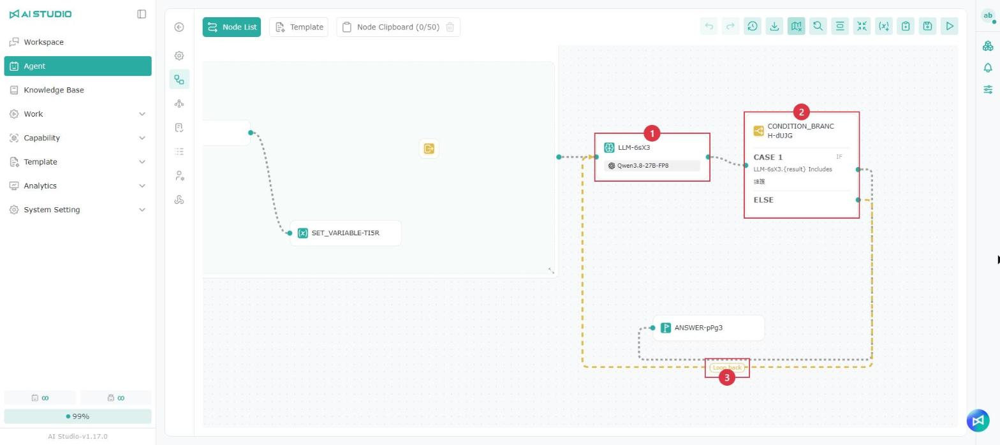<figcaption></figcaption></figure>

In this example, an LLM translates the user's input and translates again when the result doesn't meet the condition:

1. Connect the preceding node to an LLM, enter a translation instruction in Context and insert the variable to translate.
2. Click the handle on the right of the LLM and add a **Condition** node.
3. Add a condition to CASE 1 of the Condition node, for example "LLM name.{result}" **Includes** a given keyword.
4. Connect the CASE 1 exit to a Response node.
5. Drag the ELSE exit back to the LLM's input to create a loop back. The LLM now has two incoming connections.
6. Save and open **Test Preview**. When the condition is met, the response is output directly; when it isn't, the process returns to the LLM to translate again until the condition is met.

For nodes that run again, the processing steps in the conversation show "#count" after the node name. For example, "LLM-6sX3 #3" means the node is running for the 3rd time.

### Loop back limits

* **A node cannot connect back to itself**: a loop back must pass through at least one other node, for example a Condition node that decides when to leave. If you connect a node's output to its own input, a message appears and no connection is created.
* **No loop back into a Merge node**: Merge waits for all of its inputs, so the returning connection would keep it waiting until it times out. Connect to a node before the Merge instead.
* **Re-run limit**: if nodes re-run more than 200 times in total in one run because of loop backs, the process stops and the conversation shows "Workflow re-run limit (200) exceeded. Check the exit conditions of connections that lead back to earlier nodes." Check that the condition for leaving the cycle can actually be met.
* A Response node in a cycle created by a loop back may run more than once, and only the last answer is kept. See "Response" in [Workflow Nodes](gong-zuo-liu-cheng-jie-dian.md).
* Loop backs can also be used inside a loop, going back to an earlier node within the same round. If each retry should count as a round, or you need to limit the number of retries, use the loop's termination condition and Max Iterations instead.


Loop back or loop: use a loop when you need a fixed number of rounds or to accumulate results round by round; use a loop back when you only need to go back and redo a step when a check fails.


## Copying and pasting nodes

Workflows support copying and pasting node settings, which is handy for creating several similar nodes or moving existing logic between workflows.

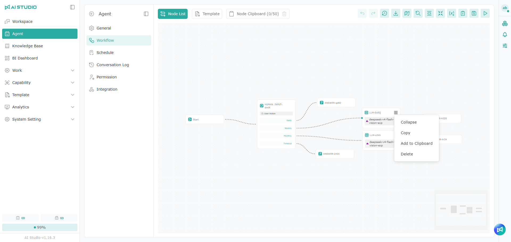

How to use it:

* Select one or more nodes on the canvas.
* Use copy and paste.
* The pasted nodes appear on the canvas with the same settings, which you can then fine-tune.

Additional behavior:

* Copying and pasting across workflows: you can copy nodes from workflow A and paste them into workflow B to assemble a process faster.
* Bulk actions: you can select several nodes at once and copy and paste them with their settings intact.
* Name conflicts: if a pasted node name or variable name is duplicated, the system may require you to change the name before saving. Follow the on-screen message.

> Note: If a node's settings reference **output variables of other nodes**, they may not resolve after pasting into a new workflow because the upstream node is missing. After pasting, check that the connections and variable references are complete.

## Draft sync

To avoid losing edits when the browser is refreshed or closed unexpectedly, the editor keeps part of the draft state in local storage and syncs it across tabs.

<figure><figcaption></figcaption></figure>

## Version history

Version history stores every save you make, so you can review the edit history and use restore to go back to an older version.

> Note: Content is only recorded in the version history when you click the save button in the upper right.

### Restoring an earlier workflow version

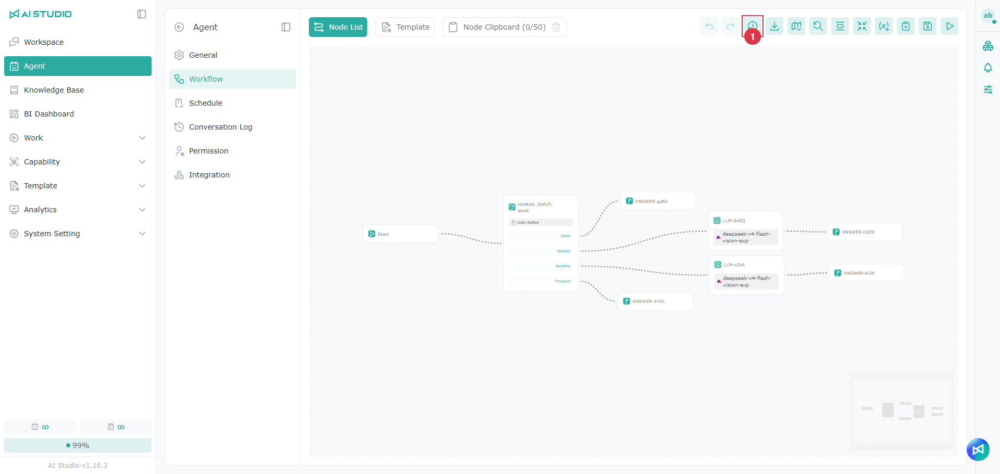

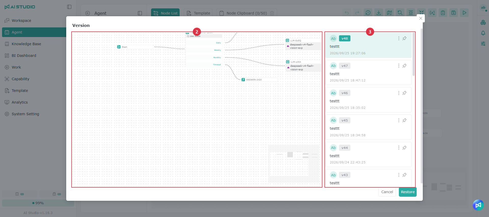

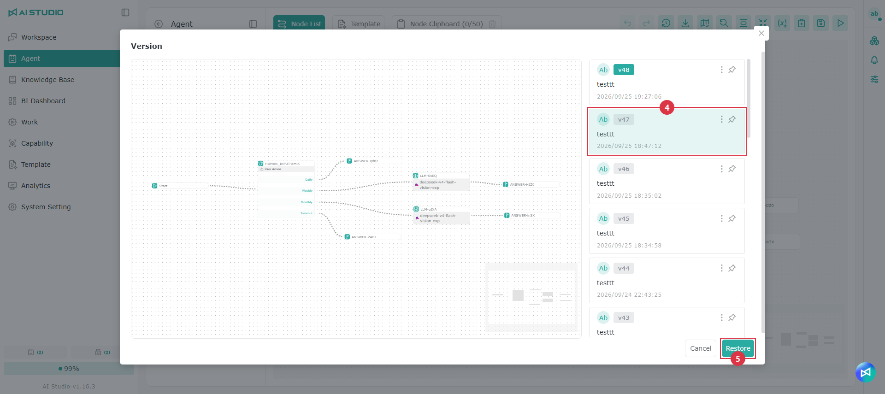

1. Click **Version History** in the workflow menu.
2. The left side of the dialog is a live preview.
3. The right side is the version history, where you can click a card to switch between versions.
4. Click the version you want to switch to.
5. Click **Restore** to apply it to the workflow.

### How versions are kept

Each workflow keeps up to **20** versions.

When the **21st** version is created, the system automatically deletes the **oldest** one, keeping the latest 20.

**Example:**

If you have 20 versions, **Version 1** through **Version 20**, then creating **Version 21** automatically deletes **Version 1**, leaving **Version 2** through **Version 21**.

## Editing global variables

Global variables are the shared constants and settings of a workflow. They suit content reused by several nodes — company policy, tone rules, fixed formats, response template fragments, default API parameters and so on. Managing them in one place avoids editing the same thing in several nodes.

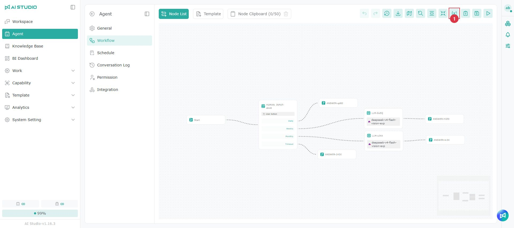

<figure><figcaption></figcaption></figure>

1. Click **Edit Global Variables** in the workflow menu.
2. Add or edit variables in the dialog.
3. Click **Save** to apply them to the workflow.

### Adding and editing a variable

* Name: the identifier used to reference the variable. Only letters and digits are allowed.
* Content: the variable's value, which can be multiple lines of text (rules, a template, a paragraph).

> Note: If you change a variable's name, the system updates the references inside the workflow (always follow the on-screen message). If you previously copied a variable into node content as **plain text**, that text is not a variable reference and you have to update it yourself.

### Referencing a global variable in a node

In a node's settings — for example the **Context** field of an LLM node, or another input field — type "/" to insert an available global variable from the list. Once inserted, it is shown as a gray variable tag and always brings in the latest content.

<figure><figcaption></figcaption></figure>

### Referencing a global variable in a system prompt

When you want several LLM nodes to share the same persona, tone or output rules, put the rules in a global variable and reference it in each node's system prompt.

The benefit: update the rules once and every node that references them is updated.

> Note: If you see a message such as "variable cannot be resolved" or "reference failed" when saving, check that:

1. The variable name contains no special characters or reserved words.
2. The node field supports variable references.
3. The variable was saved successfully.

### Example scenario

#### Global variables: a localization Agent



This scenario shows how setting a global variable once controls the output behavior of every AI node in a workflow — the output language, for example. Instead of editing each node, you can switch between Chinese, English or another language quickly and keep the output consistent, which suits multilingual and cross-border use cases.
