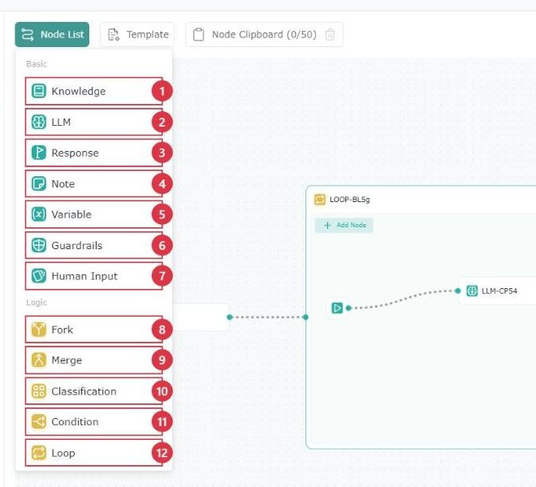
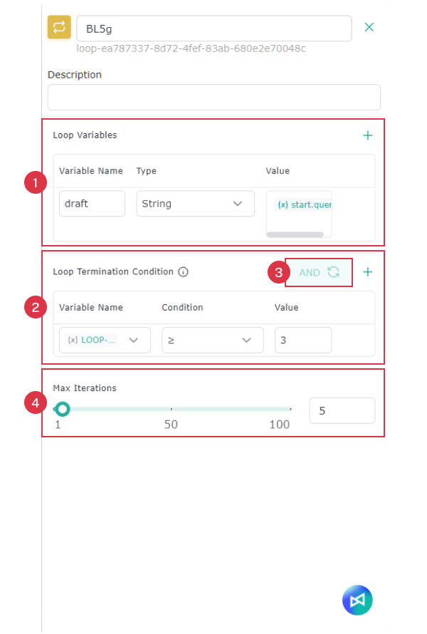
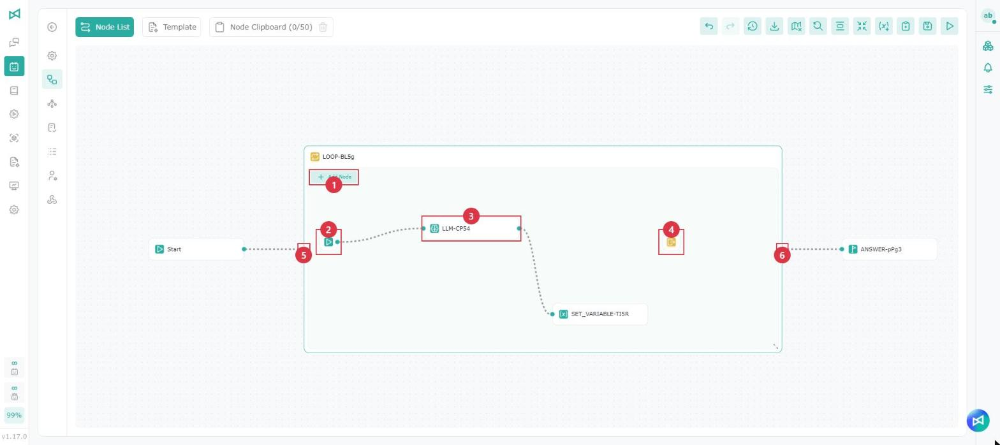
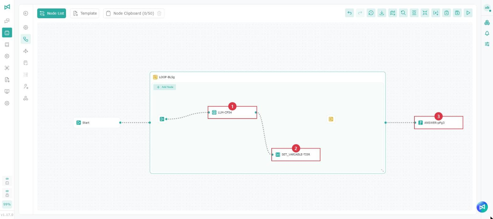
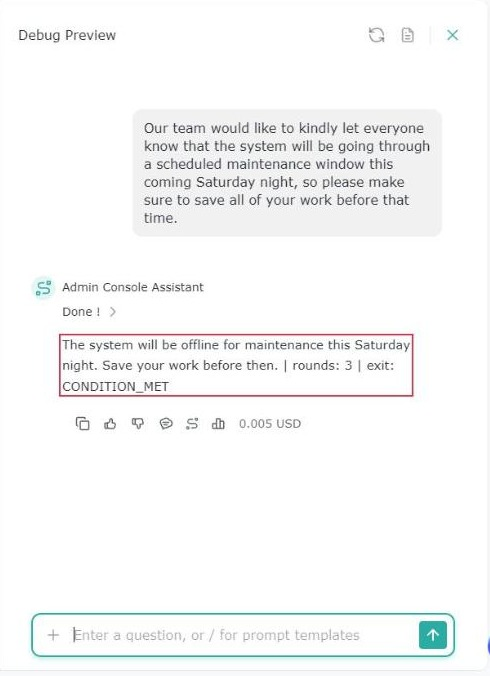

# Workflow Nodes

## Introduction

The workflow system offers a variety of nodes for building flexible, intelligent and modular Agents. Each node plays a different role in the system's logic, user interaction and backend integration.

<figure><figcaption></figcaption></figure>

<table data-search="false"><thead><tr><th width="80">Item</th><th width="160">Node</th><th>What it does in a workflow</th></tr></thead><tbody><tr><td>1</td><td>Knowledge</td><td>Retrieves relevant information from an internal knowledge base or document database.</td></tr><tr><td>2</td><td>LLM</td><td>Runs a prompt with a language model (for example GPT-5.2 Thinking, GPT-5.2 Instant or Gemini 3) to generate or reason over the current input.</td></tr><tr><td>3</td><td>Response</td><td>Defines what the user actually sees — outputs and displays the Agent's reply.</td></tr><tr><td>4</td><td>Note</td><td>Adds an internal note or annotation to the canvas; not connected to the actual logic.</td></tr><tr><td>5</td><td>Variable</td><td>Captures, stores or transforms a value from an earlier step for later nodes to use.</td></tr><tr><td>6</td><td>Guardrails</td><td>Checks and restricts content within the process, which helps reduce the risk of personal data leaks, security issues and compliance problems, and keeps the output within your rules.</td></tr><tr><td>7</td><td>Human Input</td><td>Waits for the user to choose, then continues along the branch matching their choice.</td></tr><tr><td>8</td><td>Fork</td><td>Describes how and in what order data flows between nodes, so tasks can run automatically.</td></tr><tr><td>9</td><td>Merge</td><td>Brings the outputs of different branches back into one node and hands them on together.</td></tr><tr><td>10</td><td>Classification</td><td>Labels the input or routes it automatically, based on predefined logic or model-based classification.</td></tr><tr><td>11</td><td>Condition</td><td>Routes the process to the matching branch based on IF, ELIF and ELSE conditions.</td></tr><tr><td>12</td><td>Loop</td><td>Runs the nodes inside its frame repeatedly until the termination condition is met, the maximum number of iterations is reached, or an Exit Loop node runs.</td></tr></tbody></table>

## **Knowledge**

Retrieves relevant information from an internal knowledge base or document database.

<figure><figcaption></figcaption></figure>

<table><thead><tr><th width="80">Item</th><th width="160">Field</th><th>Description</th></tr></thead><tbody><tr><td>1</td><td>Knowledge retrieval</td><td>The input content (type "/" and select query for the user's question)</td></tr><tr><td>2</td><td>Knowledge base reference</td><td>Select the knowledge bases you need</td></tr><tr><td>3</td><td>Retrieval parameters</td><td>See "Testing a knowledge base - retrieval parameter settings"</td></tr></tbody></table>

## **LLM**

Runs a prompt with a language model (for example GPT-5.2 Thinking, GPT-5.2 Instant or Gemini 3) to generate or reason over the current input.

<figure><figcaption></figcaption></figure>

<table data-search="false"><thead><tr><th width="80">Item</th><th width="160">Field</th><th>Description</th></tr></thead><tbody><tr><td>1</td><td>LLM name</td><td>Enter a node name to make it easier to identify</td></tr><tr><td>2</td><td>LLM parameters</td><td>See Parameters</td></tr><tr><td>3</td><td>Model</td><td>Change the language model this node uses (the same model setting as in 2)</td></tr><tr><td>4</td><td>Context</td><td>The input content (type "/" and select query for the user's question)</td></tr><tr><td>5</td><td>Use node files</td><td>Which files the LLM may take from earlier nodes</td></tr><tr><td>6</td><td>File handling</td><td>See File handling</td></tr><tr><td>7</td><td>Enable Knowledge Base</td><td>See Knowledge base sources</td></tr><tr><td>8</td><td>Coordination</td><td>See Coordination</td></tr><tr><td>9</td><td>Skill</td><td>See Skill</td></tr><tr><td>10</td><td>Reference Memory</td><td>When enabled, the LLM refers to the memories in the memory store when responding. For how memories are saved, see Agent Memory</td></tr><tr><td>11</td><td>Conversation memory</td><td>See conversation memory under Parameters</td></tr><tr><td>12</td><td>Tool</td><td>See Tools</td></tr></tbody></table>

## **Response**

The Response node defines the **Agent's final output**. It returns the results compiled in the workflow to the user, or as the response for downstream systems.

<figure><figcaption></figcaption></figure>

<table><thead><tr><th width="80">Item</th><th width="160">Field</th><th>Description</th></tr></thead><tbody><tr><td>1</td><td>Node name</td><td>Enter a node name to make it easier to identify</td></tr><tr><td>2</td><td>Description</td><td>Describe what this node is for</td></tr><tr><td>3</td><td>Configure variables</td><td>Type "/" to configure variables</td></tr></tbody></table>

A Response node cannot be placed inside a loop. Place it after the loop and reference the loop's variables to output the result.

When a Response node sits in a cycle created by a loop back, or several Fork branches connect to it directly, it may run more than once, and a tip appears at the top of its settings panel:

* When it repeats in a cycle, only the last answer is kept. To accumulate content, add it up with a Variable node first and output it outside the cycle.
* When several branches arrive at the same time, each may leave its own answer. To combine them into one, connect a Merge node first.

For details on loop backs, see "Multiple connections and loop backs" in [Workflow](bian-ji-gong-zuo-liu-cheng.md).

## **Note**

Adds an internal note or annotation to the canvas; not connected to the actual logic.

<figure><figcaption></figcaption></figure>

<table><thead><tr><th width="80">Item</th><th width="160">Field</th><th>Description</th></tr></thead><tbody><tr><td>1</td><td>Node name</td><td>Enter a node name to make it easier to identify</td></tr><tr><td>2</td><td>Note</td><td>Enter note content for later reference</td></tr></tbody></table>

## **Variable**

Captures, stores or transforms a value from an earlier step for later nodes to use.

<figure><figcaption></figcaption></figure>

<table><thead><tr><th width="80">Item</th><th width="200">Field</th><th>Description</th></tr></thead><tbody><tr><td>1</td><td>Variable (global variable name)</td><td>Selects or specifies the <strong>global variable key</strong> to write to (for example <code>global.age</code>), so later nodes can read and reference it by a consistent name.</td></tr><tr><td>2</td><td>Variable content (value)</td><td>Sets the global variable's <strong>actual value</strong>, for later nodes to use directly.</td></tr></tbody></table>

When a Variable node is placed inside a loop, its **Target Variable** can be one of that loop's Loop Variables (for example "loop name.{draft}") or an existing global variable, so you can update the Loop Variable's value in each round. See "Loop" below.

## Guardrails

Checks and restricts content within the process, blocking or masking it according to your settings, to reduce the risk of personal data leaks, security issues and content compliance problems.

<figure><figcaption></figcaption></figure>

<table><thead><tr><th width="80">Item</th><th width="160">Field</th><th>Description</th></tr></thead><tbody><tr><td>1</td><td>Configure variables</td><td>Type "/" to configure variables</td></tr><tr><td>2</td><td>Block / Mask</td><td>Select how the guardrail works</td></tr><tr><td>3</td><td>Category</td><td>Select the content to block or mask by category</td></tr></tbody></table>

## **Classification**

Labels the input or routes it automatically, based on predefined logic or model-based classification.

<figure><figcaption></figcaption></figure>

<table><thead><tr><th width="80">Item</th><th width="160">Field</th><th>Description</th></tr></thead><tbody><tr><td>1</td><td>Model</td><td>Change the language model this node uses</td></tr><tr><td>2</td><td>Context</td><td>The input content (type "/" and select query for the user's question)</td></tr><tr><td>3</td><td>Category</td><td>Classify the question. The node no longer provides a default category; add the categories you need</td></tr></tbody></table>

> When you open an existing workflow that contains a Classification node, the original "Default" category is automatically renamed "Other". After you save, the workflow is stored in the new format, and the branches that were already connected are not affected.

## Fork

Describes how and in what order data flows between nodes, so tasks can run automatically.

<figure><figcaption></figcaption></figure>

<table><thead><tr><th width="80">Item</th><th width="160">Field</th><th>Description</th></tr></thead><tbody><tr><td>1</td><td>Branches</td><td>View the current number of branches</td></tr><tr><td>2</td><td>Branch status</td><td>View the current branch status</td></tr></tbody></table>

## Merge

Brings the outputs of different branches back into one node and hands them on together.

<figure><figcaption></figcaption></figure>

<table><thead><tr><th width="80">Item</th><th width="160">Field</th><th>Description</th></tr></thead><tbody><tr><td>1</td><td>Waiting</td><td>View the number of nodes being waited for</td></tr><tr><td>2</td><td>Input status</td><td>View the current input status</td></tr><tr><td>3</td><td>Wait timeout</td><td>Set the wait timeout</td></tr></tbody></table>

## Loop

Runs the nodes inside its frame repeatedly until the Loop Termination Condition is met, the Max Iterations is reached, or an Exit Loop node runs, and then continues to the next nodes from the exit on the right of the loop. Use it for processes that revise or check something repeatedly, for example shortening a piece of text over a set number of rounds.

<figure><figcaption></figcaption></figure>

<table><thead><tr><th width="80">Item</th><th width="160">Field</th><th>Description</th></tr></thead><tbody><tr><td>1</td><td>Loop Variables</td><td>Click "+" to add one. Variables shared inside the loop; each keeps its current value at the end of a round for the next round to use. Nodes inside the loop and nodes after it can both reference them</td></tr><tr><td>2</td><td>Loop Termination Condition</td><td>Optional. Click "+" to add a condition. Conditions are checked after each round, and the loop exits when they are met</td></tr><tr><td>3</td><td>AND / OR</td><td>With two or more conditions, click to switch how they combine: "AND" exits only when all conditions are met, "OR" exits when any one is met</td></tr><tr><td>4</td><td>Max Iterations</td><td>1 to 100, 10 by default. When this number is reached, the loop exits even if the termination condition is not met, so it never runs endlessly</td></tr></tbody></table>

### Adding a loop

Drag **Loop** from the Node list onto the canvas, or click an unconnected handle on the right of a node and choose **Loop** from the menu. A loop is a frame that already contains three nodes: Loop Start, LLM and Exit Loop (the image below shows an example loop with a Variable node added):

<figure><figcaption></figcaption></figure>

<table><thead><tr><th width="80">Item</th><th width="160">Name</th><th>Description</th></tr></thead><tbody><tr><td>1</td><td>Add Node</td><td>Adds a node inside the loop. You can also click an unconnected handle on the right of a node inside the loop to add one quickly; the loop frame grows automatically when space runs out</td></tr><tr><td>2</td><td>Loop Start</td><td>Every round starts here. It cannot be deleted</td></tr><tr><td>3</td><td>LLM</td><td>Already connected to Loop Start. You can change its settings, replace it or delete it</td></tr><tr><td>4</td><td>Exit Loop</td><td>The loop exits immediately when this node runs. It is not connected by default; connect it when you need it, or delete it if you don't</td></tr><tr><td>5</td><td>Entrance</td><td>Connect the preceding node to the entrance on the left of the loop</td></tr><tr><td>6</td><td>Exit</td><td>When the loop ends, the process continues to the next nodes from the exit on the right</td></tr></tbody></table>

* Loop Start and Exit Loop are shown as icons only; hover over an icon to see its name.
* Drag the lower-right corner of the loop frame to resize it.
* Nodes inside the loop cannot connect directly to nodes outside it. Enter through the loop's entrance and leave through its exit.

Nodes you can place inside a loop: Knowledge, LLM, Note, Variable, Guardrails, Human Input, Fork, Merge, Classification, Condition and Exit Loop. **Response** and **Loop** cannot be placed inside a loop.

Every exit of a Classification or Condition node inside a loop must be connected before the workflow can be saved.

### Loop settings

#### Loop Variables

<table><thead><tr><th width="160">Field</th><th>Description</th></tr></thead><tbody><tr><td>Variable Name</td><td>Letters, numbers and underscores only, and it cannot start with a number. Names must be unique within the loop, and the reserved names <code>executedRounds</code> and <code>exitReason</code> cannot be used</td></tr><tr><td>Type</td><td>String, Number, Boolean</td></tr><tr><td>Value</td><td>The initial value, set once when the loop is first entered. Enter a fixed value (Number must be a number; Boolean is <code>true</code> or <code>false</code>), or type "/" to reference a variable of the same type from outside the loop, for example <code>start.query</code></td></tr></tbody></table>

To update a Loop Variable in each round, add a Variable node inside the loop and set its **Target Variable** to "loop name.{variable name}".

#### Loop Termination Condition

Each condition consists of a **Variable Name**, a **Condition** and a **Value**:

* **Variable Name**: system variables, global variables, this loop's variables (including `executedRounds`) and the outputs of nodes inside the loop, of type String, Number or Boolean.
* **Condition**: the options depend on the variable's type:

<table><thead><tr><th width="160">Type</th><th>Available conditions</th></tr></thead><tbody><tr><td>Number</td><td>=, ≠, >, &#x3C;, ≥, ≤</td></tr><tr><td>String</td><td>=, ≠, Includes, Not includes, Starts with, Ends with, Is empty, Is not empty</td></tr><tr><td>Boolean</td><td>=, ≠ (select <code>true</code> or <code>false</code> as the value)</td></tr></tbody></table>

* **Value**: the fixed value to compare against. Not needed when the condition is **Is empty** or **Is not empty**.

Notes:

* Conditions are checked only after each round finishes, so the loop always runs at least once.
* Text comparisons are case-sensitive and include leading and trailing spaces.
* Without a termination condition, the loop exits only when it reaches Max Iterations or an Exit Loop node runs, which you can use to run a fixed number of rounds.
* If a variable used in a condition is renamed or deleted, it is shown with a red strikethrough and must be selected again.

### Variables you can reference

Every loop provides two system variables, with no setup needed:

<table><thead><tr><th width="240">Variable</th><th width="100">Type</th><th>Description</th></tr></thead><tbody><tr><td><code>loop name.{executedRounds}</code></td><td>Number</td><td>Inside the loop, the current round (the first round is 1); after the loop, the total number of rounds run</td></tr><tr><td><code>loop name.{exitReason}</code></td><td>String</td><td>Why the loop exited. Only nodes after the loop can reference it: • <code>CONDITION_MET</code>: the Loop Termination Condition was met • <code>MAX_COUNT_REACHED</code>: Max Iterations was reached • <code>EXIT_LOOP</code>: an Exit Loop node ran</td></tr></tbody></table>

If the last round both meets the termination condition and reaches Max Iterations, the exit reason is recorded as `CONDITION_MET`.

The variables available when you type "/" depend on where the node is:

<table><thead><tr><th width="200">Location</th><th>Variables you can reference</th></tr></thead><tbody><tr><td>Nodes inside the loop</td><td>System variables, global variables, Start variables, outputs of nodes before the loop, this loop's variables and <code>executedRounds</code>, and outputs of earlier nodes in the same round</td></tr><tr><td>Nodes after the loop</td><td>System variables, global variables, Start variables, outputs of nodes before the loop, this loop's variables (final values), <code>executedRounds</code> and <code>exitReason</code></td></tr></tbody></table>


Nodes after the loop cannot reference the outputs of nodes inside it directly. To use them, write the result to a Loop Variable with a Variable node inside the loop, then reference that Loop Variable after the loop.


### Example: shortening a piece of text repeatedly

In this example, an LLM shortens the user's text over and over and outputs the result after 3 rounds. In the image, 1 is the LLM inside the loop, 2 is the Variable node and 3 is the Response node.

<figure><figcaption></figcaption></figure>

1. Connect the "Start" node to the entrance on the left of the loop.
2. Click the loop's title to open its settings. Under **Loop Variables**, add a row: enter `draft` as the Variable Name, select String as the Type, and type "/" in Value and select `start.query`.
3. Under **Loop Termination Condition**, add a row: select "loop name.{executedRounds}" as the Variable Name, select "≥" as the Condition and enter `3` as the Value. Set **Max Iterations** to 5.
4. Click the LLM inside the loop. In Context, enter a rewrite instruction (for example "Rewrite the text below to be shorter and clearer. Reply with the rewritten text only:"), then type "/" and insert "loop name.{draft}".
5. Click the handle on the right of the LLM and add a **Variable** node. Set **Target Variable** to "loop name.{draft}", and type "/" in the value to insert "LLM name.{result}".
6. Connect the exit on the right of the loop to a Response node and insert "loop name.{draft}" in the Response. You can also insert `executedRounds` and `exitReason` to check how the loop ran.
7. Save, open **Test Preview** and send some text. The response shows the shortened text, 3 rounds run and the exit reason `CONDITION_MET`.

<figure><figcaption>
The response in Test Preview
</figcaption></figure>

Expand the processing steps in the conversation to see the nodes that ran in each round.

### Checks when saving

When you save the workflow, a warning appears and the settings of the node with the problem open in any of these cases:

* A Loop Variable name is empty, invalid, reserved or duplicated, or its initial value doesn't match its type or references a variable that can't be used
* A node references a Loop Variable that has been renamed or deleted
* A Loop Termination Condition is incomplete, for example no variable is selected, the value is missing, or the value doesn't match the type
* A Classification or Condition node inside the loop has an unconnected exit

## **Human Input**

Pauses the process and shows a message with action buttons. Once the user chooses, the process continues along the branch matching their choice. You can also have someone else confirm, which suits processes that need a manager's or owner's approval before they continue.

<figure><figcaption></figcaption></figure>

<table><thead><tr><th width="80">Item</th><th width="160">Field</th><th>Description</th></tr></thead><tbody><tr><td>1</td><td>Message</td><td>The message shown to the person responding; type "/" to configure variables. Put any extra explanation of the actions here as well</td></tr><tr><td>2</td><td>User Actions</td><td>The actions to choose from. Each action takes a single value (up to 100 characters), which is shown on the button and is also the value used for branching. At least one action is required</td></tr><tr><td>3</td><td>Confirmed by</td><td>Choose who responds; the process waits for the confirmer's response before it continues: • <strong>Current User</strong>: the user currently interacting with the Agent in this conversation responds • <strong>Specified User</strong>: the selected user responds, regardless of who is interacting with the Agent. Select one confirmer, who can be yourself or someone else</td></tr><tr><td>4</td><td>Notification</td><td>System notifications are on by default and cannot be turned off; the confirmer is notified when the process starts waiting for a response. You can also select E-mail Notification to notify the confirmer by email as well</td></tr><tr><td>5</td><td>Timeout</td><td>The wait duration and unit (seconds, minutes, hours, days). If no response arrives in time, the process continues through the timeout exit</td></tr></tbody></table>


Action text is shown directly on the buttons, so keep it short and clear, no more than one or two lines. Buttons have no hover description; if the actions need explaining, put it in the Message.


Each user action creates a matching exit on the node, plus a fixed **timeout** exit. Every exit has to be connected to a downstream node before the workflow can be saved.

<figure><figcaption></figcaption></figure>

In a downstream node, type "/" and select "node name.{selected}" to get the value of the action the user chose. When the process continues through the timeout exit, this value is empty.

### Who responds

The Confirmed by setting decides who responds to the Human Input node. Whichever option you choose, the confirmer is reminded by a system notification when the process starts waiting for a response.

<table><thead><tr><th width="240">Setting</th><th>How to respond</th></tr></thead><tbody><tr><td>Current User</td><td>The user talking to the Agent responds, either on the card in the conversation or from the notification</td></tr><tr><td>Specified User, and the confirmer is the user in the conversation</td><td>Respond on the card in the conversation, or from the notification</td></tr><tr><td>Specified User, and the confirmer is not the user in the conversation</td><td>The card shows "Waiting for ○○ to respond". The user in the conversation cannot respond and has to wait for the confirmer to respond from the notification</td></tr></tbody></table>

With Specified User, the same confirmer responds no matter who is talking to the Agent. For example, if you set a manager as the confirmer, the process continues only after the manager confirms, whoever reaches this node.

The confirmer does not need permission for the Agent to respond: a confirmer without permission can still click an action in the system notification or email, but cannot return to the conversation.

### The card in the conversation

When the process reaches a Human Input node, a card appears in the conversation with the message, the action buttons and the expiry time. Once a response is given, the process continues through the chosen action's exit.

<figure><figcaption>
Human Input node triggered
</figcaption></figure>

<figure><figcaption>
Human Input node timed out
</figcaption></figure>

* While the process is waiting for a response, no new messages can be sent in that conversation until the response is given.
* Card states are "Waiting", "Answered", "Timed out" and "Cancelled". When a confirmer is specified, a waiting card shows "Waiting for (confirmer name)". After an answer, while the process has not yet continued, the card shows "Waiting". Status labels are shown in full and are not truncated.
* If you reopen the conversation, a waiting card is still there and can still be answered.
* If the response is stopped while waiting, the card is shown as canceled and the process does not continue.
* The confirmer can respond by clicking an action in the system notification, or click "Back to conversation" to respond in the original conversation. After a response the action buttons in the notification are collapsed; after a timeout or cancellation they can no longer be clicked. For how the notification looks, see [System Notification](../ping-tai-zhi-nan/xi-tong-tong-zhi.md).
* With E-mail Notification selected, the confirmer can also respond directly in the email; see "Email notification" below.
* Calling a Workflow Agent that contains a Human Input node through Coordination is not supported yet.

### Email notification

With E-mail Notification selected, the confirmer receives an email from Profet AI AIS (ais@profetai.com) when the process starts waiting for a response, and can respond by choosing an action in the email without opening AIS.

<figure><figcaption>
Email notification from a Human Input node
</figcaption></figure>

The email contains:

<table><thead><tr><th width="160">Item</th><th>Description</th></tr></thead><tbody><tr><td>Subject</td><td>Shows the source Agent and "Your response is needed", followed by the item to confirm</td></tr><tr><td>Body</td><td>Shows the Agent name, the item to confirm and the message set in the node</td></tr><tr><td>Response deadline</td><td>The deadline after "Expires at", currently shown in UTC. After the deadline, the process continues through the timeout exit</td></tr><tr><td>Action buttons</td><td>The same as the user actions set in the node; click one to send your response</td></tr></tbody></table>

To respond:

1. Open the email and check what needs confirming and the response deadline.
2. Click one of the action buttons in the email. You need to sign in to AIS before the response is sent.
3. A result page opens in your browser. "Submitted" means the response was sent, and the process continues according to the chosen action.
4. Click "Back To Homepage" to return to the AIS homepage.

<figure><figcaption>
Response submitted
</figcaption></figure>

If the result page shows an error message, such as "The selected human input action does not exist.", the response was not sent. Go back to the conversation in AIS and check the card's current status, for example whether it has timed out, been canceled or already been answered another way.

<figure><figcaption>
Response failed
</figcaption></figure>
