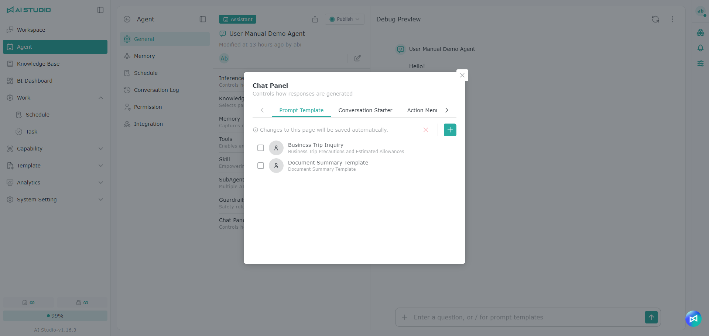
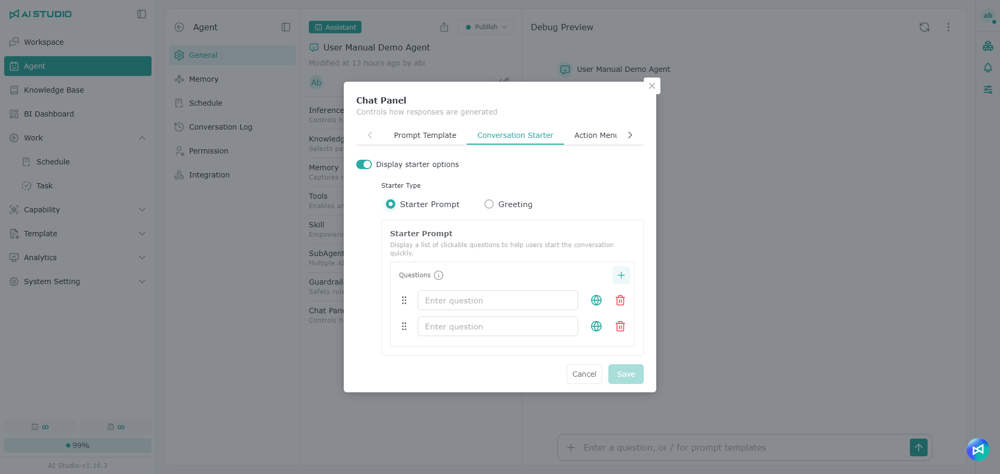
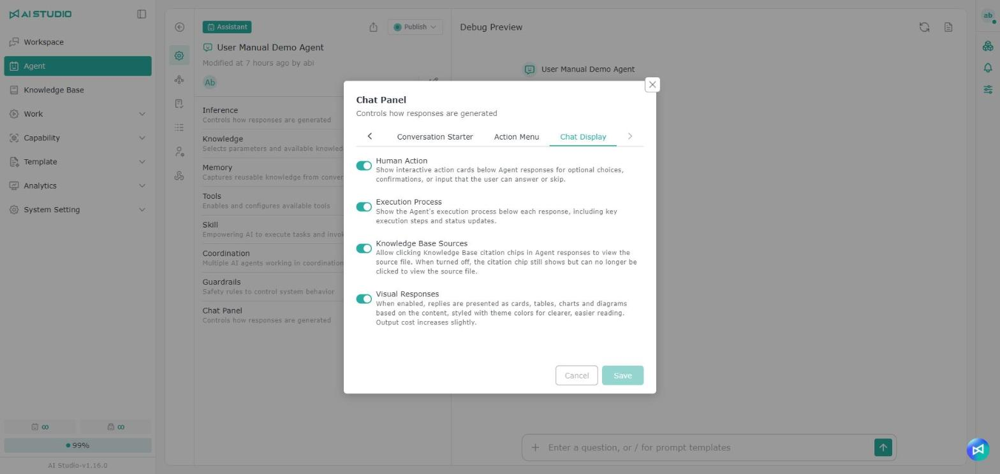
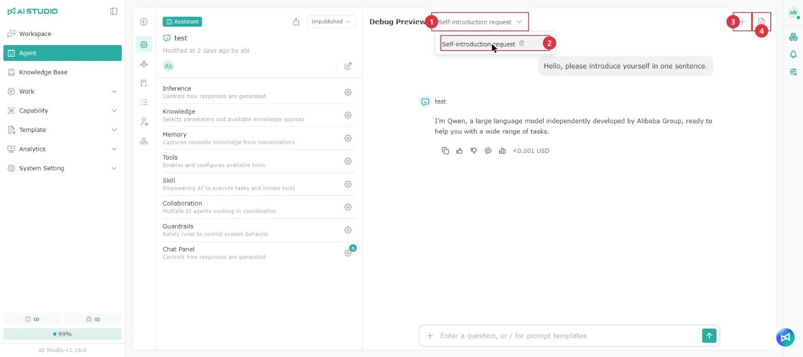

# Chat Agent

## **Basic settings**

<figure><figcaption></figcaption></figure>

The Chat Agent home page has several parts:

1. **Agent feature menu**: contains the links below; each one opens the corresponding settings page.
2. **Basic information**: shows the Agent name, when and by whom it was created and last edited, and its enabled state.
3. **Application settings:** settings for the Agent's behavior, depending on the Agent type.
4. **Debug Preview:** lets you test whether the answers are what you expect.

### Setting count badges

<figure><figcaption></figcaption></figure>

In the application settings, the gear icons on setting rows such as **Knowledge**, **Tools**, **Skill** and **Memory** show the number of configured items in the top-right corner, so you can check without opening the settings window.

* **Memory**: shows 1 when **Memory citation** is turned on, and no number when it is off. **Automatically optimize memory** and the extraction instructions are not counted; even if automatic memory optimization is on, no number is shown while memory citation is off.
* The number reflects the saved settings: if you change something in the settings window and click **Cancel**, the number does not change; after you click **Save**, it updates immediately.

## **Inference parameters**

The settings have two tabs: **Parameters** and **Instruction**.

### **Parameters**

Use the items on the **Parameters** tab to control how the Agent responds.

<figure><figcaption></figcaption></figure>

<figure><figcaption></figcaption></figure>

Inference parameters define which model the Agent uses, and how that model generates its responses — the generation method, the response length and the context range.

Turn on **Update inference settings** to adjust these settings on the **Parameters** tab. The fields shown depend on whether the selected model supports thinking parameters.

#### Selecting a model

Select the model the Agent uses in the **Model** field. The labels next to a model name show its capabilities, for example "chat", "voice" or "realtime".

Once you select a model, the following is shown below it:

| Information | Description                                |
| ----------- | ------------------------------------------ |
| Input       | Reference cost per 1 million input Tokens  |
| Output      | Reference cost per 1 million output Tokens |
| Max Tokens  | The Token limit the model supports         |

The available models, capability labels and cost information depend on your system administrator's configuration. For which models suit which use cases, see [Model - Model recommendations by feature](../xi-tong-she-ding-zhi-nan/mo-xing.md).

#### Which fields are shown

The system shows fields according to whether the model supports thinking parameters:

| Model type                    | Fields shown                                                |
| ----------------------------- | ----------------------------------------------------------- |
| No thinking parameter support | Temperature, Top P, Max Tokens, Context Window, Window Size |
| Thinking parameter support    | Reasoning Effort, Max Tokens, Context Window, Window Size   |

When you switch models, the available fields update automatically; you do not need to change the settings mode manually.

#### Parameters for a standard model

When a model does not support thinking parameters, you can set the following generation parameters.

#### Temperature

Controls how consistent or varied the answers are.

* Range: `0–1`
* Closer to `0`: answers are more stable and focused, which suits tasks that need consistency or accuracy.
* Closer to `1`: answers are more varied, which suits creative ideation or open-ended content.

Drag the slider, or enter a value on the right.

#### Top P

Controls the range of content the model can draw on when generating an answer.

* Range: `0–1`
* Lower value: answers are more focused and conservative.
* Higher value: wording and content vary more.

Unless you have a specific tuning need, we recommend keeping the system default.

#### Models that support thinking parameters

When a model supports thinking parameters, **Reasoning Effort** is shown and **Temperature** and **Top P** are hidden.

#### Reasoning Effort

Sets how much thinking the model uses on a problem. A higher setting suits complex analysis or multi-step tasks, but usually also means longer response times and more Tokens.

<table data-header-hidden data-search="false"><thead><tr><th></th><th></th></tr></thead><tbody><tr><td>Setting</td><td>When to use it</td></tr><tr><td>None</td><td>No reasoning effort specified; suits direct, simple Q&#x26;A</td></tr><tr><td>Low</td><td>Simple judgments, summaries or format conversion</td></tr><tr><td>Medium</td><td>General analysis, organizing content and most everyday tasks</td></tr><tr><td>High</td><td>Complex instructions, in-depth analysis or multi-step tasks</td></tr><tr><td>Very High</td><td>Tasks that need more complete reasoning and deeper judgment</td></tr><tr><td>Maximum</td><td>The highest reasoning effort the model offers; suits highly complex tasks</td></tr></tbody></table>

The levels actually available depend on the model and the system configuration. If your system administrator has not enabled a level for a model, it does not appear in the menu.

#### Shared parameters

The following fields are shown for both types of model.

#### Max Tokens

Sets the maximum number of Tokens the model can produce in a single response.

* Drag the slider or enter a value.
* The upper limit varies by model.
* The model's supported limit is shown below the **Model** field.
* A higher value allows longer responses, but may also increase processing time and Token usage.

This setting is the maximum allowed, not the amount used in every response.

#### Context Window

Controls whether the model refers to recent conversation history when generating an answer.

| Setting | Description                                                           |
| ------- | --------------------------------------------------------------------- |
| On      | The model refers to recent conversation within the range you set      |
| Off     | The model does not bring in conversation history through this setting |

When it is on, the **Window Size** field appears.

#### Window Size

Sets how much recent conversation the model can refer to.

* Range: `1–50`
* A higher value lets the model refer to more of the recent conversation.
* A larger window helps maintain context in long conversations, but may also increase Token usage.
* This field only takes effect when **Context Window** is on.

When you are done, click **Save** to apply the changes. If you switched models, check the parameters again, because the supported fields and upper limits can differ from model to model.

> Note: A thinking model produces additional reasoning Tokens, so the actual cost can be higher than for a standard model. The higher the Reasoning Effort, the more Tokens are usually used.

### Instruction

Use the **Instruction** tab to define the prompt that controls the Agent's language, persona, tone and so on.

<figure><figcaption></figcaption></figure>

#### **Adding a prompt from a template**

You can add the application template you need quickly from the templates.

<figure><figcaption></figcaption></figure>

<figure><figcaption></figcaption></figure>

1. Add from a blank field, or, if there is already a prompt, use the mouse to select where you want to insert it.
2. Click the **Template** button to open the template list and select the template type you want.
3. The corresponding template is generated and inserted as selected text, which you can then edit as needed.
4. Click **Save** to finish.

#### **Generating a prompt from a description**

Prompt generation supports both rewriting existing content and generating from scratch. The red box at the top is optional and serves as the basis for a rewrite; enter your generation instructions in the green input box below to produce the result.

<figure><figcaption></figcaption></figure>

<figure><figcaption></figcaption></figure>

1. Select the input box below and describe what you want the prompt to do.
2. Press Enter, or click the generate button on the right, and wait for the AI to generate the template.
3. When generation is complete, you can edit the result as needed.
4. Click **Save** to finish.

> Note: When generating or rewriting an instruction, the system takes the Agent's current settings into account — such as the tools, skills and collaborating Agents it already has — so that the instruction matches what the Agent can actually do. A notification in the lower-right corner tells you that these settings are being used. A rewritten instruction does not keep its skill and tool references, so select them again with "/". See [Referencing skills and tools in an instruction](#zai-zhi-ling-zhong-yin-yong-ji-neng-yu-gong-ju).

#### **Using system variables in instructions**

You can add system variables to an instruction so the Agent gets information about the current user and conversation during the chat — for example, to tailor responses to the user's account or name. Type "/" in the instruction box to open the menu, then select a variable from the **System** group. Inserted variables are shown as gray tags. The same menu can also reference skills and tools; see below.

| Variable | Description |
| --- | --- |
| `system.sessionId` | The ID of the current conversation |
| `system.userId` | The signed-in user's user ID in AI Studio |
| `system.account` | The account of the signed-in user |
| `system.userName` | The name of the signed-in user |
| `system.userEmail` | The email of the signed-in user |
| `system.loginProvider` | How the user signed in, for example an AI Studio account, Google, Azure Entra ID or AD |
| `system.externalUserId` | The user's ID in the external sign-in service |
| `system.externalTenantId` | The tenant ID of the external sign-in service |
| `system.time` | The current system time |
| `system.date` | The current system date |
| `system.dateTime` | The current system date and time |

> Variable values depend on how the user signed in. For example, when signed in with an AI Studio account, the variables related to external sign-in services may be empty.

#### **Referencing skills and tools in an instruction** 

When an instruction mentions a skill or tool, you can select it directly with "/". Once selected, the system records the actual item it points to rather than just a piece of text: the reference keeps working if the item is renamed, and it is checked when you save.

<figure><figcaption></figcaption></figure>

1. Type "/" in the instruction box.
2. Find the item you want to reference in the **Tool** or **Skill** group of the menu, or type its name in the search box.
3. Click the item. A reference tag for it is inserted into the instruction.
4. Click **Save**.

<table data-search="false"><thead><tr><th width="90">Item</th><th width="157">Name</th><th>Description</th></tr></thead><tbody><tr><td>1</td><td>Search</td><td>Search variables, tools and skills by name</td></tr><tr><td>2</td><td>Tool</td><td>Tools you can reference</td></tr><tr><td>3</td><td>Skill</td><td>Skills you can reference</td></tr><tr><td>4</td><td>Source tag</td><td><strong>Agent</strong> means the item has been added to this Agent and can be used at run time; <strong>Personal</strong> means you have permission to use the item but it has not been added to this Agent yet</td></tr></tbody></table>

> Note: Referencing an item does not add it to the Agent automatically. When you reference an item tagged **Personal**, first add it to this Agent under **Tools** or **Skill**; otherwise it has no effect at run time.

**Reference check on save**

<figure><figcaption></figcaption></figure>

When you save an instruction, the system checks every reference. If any reference may not be usable, a notification "Some Skill/Tool references may be unavailable" appears at the top of the screen (1 in the image above), listing each reference's type and name, the reason, and the line and column where it appears. The notification closes automatically after a few seconds. The instruction is still saved; adjust it according to the table below and save again so the references take effect.

| Reason                                                  | What to do                                                                           |
| ------------------------------------------------------- | ------------------------------------------------------------------------------------ |
| Not found (deleted or wrong id)                         | The item has been deleted. Remove the reference or choose another item               |
| Disabled                                                | The item has been disabled. Ask its admin to enable it again, or choose another item |
| No read permission                                      | You do not have permission to use the item. Ask its admin to grant you permission    |
| Not attached to this Agent; it has no effect at run time | Add the item to the Agent under **Tools** or **Skill**                               |

#### **Restoring a previous instruction**

<figure><figcaption></figcaption></figure>

<figure><figcaption></figcaption></figure>

<figure><figcaption></figcaption></figure>

1. Click **Version** in the instruction.
2. Select the instruction you want to restore.
3. Click **Restore**.
4. Click **Save** to finish.

> **How versions are kept**\
> There is currently no limit on the number of instruction versions stored.

## Knowledge Base

### Knowledge base sources

<figure><figcaption></figcaption></figure>

### Knowledge base parameters 

For details, see [Knowledge Base Parameters](liao-tian-agent.md#zhi-shi-ku-can-shu).

<figure><figcaption></figcaption></figure>

## **Tools**

In the settings you can enable or disable the tools an Agent can access.

<figure><figcaption></figcaption></figure>

> Note: If the creator of a tool set default parameters, those defaults are filled in when the tool is added, and values you change here take precedence over them. To apply the latest defaults, click **Reset**. For details, see MCP - tool default parameters.

#### **Session Memory**

<table data-search="false"><thead><tr><th width="250">Tool</th><th>Description</th></tr></thead><tbody><tr><td>KV session short-term memory</td><td>Stores and retrieves temporary data precisely by key during a session. Useful for tracking dynamic variables such as <code>user name</code> or <code>selected plan</code>.</td></tr><tr><td>graphiti - add memory data</td><td>Stores episodic information (such as an interaction or event) in the knowledge graph.</td></tr><tr><td>graphiti - query memory nodes</td><td>Retrieves entity summaries or node-level memory representations.</td></tr><tr><td>graphiti - query memory facts</td><td>Searches the memory graph for relevant facts and structured relationships.</td></tr><tr><td>graphiti - delete entity relationship</td><td>Deletes a defined relationship between entities from the graph.</td></tr><tr><td>graphiti - delete episode</td><td>Deletes a specific episode segment from the memory graph.</td></tr><tr><td>graphiti - get entity relationships</td><td>Retrieves the structured relationships related to a specific entity.</td></tr><tr><td>graphiti - get episodes</td><td>Returns recent memory episodes to provide context for a conversation or decision.</td></tr><tr><td>graphiti - clear memory graph</td><td>Resets the entire graph-based memory system.</td></tr></tbody></table>

> Note: For more information about Graphiti, see its official website.

#### **Academic Articles**

<table><thead><tr><th width="250">Tool</th><th>Usage</th></tr></thead><tbody><tr><td>arXiv paper search</td><td>Lets users search academic papers in the arXiv database.</td></tr><tr><td>Google Scholar search</td><td>Searches academic articles and citations using Google Scholar.</td></tr></tbody></table>

#### **Web Search**

<table data-search="false"><thead><tr><th width="250">Tool</th><th>Usage</th></tr></thead><tbody><tr><td>Serper - web content extraction</td><td>Extracts readable content from a web page URL.</td></tr><tr><td>Serper - Google search</td><td>Runs a Google search and returns summarized results.</td></tr><tr><td>Serper - patent search</td><td>Searches published patents and related documents.</td></tr><tr><td>Serper - image search</td><td>Searches images from a text query.</td></tr><tr><td>Serper - paper search</td><td>Searches academic papers using Google Scholar-style sources.</td></tr><tr><td>Serper - news search</td><td>Searches news from a text query.</td></tr><tr><td>Serper - maps search</td><td>Searches maps from a text query.</td></tr></tbody></table>

> Note: For more information about Serper, see its official website.

#### **Code**

<table><thead><tr><th width="250">Tool</th><th>Usage</th></tr></thead><tbody><tr><td>Run Python code</td><td>Runs a Python script or logic to support tasks such as math, data parsing or automation.</td></tr></tbody></table>

#### **Document Handling**

<table><thead><tr><th width="250">Tool</th><th>Usage</th></tr></thead><tbody><tr><td>Preview document</td><td>Displays an uploaded document in a readable format inside the platform.</td></tr><tr><td>Document to Markdown</td><td>Converts a document to Markdown.</td></tr></tbody></table>

#### **Other**

<table><thead><tr><th width="250">Tool</th><th>Usage</th></tr></thead><tbody><tr><td>Get current time</td><td>Returns the current system time when the request is made.</td></tr><tr><td>Simple math</td><td>Performs simple arithmetic in a prompt.</td></tr><tr><td>Sequential Thinking</td><td>Breaks a complex problem into step-by-step thinking, with the option to revise or branch. Suits planning, troubleshooting and structured reasoning.</td></tr></tbody></table>

## Skill

<figure><figcaption></figcaption></figure>

By configuring skills, an Agent can support more features and task scenarios — for example accessing data, operating tools, running processes or extending specific tasks. Configure the skills you need to make the Agent more flexible and more capable.

## Coordination 

With this feature you can set up collaboration between several Agents, so that tasks are divided by responsibility. This makes processes more flexible and task handling more efficient overall.

<figure><figcaption></figcaption></figure>

<figure><figcaption></figcaption></figure>

In addition to other Agents in AI Studio, you can add external Agents registered under **Capability → A2A**, so your Agent can delegate questions to Agents on other platforms. You can add only external Agents that you have permission to use, and your Agent delegates only to the external Agents added here. For registration and permission settings, see [A2A](../neng-li-zhi-nan/a2a.md).

### Managing the items you have added

The Knowledge Base, Tool, Skill, Coordination and Prompt Template menus all share the following actions:

* **Search**: tools and skills can be searched by name or group name. Results show the group each item belongs to, which helps tell apart items with the same name. Only items you have permission to use are listed.
* **Multi-select removal**: select several added items and remove them from the Agent at once.
* **Favorites**: add the skills, knowledge bases, tools or prompt templates you use often to your favorites, then use the **Favorites** filter to find them quickly.
* **Item information**: the menu shows each item's creator, name and description, which helps tell apart items with the same name.
* **Unavailable items**: if an added item has been disabled, or you do not have permission to use it, the whole row is shown as disabled; hover over the row to see why. The corresponding block on the Agent settings page also shows an indicator icon.

> Note: An Agent Admin or Agent Editor can remove a knowledge base, tool, skill, SubAgent or prompt template from the Agent even without permission to use that item.

## Guardrails

Guardrails check and restrict content to reduce the risk of personal data leaks, security issues and content compliance problems. By where they apply, they are divided into input guardrails (which check and block content before it reaches the model) and output guardrails (which check and mask content before a response is sent).

<figure><figcaption></figcaption></figure>

<figure><figcaption></figcaption></figure>

#### Modes (Block / Mask)

| Mode  | Behavior                                                                                                                     |
| ----- | ---------------------------------------------------------------------------------------------------------------------------- |
| Block | When a rule matches, the entire content is blocked and not output. Use this when something must be prohibited outright.      |
| Mask  | Only the matched part is masked or replaced (for example personal data replaced with symbols); the rest is output as normal. |

#### The rule categories you can configure:

<table data-search="false"><thead><tr><th>Rule</th><th>Description</th></tr></thead><tbody><tr><td>Keyword</td><td>Matches the keywords you specify and triggers on a match.</td></tr><tr><td>Jailbreak</td><td>Detects questions that try to bypass the system's safety limits, such as instructions to ignore existing rules.</td></tr><tr><td>NSFW</td><td>Detects inappropriate content such as sexual, violent or hateful material.</td></tr><tr><td>PII</td><td>Detects personally identifiable information such as names, phone numbers, account numbers and ID numbers.</td></tr><tr><td>Topical Alignment</td><td>Requires content to stay within the topics you specify, and triggers when it goes off topic.</td></tr><tr><td>URLs</td><td>Detects or restricts links in the content.</td></tr><tr><td>Prompt Custom</td><td>Describe in text the kind of content to detect, and the system judges according to that description.</td></tr><tr><td>Regex Custom</td><td>Identifies content matching a custom pattern (for example a specific ID format).</td></tr></tbody></table>

#### What is checked

Guardrails on the Block tab apply to the **input** (what the user sends). Those on the Mask tab apply to the **output** (the model's response). Personal data and content moderation are usually checked on both: on input so personal data is not recorded, and on output so it does not appear in a response.

> Note: When the guardrails on one side are set to follow the other side's settings, the guardrail being followed cannot be turned off — its toggle becomes unavailable, and hovering over it shows a message. To turn it off, first cancel the follow setting on the other side.

## **Chat panel**

The conversation panel contains the prompt template, the Conversation Starter, the action menu and the Chat Display settings.

### **Prompt Template**

You can bind an existing or favorited application template (prompt template) to an Agent, so that filling in the required fields speeds up Q\&A.

<figure><figcaption></figcaption></figure>

### **Conversation Starter**

#### **Quick questions**

You can define preset conversation content so the Agent offers clickable starting points before the conversation begins, which helps users get going faster.

<figure><figcaption></figcaption></figure>

#### **Greeting**

Sets the Agent's initial greeting message. When a user selects this Agent and starts a conversation, the Agent sends this message first to open the conversation.

<figure><figcaption></figcaption></figure>

### **Action menu**

<figure><figcaption></figcaption></figure>

#### **File handling**

When enabled, users can upload files in the conversation input box. Once a file is uploaded, **the Agent decides how to handle it based on the file type and the user's question** — for example reading the file content directly, or calling a suitable tool.

#### **Canvas**

When enabled, the Canvas option appears in the conversation input menu.

Canvas is on by default when an Agent is created.

### **Chat Display**

<figure><figcaption></figcaption></figure>

#### **Human Action**

<figure><figcaption></figcaption></figure>

When enabled, an Action Card appears below a response whenever the Agent needs the user to take part in a decision, confirm an action or provide extra information. Users can complete the interaction, or skip the card and continue the conversation.

#### **Execution process** 

<figure><figcaption></figcaption></figure>

When enabled, every Agent response shows the execution process, including tool calls, key steps and status, which helps you understand how the Agent completed the task. The execution process updates along with the response, and **Execution Process** marks the current progress.

#### **Knowledge base sources**

<figure><figcaption></figcaption></figure>

When enabled, the Agent's responses show the knowledge base sources cited, and the related files are listed under **Reference File**.

When disabled, responses do not show knowledge base citations and **Reference File** does not list knowledge base files. In that case only the Agent Admin and Agent Editor can see which knowledge bases were cited, in the Conversation Log.

#### **Visual Responses** 

<figure><figcaption></figcaption></figure>

When enabled, the Agent presents its responses as cards, tables, charts and flowcharts according to the content, using the theme colors, so information is clearer and easier to read.

* Output cost increases slightly when this is enabled.
* If an external system gets responses through the Agent API, **Visual Responses** must also be enabled in the Agent API settings, and the caller must be able to render HTML. For details, see [Integration - Agent API](zheng-he.md#agent-api).

## **Debug Preview**

<figure><figcaption></figcaption></figure>

Use this area to test the Agent's responses and adjust the settings accordingly. The right-side panels in the Debug Preview, such as Canvas, Web Search, Mind Map and knowledge base citations, work the same way as in the Workspace.

### Switching and deleting test conversations

<figure><figcaption></figcaption></figure>

The Debug Preview keeps every test conversation. If you switch to another settings page of the Agent and come back, the conversation is still there and you can continue testing. You can also switch back to an earlier test conversation and keep asking questions.

<table data-search="false"><thead><tr><th width="90">Item</th><th width="157">Action</th><th>Description</th></tr></thead><tbody><tr><td>1</td><td>Test conversation</td><td>Click the drop-down menu next to the title to switch to another test conversation of this Agent. Conversation names are generated from the first question, and the menu lists only your own test conversations</td></tr><tr><td>2</td><td>Delete</td><td>Hover over a conversation in the menu and click the trash icon to delete it</td></tr><tr><td>3</td><td>New Conversation</td><td>Start a new test conversation</td></tr><tr><td>4</td><td>Conversation files</td><td>View the files uploaded or produced in this test conversation</td></tr></tbody></table>

> Note: Deleting a test conversation in the Debug Preview only removes it from the menu. The Conversation Log still keeps the full conversation, with the source shown as **Debug Preview**. See [Conversation Log](dui-hua-ri-zhi.md).

If an error message appears during testing, hover over it and click the light-bulb button to ask Copilot. See [Asking Copilot about an error](../ping-tai-zhi-nan/ai-studio-copilot.md#yu-dao-cuo-wu-shi-xun-wen-copilot).

### Uploading files in the **Debug Preview**

* Click the plus sign (+) in the input box to upload a file.

<figure><figcaption></figcaption></figure>

* Drag and drop upload is also supported.

<figure><figcaption></figcaption></figure>

> Note: Files uploaded or produced in the Debug Preview are kept for 30 minutes only.
