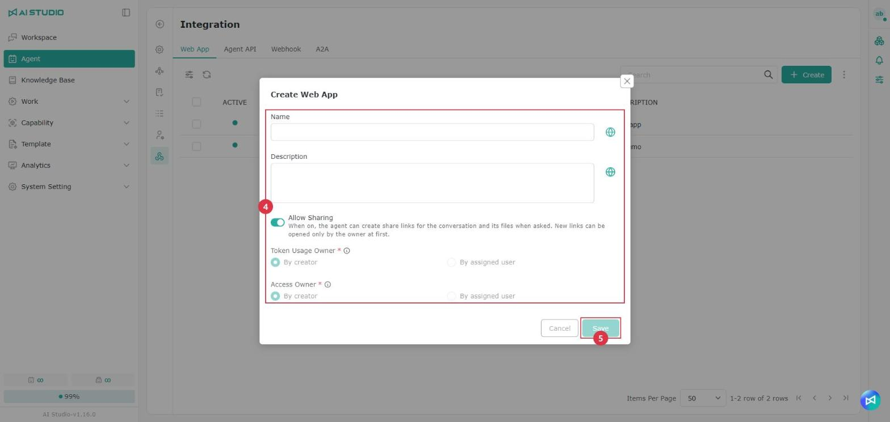
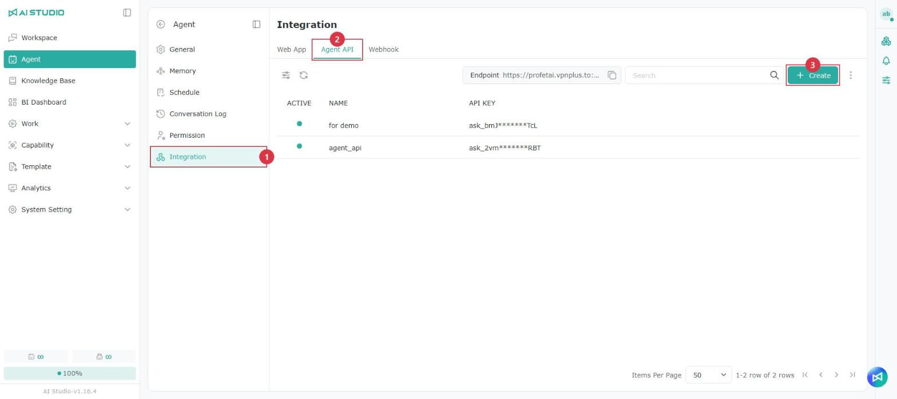
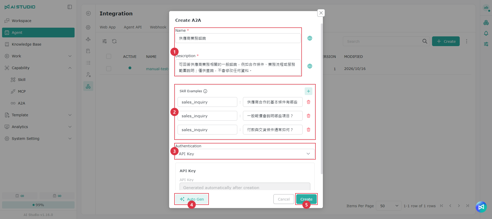
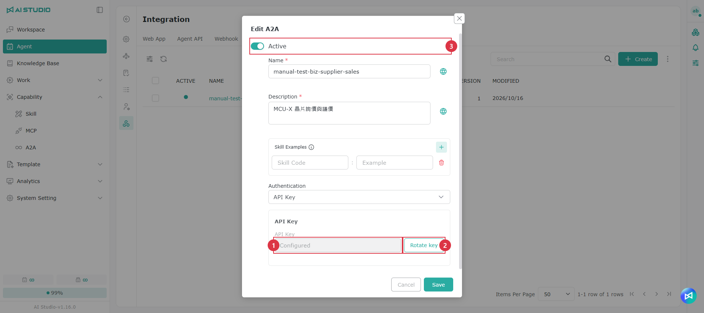
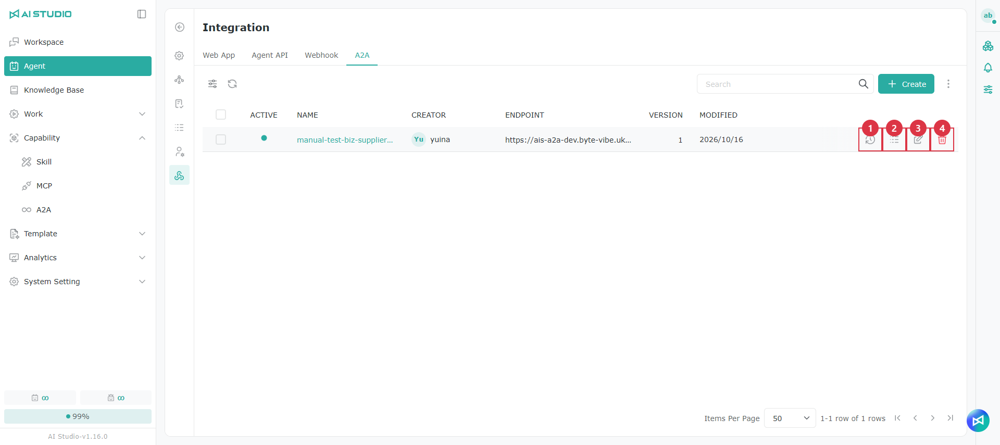

# Integration

## **Web App**

An Agent can be embedded in a web page to provide Q&A, as shown below:

<figure><figcaption></figcaption></figure>

To embed an Agent in a website, use this feature to generate the front-end embed code.

### Creating a Web App

<figure><figcaption></figcaption></figure>

<figure><figcaption></figcaption></figure>

1. Click **Integration** in the Agent feature menu.
2. Select the **Web App** tab.
3. Click **Create** in the upper right.
4. Complete the following settings:

| Setting               | Description |
| --------------------- | ----------- |
| **Name**              | A name for the Web App, so you can identify its purpose in the list. Click the button on the right of the field to set the name in other languages. See [Multilingual settings](guan-li-agent.md#duo-guo-yu-yan-she-ding). |
| **Description**       | What the Web App is for. Click the button on the right of the field to set the description in other languages. See [Multilingual settings](guan-li-agent.md#duo-guo-yu-yan-she-ding). |
| **Token Usage Owner** | Fixed to **Creator** and cannot be changed. All Token usage generated through this Web App is attributed to its creator. |
| **Access Owner**      | Fixed to **Creator** and cannot be changed. The Web App runs with its creator's user permissions. |
| **Allow Sharing**     | When on, the Agent can create share links for a conversation and its files at the user's request. When a link is created, only its owner can open it. |

5. Click **Save** to finish.

> Web Apps do not currently support **Specified user**. Token usage and permissions are always attributed to the developer who created the Web App. For details, see [Token usage attribution](zheng-he.md#token-ji-liang-gui-shu).

### Managing Web Apps

<figure><figcaption></figcaption></figure>

<figure><figcaption></figcaption></figure>

Created Web Apps appear in the list, where you can see each one's status, name, creator, last modified time, expiry date and description.

* A green status means the Web App is enabled.
* Hover over a Web App row to use **Call Log**, **Edit**, **Set expiry date** and **Delete**.
* Click a Web App name to open its details page:
  * **Embed:** view and copy the embed code.
  * **Settings:** set the language, requests per minute (RPM), Tokens per minute (TPM) and expiry date.

> Each Agent can have several Web Apps, each with its own API Key and embed code, so you can manage the expiry date and usage limits of each website separately.

## Agent API <a href="#agent-api" id="agent-api"></a>

The Agent API access key authenticates requests, so that when the Agent API is called the system can identify where the request came from and apply the corresponding permissions and usage quota. Keep your Agent API key safe. If you suspect it has been exposed, replace it immediately and update every integration that uses it.

### Creating an Agent API

<figure><figcaption></figcaption></figure>

<figure><figcaption></figcaption></figure>

1. Click **Integration** in the Agent feature menu.
2. Select the **Agent API** tab.
3. Click **Create** in the upper right.
4. Complete the following settings:

| Setting               | Description |
| --------------------- | ----------- |
| **Agent ID**          | Filled in automatically with the current Agent's ID; cannot be changed. |
| **Name**              | A name for the Agent API, so you can identify its purpose in the list. |
| **Token Usage Owner** | Who the Token usage of calls through this Agent API is attributed to. |
| **Access Owner**      | Whose user permissions apply when the Agent is called through this Agent API. |
| **Rate Limit**        | When on, set the number of requests allowed per minute in **Requests per minute (RPM)**. |
| **Expiry date**       | Set an expiry date for the Agent API if you need one. |
| **Visual Responses**  | Off by default; turn it on if needed. When on, responses received through this Agent API may contain HTML tags, so the caller must be able to render HTML. For details, see [Chat Agent - Visual Responses](liao-tian-agent.md#shi-jue-hua-hui-fu). |
| **Allow Sharing**     | When on, the Agent can create share links for a conversation and its files at the user's request. When a link is created, only its owner can open it. |

Token Usage Owner and Access Owner both offer the following options:

* **Creator:** attribute to the user who created the Agent API.
* **Specified user:** attribute to the user specified in the call.

Token usage attribution and access permissions are two separate settings. With different choices, Token usage and data access permissions may apply to different users.

5. Click **Save** to finish.

### Saving the Agent ID and API Key

<figure><figcaption></figcaption></figure>

Once the Agent API is created, the system immediately shows:

* **Agent ID**
* **API Key**

Copy them from this screen, or click **Download JSON** and store the file safely.

> The full API Key is shown only once, when it is created. After you close the screen you cannot see it in full again. Only click **Confirm** once you have copied or downloaded it.

An API Key can be used to call the corresponding Agent, so treat it as sensitive information: never put it in public code, documents or front-end pages.

### Managing Agent APIs

Created Agent APIs appear in the list, where you can see each one's status, name and API Key (only part of it is shown).

* A green status means the Agent API is enabled.

### Copying the Endpoint

The Endpoint is the service URL of the Agent API. The system sends API requests to this address to run the corresponding function. Choose the right Endpoint for your situation (a test environment or production, for example) so that requests do not go to the wrong environment or fail to connect.

The Endpoint's copy button is next to the search box; click it to copy the URL. Note which environment you are in when you copy it.

<figure><figcaption></figcaption></figure>

### Notes

* The full API Key is shown only once, so copy or download it as soon as it is created.
* Do not expose the API Key in public.
* Mask the API Key before sharing a request, an error log or a screenshot.
* Even with Rate Limit off, system-level request limits may still apply.

## Webhook

A Webhook lets an external system push events or data to an Agent — order status, system notifications or other service events — for the Agent to process and respond to.

A Webhook is automatically bound to the Agent it was created in, so the external system does not need to specify an Agent; it only needs to send events to the Webhook Endpoint the system generates.

### Creating a Webhook

<figure><figcaption></figcaption></figure>

<figure><figcaption></figcaption></figure>

1. Select **Integration > Webhook**.
2. Click **Create** in the upper right.
3. Complete the following settings:

| Setting                | Description                                                     |
| ---------------------- | --------------------------------------------------------------- |
| **Name**               | A name for the Webhook, so you can identify its purpose in the list. |
| **Token Usage Owner**  | Who the Token usage of this Webhook's runs is attributed to.      |
| **Access Owner**       | Whose permissions apply when the Webhook runs.                   |

Token Usage Owner and Access Owner both offer the following options:

* **Creator:** attribute to the user who created the Webhook.
* **Specified user:** attribute to the user specified in the call.

Token usage attribution and access permissions are two separate settings. With different choices, Token usage and data access permissions may apply to different users.

4. Click **Create** to finish.

> You do not need to enter a key when creating a Webhook. The Webhook Key is generated by the system and shown after creation.

### Saving the Webhook Endpoint and Key <a href="#chu-cun-webhook-url-yu-keyendpoint" id="chu-cun-webhook-url-yu-keyendpoint"></a>

<figure><figcaption></figcaption></figure>

Once the Webhook is created, the system immediately shows:

* **Webhook Endpoint**
* **Webhook Key**

Copy them from this screen, or click **Download JSON** and store the file safely.

> The full Webhook Key is shown only once, when it is created. After you close the screen you cannot see it in full again. Only click **Confirm** once you have copied or downloaded it.

A Webhook Key can be used to call the corresponding Agent, so treat it as sensitive information: never put it in public code, documents or front-end pages.

### Managing Webhooks

Webhooks you have created appear in the list, with their enabled state, name, creator and last modified time.

* A green status means the Webhook is enabled.
* Hover over a Webhook row to open **Call Log** and see how external systems have called it.
* Click a Webhook name to open its details and see the **Request** and **Response** specifications.

### Sending an event to an Agent

Open a Webhook's details and select **Request** to see what an external system needs in order to send events.

### Request settings

* **Method:** `POST`
* **Endpoint:** the full Webhook Endpoint shown in the Webhook details
* **Header:** `Bearer <Webhook Key>`
* **Content-Type:** `application/json`

Example request headers:

```http
Authorization: Bearer <Webhook Key>
Content-Type: application/json
```

Example request body (in the example on the details page, every field has a comment):

```json
{
  // Unique identifier for the external event. Use a different UUID for each webhook event.
  "event_id": "evt_550e8400-e29b-41d4-a716-446655440000",

  // ID of the Agent session that should receive this event.
  "session_id": "session_12345678-abcd-4321-abcd-1234567890ab",

  // Event type. "incoming" indicates an event sent from an external system to the Agent.
  "type": "incoming",

  // Event content passed to the Agent, such as an order update, notification, or alert.
  "content": "Order O-123 has been paid",

  // Additional information related to the event.
  "metadata": {
    // ID of the user associated with this event.
    "user_id": "user_12345678-abcd-4321-abcd-1234567890ab"
  }
}
```

> The comments are for explanation only. The request body you actually send must be standard JSON, so remove the comments first.

### Request body fields

| Field              | Description                                                        |
| ------------------ | ------------------------------------------------------------------ |
| `event_id`         | The external event's unique identifier. Use a different value for each event; it can also be used to query the processing result later. |
| `session_id`       | The identifier of the Agent Session that receives this event.                       |
| `type`             | The message type. Events sent to an Agent use `incoming`.           |
| `content`          | The main event content sent to the Agent, such as an order update, notification or alert.                           |
| `metadata`         | Additional information related to the event.                        |
| `metadata.user_id` | The identifier of the user related to this event.                   |

### Checking a Webhook's result

Webhook processing has two stages: accepting the event and querying the result.

#### 1. Accepting the event

After the external system sends the `POST` request, the system returns `202 Accepted` if the event is accepted:

```json
{
  "event_id": "external-event-uuid",
  "invocation_id": "whi_01HYX...",
  "session_id": "session-uuid",
  "status": "accepted"
}
```

`accepted` means the system received and accepted the event; it does not mean the Agent has finished processing it.

#### 2. Querying the processing status

An external system can query an event's progress at the following endpoint:

```http
GET /v1/agent-webhooks/{webhookId}/events/{eventId}
```

Example response while processing:

```json
{
  "event_id": "external-event-uuid",
  "invocation_id": "whi_01HYX...",
  "status": "processing"
}
```

`processing` means the Agent is working on the event.

Example response once processing is complete:

```json
{
  "event_id": "external-event-uuid",
  "invocation_id": "whi_01HYX...",
  "status": "completed",
  "message": {
    "id": "msg_01HYX...",
    "session_id": "session-uuid",
    "type": "outgoing",
    "content": "The Agent's response",
    "created_at": 1757400000
  }
}
```

`completed` means the Agent has finished, and the result is in `message`.

### Response fields

<table data-search="false"><thead><tr><th>Field</th><th>Description</th></tr></thead><tbody><tr><td><code>event_id</code></td><td>The event identifier from the original request.</td></tr><tr><td><code>invocation_id</code></td><td>The identifier the system generated for this Agent run.</td></tr><tr><td><code>session_id</code></td><td>The Session identifier this event belongs to.</td></tr><tr><td><code>status</code></td><td>The current processing status, for example <code>accepted</code>, <code>processing</code> or <code>completed</code>.</td></tr><tr><td><code>message</code></td><td>The response the Agent produced once processing was complete.</td></tr><tr><td><code>message.id</code></td><td>The identifier of the Agent's response message.</td></tr><tr><td><code>message.type</code></td><td>The response message type; messages sent by the Agent are <code>outgoing</code>.</td></tr><tr><td><code>message.content</code></td><td>The response content the Agent produced.</td></tr><tr><td><code>message.created_at</code></td><td>When the response message was created.</td></tr></tbody></table>

### Notes

* The Webhook Key is shown in full only once, so copy or download it as soon as it is created.
* Do not expose the Webhook Endpoint and Webhook Key in public.
* Mask the key and authentication information before sharing a request, an error log or a screenshot.
* Even with Rate Limit off, system-level request limits may still apply.
* After receiving `accepted`, use the query endpoint to check the processing status; do not treat it as the Agent having already responded.

## A2A <a href="#a2a" id="a2a"></a>

Publish an Agent so external systems can ask it questions through A2A (Agent-to-Agent). After creating a public entry, give the other party its **Endpoint** and key so their system can call this Agent directly. To let your own Agent call external Agents instead, see [A2A](../neng-li-zhi-nan/a2a.md).

> Note: Published Agents are restricted by the system to read-only query operations. Before publishing, a system administrator must configure **A2A Public Base URL** under **System Setting → Configuration**. See [Configuration - A2A Public Base URL and allowed hosts](../xi-tong-she-ding-zhi-nan/pei-zhi.md#a2a-dui-wai-wang-zhi-yu-yun-xu-lian-xian-de-zhu-ji).

### Opening the A2A tab

<figure><figcaption></figcaption></figure>

<table data-search="false"><thead><tr><th width="90">No.</th><th width="157">Action</th><th>Description</th></tr></thead><tbody><tr><td>1</td><td>Integration</td><td>The last icon on the left of the Agent settings page.</td></tr><tr><td>2</td><td>A2A tab</td><td>Alongside Web App, Agent API and Webhook.</td></tr><tr><td>3</td><td>Create</td><td>Create a public A2A entry for this Agent. One Agent can have multiple entries, for example with separate authentication for each partner.</td></tr><tr><td>4</td><td>More (⋮)</td><td>View the combined call logs for all A2A entries of this Agent.</td></tr><tr><td>5</td><td>Published entries</td><td>Endpoint is the URL to give to the other party. Version is the currently published release.</td></tr></tbody></table>

### Creating a public A2A entry

1. Click **Create**.
2. Click **Auto Gen** in the lower-left corner to draft a name, description and skill examples with AI, then edit them as needed. You can also fill in everything manually.
3. Select an authentication method.
4. Click **Create** to create and publish the entry. If you select API Key, a window displays the key only once.
5. Give the other party the **Endpoint** from the list and the key.

<figure><figcaption></figcaption></figure>

<table data-search="false"><thead><tr><th width="90">No.</th><th width="157">Field</th><th>Description</th></tr></thead><tbody><tr><td>1</td><td>Name and description</td><td>The name and introduction the other party sees in the Agent Card. Clearly explain what this Agent can and cannot do: the remote Agent uses this description to decide whether to call it. Click the globe button on the right to configure multiple languages.</td></tr><tr><td>2</td><td>Skill examples</td><td>The skill identifier is on the left and its example question is on the right. You can add up to five.</td></tr><tr><td>3</td><td>Authentication</td><td>The credentials required when the other party calls the Agent. See Authentication below.</td></tr><tr><td>4</td><td>Auto Gen</td><td>AI fills in items 1 and 2 using this Agent's tools, knowledge bases and skills. This takes about 20–30 seconds. You can still edit the results manually.</td></tr><tr><td>5</td><td>Create</td><td>Create and publish the entry at the same time. It takes effect immediately.</td></tr></tbody></table>

For **Auto Gen** to work, a system administrator must first turn on **A2A Agent Card Suggestion** under **System Setting → Configuration**. If it is off, a message at the top of the window asks an administrator to enable it in the system settings. After it is enabled, click Auto Gen again.

### Authentication

<figure><figcaption></figcaption></figure>

| Authentication | What the caller must send | Who determines the credentials |
| --- | --- | --- |
| API Key | The <code>x-api-key: &lt;key&gt;</code> header | AI Studio generates the key and displays it only once when the entry is created. Copy it immediately. |
| HTTP Basic | <code>Authorization: Basic …</code> | Set a username and password in the form. |
| HTTP Bearer | A JWT issued by the caller's authentication service | The caller's authentication service. Enter its Issuer and other details so AI Studio can validate the token. |

For HTTP Bearer, enter **Issuer**, **JWKS URL** and **Audience** (required), and **Scopes** (optional). Obtain these values from the other party's security or system administrator.

<figure><figcaption></figcaption></figure>

After creating an entry with API Key selected, the **API Key** window opens:

<table data-search="false"><thead><tr><th width="90">No.</th><th width="157">Action</th><th>Description</th></tr></thead><tbody><tr><td>1</td><td>Key and copy button</td><td>Click the button on the right to copy the key. This is the only opportunity to view its original value.</td></tr><tr><td>2</td><td>Reminder</td><td>The caller must place the key in the <code>x-api-key</code> header.</td></tr><tr><td>3</td><td>OK</td><td>Close the window. Afterward, only Configured is shown.</td></tr></tbody></table>

### Editing and rotating a key

<figure><figcaption></figcaption></figure>

<table data-search="false"><thead><tr><th width="90">No.</th><th width="157">Action</th><th>Description</th></tr></thead><tbody><tr><td>1</td><td>Configured</td><td>The original key is displayed only when it is generated. Afterward, only Configured is shown.</td></tr><tr><td>2</td><td>Rotate key</td><td>Generate a new key and immediately invalidate the old one. The new key is also displayed only once; give it to the other party right away.</td></tr><tr><td>3</td><td>Active</td><td>Turning this off prevents external calls. Settings and logs are retained.</td></tr></tbody></table>

> If you forgot to copy a key, you cannot view its original value again. Click **Rotate key** to generate a new one. The old key becomes invalid immediately, so every system using it must also be updated.

### Version history

Every save publishes a new version. If a change is incorrect, you can restore a previous version from the version history.

<figure><figcaption></figcaption></figure>

<table data-search="false"><thead><tr><th width="90">No.</th><th width="157">Action</th><th>Description</th></tr></thead><tbody><tr><td>1</td><td>Version history</td><td>View the contents of each version and restore one.</td></tr><tr><td>2</td><td>Call Log</td><td>View calls to this entry only.</td></tr><tr><td>3</td><td>Edit</td><td>Modify settings, rotate the key or turn off Active.</td></tr><tr><td>4</td><td>Delete</td><td>After deletion, calls from the other party fail.</td></tr></tbody></table>

<table data-search="false"><thead><tr><th width="90">No.</th><th width="157">Action</th><th>Description</th></tr></thead><tbody><tr><td>1</td><td>Version contents</td><td>The Agent Card published by this version.</td></tr><tr><td>2</td><td>Selected version</td><td>Click a version to view its contents on the left.</td></tr><tr><td>3</td><td>Current</td><td>The version currently in effect.</td></tr><tr><td>4</td><td>Restore</td><td>Put the selected version back into the draft and publish it again. It takes effect immediately.</td></tr></tbody></table>

To delete a version, click **⋮ → Delete** in its upper-right corner. Deletion cannot be undone. The **Current** version cannot be deleted.

### Call logs

Use call logs to check whether external systems are using the Agent and whether their calls succeed. There are two ways to open them:

* **⋮ → Call Log** in the list's upper-right corner: calls to all A2A entries of this Agent.
* **Call Log** on an individual row: calls to that entry only.

<table data-search="false"><thead><tr><th width="90">No.</th><th width="157">Field</th><th>Description</th></tr></thead><tbody><tr><td>1</td><td>Toolbar</td><td>Adjust visible columns, refresh, or filter by status and time.</td></tr><tr><td>2</td><td>Status</td><td>Processing, completed, failed or rejected. Rejected usually means authentication did not pass.</td></tr><tr><td>3</td><td>Caller</td><td>The authentication method used by the caller.</td></tr><tr><td>4</td><td>Duration</td><td>The time from receiving the request to completing the response.</td></tr></tbody></table>

Hover over a row and click **View conversation** on the right to open the full question and answer for that call:

<table data-search="false"><thead><tr><th width="90">No.</th><th width="157">Action</th><th>Description</th></tr></thead><tbody><tr><td>1</td><td>Session / Summary</td><td>Switch between the full conversation and a summary.</td></tr><tr><td>2</td><td>Incoming question</td><td>The question sent by the external system.</td></tr><tr><td>3</td><td>Agent response</td><td>The Agent's reply. Usage and cost are shown below it.</td></tr><tr><td>4</td><td>Download</td><td>Download the conversation.</td></tr></tbody></table>

### A2A FAQ

<details>

<summary>Publishing says the system's public URL has not been configured</summary>

Ask an administrator to enter an externally reachable URL in **System Setting → Configuration → A2A Public Base URL**.

</details>

<details>

<summary>The other party says calls are rejected</summary>

Open the call logs. A rejected status usually indicates an authentication failure: the key is in the wrong header (API Key requires <code>x-api-key</code>), the caller is using an old key that has been rotated, or the entry is inactive.

</details>

## Token usage attribution <a href="#token-ji-liang-gui-shu" id="token-ji-liang-gui-shu"></a>

When an Agent is called through a Web App, the Agent API or a Webhook, you can decide whose quota the Token usage counts against. The attribution methods each integration supports are:

| Integration | Charged to the developer | Charged to the calling user |
| ----------- | ------------------------ | --------------------------- |
| Web App     | ✓                        | —                           |
| Agent API   | ✓                        | ✓                           |
| Webhook     | ✓                        | ✓                           |

| Method                      | Option             | Description |
| --------------------------- | ------------------ | ----------- |
| Charged to the developer    | **Creator**        | All Token usage from calls through this integration counts against the developer who created the Web App, Agent API or Webhook. |
| Charged to the calling user | **Specified user** | Pass the user ID (`metadata.user_id`) in the request, and the Token usage counts against that user's quota. For how to pass it, see Agent API Integration - running on behalf of a specified user. |

> Web Apps currently support only charging the developer: all Token usage generated through a Web App counts against the developer who created it.
