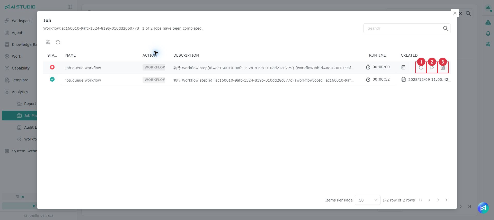
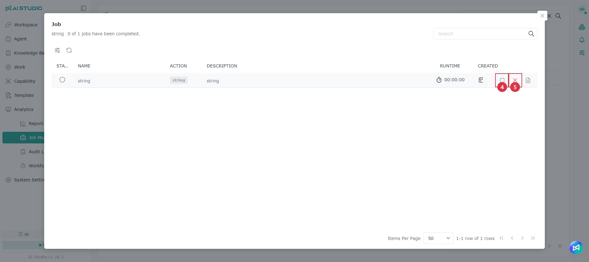

# Job Management

## Introduction

When a user makes a request, the system breaks it into work items and creates the corresponding Tasks in Job Manager. Each Task has a clear Job, description, current status (Pending, Running, Completed, Failed / needs attention, and so on), creation and update times, related inputs and outputs, and the run records needed, so you can trace and verify what happened.

### Which records you can see

What Job Management shows depends on your account role:

* **AI Studio Admin**: can see every user's job records.
* **AI Studio Domain User**: can only see their own job records.

## Task statuses

There are 8 statuses:

<table><thead><tr><th width="224">Status</th><th>Description</th></tr></thead><tbody><tr><td>PENDING</td><td>Created, waiting to enter the queue or not yet dispatched</td></tr><tr><td>QUEUED</td><td>In the queue, waiting to run</td></tr><tr><td>RUNNING</td><td>Running</td></tr><tr><td>SUCCEEDED</td><td>Completed successfully</td></tr><tr><td>FAILED</td><td>The run failed</td></tr><tr><td>STOPPED</td><td>Stopped (aborted)</td></tr><tr><td>CANCELED</td><td>Canceled</td></tr><tr><td>PAUSED</td><td>Paused</td></tr></tbody></table>

## The Job window

Click the name of a Task to open a dialog and browse the Jobs under it.

<table><thead><tr><th width="101">Item</th><th width="177">Action</th><th>Description</th></tr></thead><tbody><tr><td>1</td><td>Retry</td><td>Run the Job again</td></tr><tr><td>2</td><td>Resume</td><td>Continue the Job's progress</td></tr><tr><td>3</td><td>Details</td><td>See the details</td></tr><tr><td>4</td><td>Pause</td><td>Pause the Job's progress</td></tr><tr><td>5</td><td>Cancel</td><td>Cancel this Job</td></tr></tbody></table>

> Note: The creator column in the list shows the full user name.
