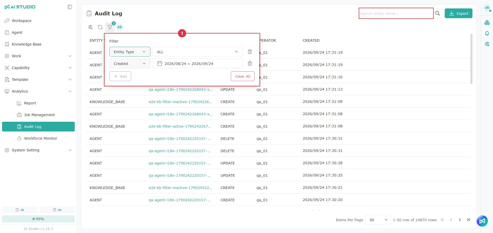
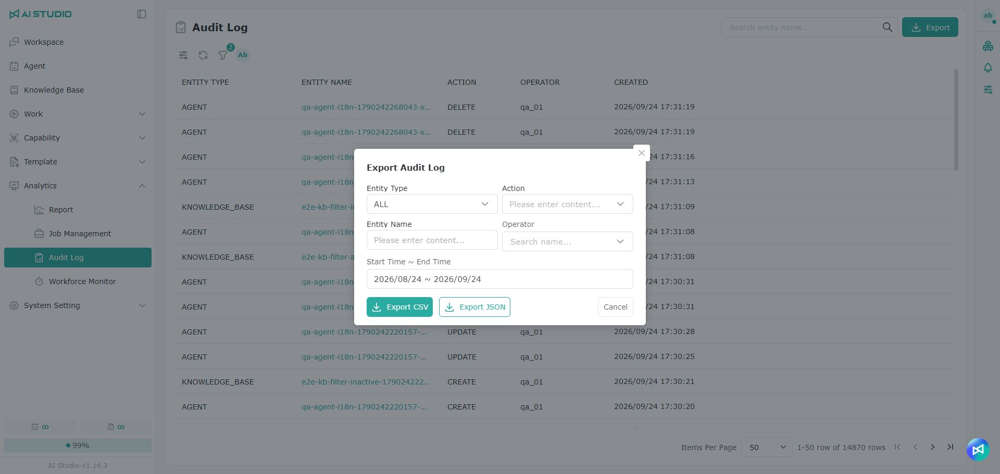

# Audit Log

## Introduction

The Audit Log records actions on important objects in the system, which helps administrators track what users add, edit and delete on the platform. It shows when an action happened, who performed it, the object type, the object name and what changed, for system management, troubleshooting and data auditing.

## Columns

| Column        | Description                                                                                  |
| ------------- | -------------------------------------------------------------------------------------------- |
| Object type   | The type of object acted on, for example an Agent, dataset, skill, workflow template or prompt template. |
| Object name   | The name of the object acted on. Click it to see the details of that change.                   |
| Action        | The action performed, for example CREATE, UPDATE or DELETE.                                     |
| User          | The user who performed the action.                                                             |
| Created       | When the record was created.                                                                   |

## Viewing an audit log entry

Click an object name in the list to open the audit log preview window and see the details of that action.

The **Before** and **After** blocks show the data difference the action caused, so you can see how the object changed.

Different action types show different content. A **create** action usually shows the resulting data; an **update** action shows the difference before and after; a **delete** action can be used to trace information about the deleted object.

## Searching and filtering

Use the search field at the top of the page to find the records for a specific object by name.

You can also narrow the results with filters — by object type, action, user or time range. Filters help you find the records for a particular period or a particular user quickly.

## Exporting the audit log

To keep audit records or analyze them further, click the **Export** button in the upper right to open the export window.

You can set the following before exporting:

| Field              | Description                       |
| ------------------ | --------------------------------- |
| Object type        | The object types to export         |
| Action             | The actions to export              |
| Object name        | A specific object name             |
| User               | The user who performed the actions  |
| Start time ~ End time | The time range to export         |

Once the criteria are set, you can export in the following formats:

* **Export CSV**: a CSV file, suited to reviewing or organizing in a spreadsheet tool.
* **Export JSON**: a JSON file, suited to system integration, data exchange or technical analysis.

## Notes

The Audit Log is mainly for tracking actions in the system. Which records you can see depends on your permissions.

If you cannot find a particular record, check the search criteria, the filters and the time range. After adjusting them, search again or export the records that match.
