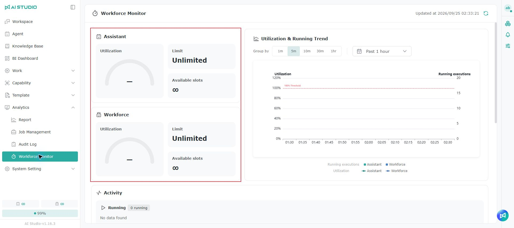
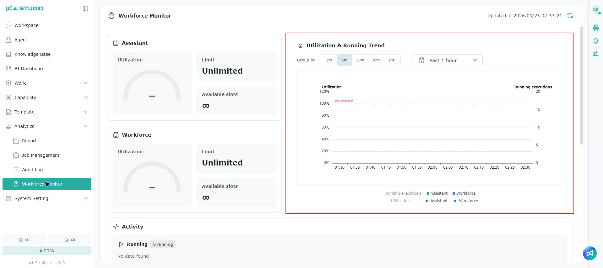
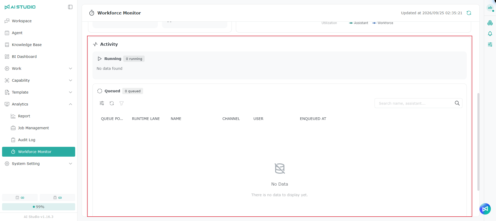

# Workforce Monitor

Workforce Monitor brings together the capacity usage and job status of Assistant and Workforce, so administrators can see the slots available, the jobs running and queued, and identify periods of high load from the trend data.

> This page shows current run capacity and job status, not Token usage accumulated over time.

## The difference between Assistant and Workforce 

<figure><figcaption></figcaption></figure>

<figure><figcaption></figcaption></figure>

Based on an Agent's settings, the system decides automatically whether a run uses an Assistant or a Workforce slot. Only the Agent's own settings count: it does not matter who the user is, which screen the Agent is used from or whether it is called through the API. If an Agent meets any Workforce condition in the table below, it uses a Workforce slot; otherwise it uses an Assistant slot. Each type has its own limit, and they are not shared.


When an Agent's settings change, the system immediately re-evaluates its type.


> Note: AI Studio Copilot uses a SubAgent, so it counts toward Workforce.

### Agent settings

If you turn on or bind any feature with a check in the Workforce column below on the Agent settings page, the Agent uses a Workforce slot.

<figure><figcaption></figcaption></figure>

<table data-search="false"><thead><tr><th>Setting</th><th align="center">Assistant</th><th align="center">Workforce</th><th>Description</th></tr></thead><tbody><tr><td>Knowledge</td><td align="center">✔</td><td align="center"></td><td>Binding any number makes no difference.</td></tr><tr><td>Memory</td><td align="center"></td><td align="center">✔</td><td>Counts if either <strong>Memory citation</strong> or <strong>Automatically optimize memory</strong> is turned on. See <a href="../agent-zhi-nan/ji-yi.md">Memory</a>.</td></tr><tr><td>Tools</td><td align="center">✔</td><td align="center"></td><td>Includes built-in tools, MCP tools and AutoML. Binding any number makes no difference.</td></tr><tr><td>Skill</td><td align="center">✔</td><td align="center"></td><td>Binding any number makes no difference.</td></tr><tr><td>Coordination</td><td align="center"></td><td align="center">✔</td><td>At least one Agent must be bound.</td></tr></tbody></table>

Memory settings a user makes in [Personalization](../ge-ren-she-ding/agent-memory.md) are personal settings and do not affect an Agent's slot type.

### Schedules

Creating a schedule does not change an Agent's slot type. When a schedule runs, it uses an Assistant or a Workforce slot depending on the settings of the Agent it is bound to. For how to create schedules, see [Schedule](../gong-zuo-zhi-nan/pai-cheng.md).

## Checking current capacity

The capacity cards for Assistant and Workforce are shown at the top of the page, so you can compare the load on each.

| Field             | Description                                                                          |
| ----------------- | ------------------------------------------------------------------------------------ |
| **Utilization**   | The proportion of the `Limit` currently in use, for a quick view of the overall load.  |
| **Running**       | The number of jobs currently running and occupying a slot.                             |
| **Queued**        | The number of jobs waiting to run because no slot is available.                         |
| **Limit**         | The maximum number of concurrent slots, determined by the customer's license.           |
| **Available**     | The slots still available to start a job, given current usage.                           |

When no slots remain, every slot is in use. Jobs that support queuing enter `Queued` first and start automatically once a job ahead of them finishes and releases a slot. Queuing is a normal waiting state, not a failure.

## Viewing usage trends

The utilization and run-count trends show how capacity changed over the time range you select:

* **Run-count bar chart**: the number of jobs running at each point in time.
* **Utilization line chart**: how slot utilization changed.

Adjust the time range to look at peaks and see whether Assistant or Workforce regularly approaches its limit, as a basis for adjusting slot allocation and usage.

## Tracking activity

In the activity area, switch between Assistant and Workforce to see the jobs running and queued.

| Status       | Description                                                                                                  |
| ------------ | ------------------------------------------------------------------------------------------------------------ |
| **Running**  | The job has a slot and is running. Shows the Agent, the user, the job's source, its start time and how long it has been running. |
| **Queued**   | The job is waiting for an available slot. Shows when it was queued, how long it has waited and its current queue position. |

A job's source can be chat, a Web App, the Agent API, a schedule, a workflow, an Agent Task or a multi-Agent conversation, which helps you see where the load comes from.

> In a multi-node deployment, the queue position is the job's place within its own node, not a unique position across the system, so the same position may appear more than once in the list.

## Notes

* Assistant and Workforce slots are independent: one type being full does not mean the other has no slots available.
* A queued job starts automatically once it gets a slot, so it usually does not need to be resubmitted.
* Realtime voice conversations do not occupy an Assistant or Workforce slot, so they are not included in this page's usage data.
* This page is for the overall picture. For an individual conversation, the queue message shown on that conversation's screen is the live status.

## FAQ

Why does my Agent start queuing after I turn on Memory?

Once **Memory citation** or **Automatically optimize memory** is turned on, the Agent immediately switches to Workforce slots. Workforce and Assistant slots are independent, and Workforce usually has a lower limit, so requests are more likely to queue when usage is high. Adding Agents under Coordination has the same effect. See [The difference between Assistant and Workforce](workforce-jian-kong.md#assistant-yu-workforce-de-cha-yi).

Does binding an MCP tool or creating a schedule make an Agent use Workforce slots?

No. Tools (including MCP tools and AutoML), Knowledge, Skills and schedules do not affect the slot type. Only turning on Memory or adding Agents under Coordination makes an Agent use Workforce slots.

AI Studio Copilot shows it is queued. Is something wrong?

No. AI Studio Copilot uses a SubAgent and counts toward Workforce, so being queued means Workforce slots are currently full; Copilot is not broken. Once other jobs finish and release a slot, Copilot starts automatically, so you do not need to resend your message.

