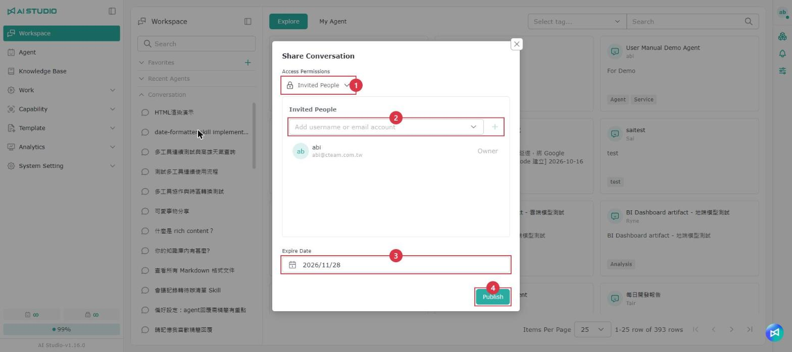
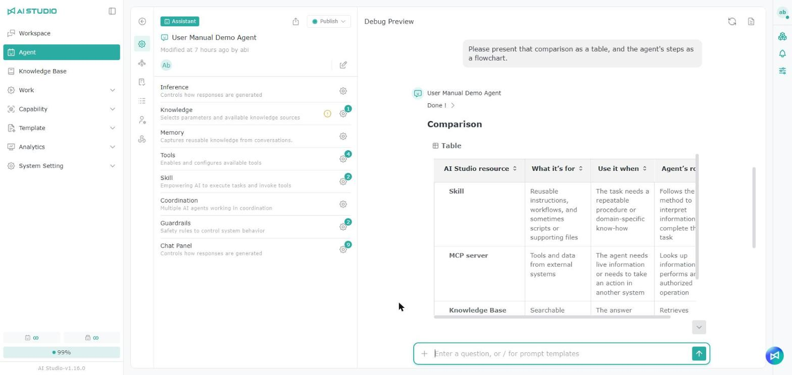

# Conversation

## Page overview

The interface has two main parts:

* **Conversation history**: where you start a new conversation or quickly return to an earlier one.
* **Chat area**: where you talk to the Agent.

> Note: The screenshots below are for reference only. Your actual conversations, Agents and prompt templates may differ in your own environment.

The conversation history area is divided into two parts:

* **Recent Conversations**: the conversation threads you have already created. Click any thread to open it in the chat area.
* **Recent Agents**: the Agents you have talked to.

<figure><figcaption></figcaption></figure>

Actions available in the conversation history area:

<table data-search="false"><thead><tr><th width="90">Item</th><th width="157">Action</th><th>Description</th></tr></thead><tbody><tr><td>1</td><td>Explore Agents</td><td>Return to the Explore Agents / application templates page</td></tr><tr><td>2</td><td>New Conversation</td><td>Start a new conversation with the Agent you are talking to</td></tr><tr><td>3</td><td>Edit</td><td>Rename the selected conversation</td></tr><tr><td>4</td><td>Add to Folder</td><td>Add the selected conversation or Agent to a folder</td></tr><tr><td>5</td><td>Delete</td><td>Delete the selected conversation</td></tr><tr><td>6</td><td>Copy</td><td>Opens the copy menu, where you can choose <strong>Copy Text</strong> (plain text) or <strong>Copy Markdown</strong> (keeps headings, lists, tables and other formatting)</td></tr><tr><td>7</td><td>Like / Dislike</td><td>Rate the Agent's answer to help improve how it responds</td></tr><tr><td>8</td><td>Related Questions</td><td>Generates five related questions so you can continue the conversation quickly</td></tr><tr><td>9</td><td>Usage</td><td>Shows the cost, output Tokens, input Tokens and total Tokens</td></tr><tr><td>10</td><td>Add</td><td>Attach a file, open Canvas or use a prompt template</td></tr><tr><td>11</td><td>Input box</td><td>Enter your prompt here and click the send button to send it to the Agent</td></tr></tbody></table>

> Additional note: Whether the attachment entry point appears can depend on the Agent's settings. For some Agents or environments, an administrator controls whether the **Upload File** icon is shown. When it is turned off, the chat input area does not show the attachment entry point and you cannot attach files in that session. If you do not see the attachment button in the Workspace, check whether the selected Agent allows file attachments, or ask your system administrator.

> Tip: Use **Copy Text** when pasting into an email, a messaging app or another plain text field. Use **Copy Markdown** when pasting into an editor that supports Markdown (such as Notion, GitBook or a code editor) to keep the original formatting.

### Conversation status indicators

In the Recent Conversations list, an icon on the right of each conversation shows its current status:

| Icon      | Status              | Description                                                                                                                                                              |
| --------- | ------------------- | ------------------------------------------------------------------------------------------------------------------------------------------------------------------------ |
| Spinner   | Agent is responding | You can switch to another conversation or page while the Agent responds; when you come back, the conversation continues from the latest progress. The spinner is also kept after you refresh the page, and stops automatically once the response is complete. |
| Green dot | Unread response     | If you are not in the conversation when the Agent finishes responding, a green dot appears. It disappears once you open that conversation and reach the latest response.   |
| No icon   | Normal              | Hover over the conversation to show the "…" menu.                                                                                                                         |

### Copying the Session ID

When reporting a problem, you can provide the conversation's Session ID so that the admin can find the same conversation in the Conversation Log.

1. Hover over a conversation in **Recent Conversations** on the left or inside a **Favorites** folder, and click the "…" menu.
2. Click **Session ID**. The system copies the conversation's Session ID to the clipboard and shows "Content has been copied to the clipboard."

<figure><figcaption></figcaption></figure>

### Sharing a conversation

You can share a whole conversation with other people. When they open the link, they can only read the conversation (read-only); they cannot keep asking questions in it, and the conversation does not appear in their own conversation list.

<figure><figcaption></figcaption></figure>

1. Hover over a conversation on the left, click the "…" menu and select **Share**.
2. In the **Share Conversation** window, set the access permission and the expiration date.
3. Click **Publish**, then copy the share link and send it to the people who should see it.

<table data-search="false"><thead><tr><th width="90">Item</th><th width="157">Name</th><th>Description</th></tr></thead><tbody><tr><td>1</td><td>Access</td><td>Choose who can view this conversation. See the options in the table below</td></tr><tr><td>2</td><td>Specific accounts</td><td>When access is set to <strong>Specific accounts</strong>, enter a user name or email account here to add the people who can view it</td></tr><tr><td>3</td><td>Expiration date</td><td>How long the share link stays valid. The default is one month later. The expiration date is applied only when you publish and cannot be changed afterwards; to change it, click <strong>Unpublish</strong> first and set it again</td></tr><tr><td>4</td><td>Publish</td><td>Create the share link</td></tr></tbody></table>

| Access            | Who can view                                   |
| ----------------- | ---------------------------------------------- |
| Specific accounts | Only you and the people you add                |
| All users         | Anyone with an account, after signing in       |
| Public            | Anyone who has the link                        |

* If new content is added to the conversation after you share it, what the recipients see is updated as well.
* A conversation with no content yet, or with too much content, cannot be shared.

> Note: When you choose **Public**, anyone who gets the link can view the conversation. Before sharing, make sure the conversation contains nothing that should not be made public.

### Switching between conversations with the same Agent

In a conversation, you can switch directly to another conversation with the same Agent, without going back to the recent conversations list on the left.

<figure><figcaption></figcaption></figure>

### Execution Process

While the Agent is responding, **Execution Process** and the current step — such as calling a tool or querying a knowledge base — are shown above the response, so users know which step the Agent is working on.

Click **Execution Process** to open **Execution Details** on the right, where you can check each step's settings, variables and input. If the response was delegated to an external Agent, **Execution Details** has an additional **Conversation between Agents** tab showing what the two Agents actually said. See [A2A - Viewing the conversation between Agents](../neng-li-zhi-nan/a2a.md#cha-kan-agent-zhi-jian-de-dui-hua).

<figure><figcaption></figcaption></figure>

## Queuing and full run slots

The system limits how many Agents can run at the same time (run slots). There are two kinds of slots, Assistant and Workforce, and which one an Agent uses depends on the Agent's settings. See [Workforce Monitor](../fen-xi-zhi-nan/workforce-jian-kong.md#assistant-yu-workforce-de-cha-yi). When the slots are used up, a request is queued or you are asked to try again later. This does not mean the system has failed.

### Queued chats

If the slots are full when you send a message, the conversation first becomes **Queued** and shows your current queue position and how long you have waited. When it is your turn, the Agent starts responding automatically; you do not need to resend the message. This applies to both regular chat and Web App chat.

* A queue position of 1 means you are next.
* If you close the tab or cancel the request while it is queued, the request leaves the queue and you need to send it again.

If a request cannot get through the queue, you see one of the following:

| Situation | Description | What to do |
| --------- | ----------- | ---------- |
| **Waited too long** | The request was queued for a while but still did not get a slot | Send it again later |
| **Could not join the queue** | The queue is full, so the request could not be added | Many people are using the system right now; try again later |

> The waiting limit is set by the system. A failure message in chat may also come from other usage limits, so it is not always caused by full slots.

### "Slots full" message

The following actions do not queue. If the slots are full, a "slots full" message appears right away:

* Regenerating a response after editing a message
* Creating a Workflow job
* Multi-Agent conversations
* Answering a human intervention card

This message means all run slots are currently in use; the system has not failed. Wait for running jobs to finish, then try again.

#### Human intervention cards

If the slots are full when you answer a human intervention card, your answer has **not been sent**. The card returns to the waiting-for-input state and is still valid; just send your answer again later.

### Multi-Agent conversations

A multi-Agent conversation starts only when it can get as many slots as the number of Agents selected at the same time. For example, if you select 3 Agents, 3 slots must be available at once. If there are not enough slots, you see one of two messages, and each needs a different response:

| Message | Description | What to do |
| ------- | ----------- | ---------- |
| **Slots full** | Not enough slots are available right now; they are released as other jobs finish | Try again later |
| **Selection exceeds the limit** | You selected more Agents than your plan can run at the same time, so the conversation cannot start even if no other jobs are running | Select fewer Agents; trying again later will not help |

## Quick actions **in chat**

### Using a prompt template

* Press the "/" key in the prompt input area, or click **Prompt Template** under "+", to see the list of available prompt templates.

<figure><figcaption></figcaption></figure>

#### Viewing all templates

<figure><figcaption></figcaption></figure>

<figure><figcaption></figcaption></figure>

1. Click "+" and select **Prompt Template**.
2. Select the template you want, fill it in, then click **Insert Prompt** to write the prompt into the input box. You can send it as it is or edit it first.

Available prompt template types:

<table><thead><tr><th width="176">Template type</th><th>Description</th></tr></thead><tbody><tr><td>Chat Prompt</td><td>Can be used in any Agent conversation</td></tr><tr><td>Agent Prompt</td><td>A prompt template bound to a specific Agent, and usable only in that Agent</td></tr></tbody></table>

### Mentioning Agents and users

<figure><figcaption></figcaption></figure>

Press the "@" key in the prompt input area to show Agents and other users. Mentions can then be used to create a schedule quickly. For details on schedules, see [Work Guide > Schedule](../gong-zuo-zhi-nan/pai-cheng.md).

### Pasting long text

When you paste a large amount of text into the input box, it is automatically turned into an attachment-like card, so the input box does not grow too tall. Before sending, click the "×" on the card to remove it.

After sending, long messages in the conversation are shown as the same kind of card. Click the card to view the full content.

<figure><figcaption></figcaption></figure>

## **Uploading files for content analysis**

<figure><figcaption></figcaption></figure>

<figure><figcaption></figcaption></figure>

The Conversation page accepts files in many formats, but a successful upload does not guarantee that the Agent can read or analyze the content. What can actually be processed depends on the capabilities of the model, the file format and the file content.

After an upload, the Agent determines whether it can read the file and then follows your instructions to summarize it, organize its content, produce a transcript and so on. If the model cannot process the file, it replies in the conversation that it cannot read or analyze it.

## **Files in a conversation**

<figure><figcaption></figcaption></figure>

Two kinds of files are involved when you talk to an Agent. Click the file icon inside the **File** icon to **view** them and, depending on your permissions, **download** or **delete** them:

* **Reference file**: a file you uploaded as a prompt attachment.
* **Work file**: a file the Agent produced in a response or as output.

### Reusing an uploaded file in the same conversation

In the **Reference File** list in the input area, you can select a file you uploaded earlier so the Agent can reuse it without another upload.

<figure><figcaption></figcaption></figure>

<figure><figcaption></figcaption></figure>

<figure><figcaption></figcaption></figure>

Within the same conversation, you can reselect a previously uploaded file as reference material.

Steps:

1. Click the **More** icon in the upper-right corner of the conversation page.
2. In the file panel, switch to **Work File**.
3. Select the files you want to reuse.
4. The files appear in the conversation input box, and are referenced again once you enter your instruction.

If you no longer need a file, click the **×** next to its tag to remove it.

### Downloading a file from a conversation

To get back a file the Agent provided earlier, open the original conversation and click the download link in the Agent's response directly — you do not need to go through the file list:

<figure><figcaption></figcaption></figure>

<figure><figcaption></figcaption></figure>

Steps:

1. Click the **More** icon in the upper-right corner of the conversation page.
2. Click the download icon on the file you want.

### Sharing a work file

Work files produced by an Agent can be shared with other people. Sharing creates a link that the recipient can open in a browser: an HTML file is rendered as a web page, and a Markdown file is shown with its formatting applied.

Steps:

1. Click the **More** icon in the upper-right corner of the conversation page.
2. In the file panel, switch to **Work File**.
3. Click the share icon next to the file you want to share and copy the link.

#### Link expiry

| Setting          | Description                                                          |
| ---------------- | -------------------------------------------------------------------- |
| Default          | The link is valid for one month after it is created, and cannot be opened after that. |
| Extend expiry    | You can extend the link's validity manually.                          |
| Never expires    | You can set the link never to expire, so it stays open indefinitely.  |

> Note: Anyone with the link can open the file. Before sharing, make sure the content can be made public and set an appropriate expiry. Use **Never expires** with care.

### Download and access permissions

When you download a file, the system checks your sign-in status, your Agent permissions and your file download permissions separately. These are three different things: being able to open or use an Agent does not necessarily mean you can download every file that Agent references or produces.

<table><thead><tr><th width="222">Check</th><th>Description</th></tr></thead><tbody><tr><td><strong>Sign-in status</strong></td><td>Confirms that you are signed in and authenticated. If your session has timed out or authentication is incomplete, downloads may be temporarily unavailable.</td></tr><tr><td><strong>Agent permissions</strong></td><td>Determine whether you can open the Agent and access its conversations and related files.</td></tr><tr><td><strong>File download permissions</strong></td><td>Determine whether you can download knowledge base files, datasets or work files produced by an Agent. The system decides based on the file's source and the latest permission settings.</td></tr></tbody></table>

#### Knowledge base and dataset files

Download control is applied at the level of the knowledge base or dataset the file comes from. Even if you can open and use an Agent, you do not automatically have permission to download the source documents it references.

For example, you may be able to query the content of a knowledge base through an Agent, but if you have not been granted download permission for that knowledge base, you still cannot download its original documents.

In short, if a file comes from a controlled knowledge base or dataset, download permission follows that source's rules — not everyone who can see a file can download it.

#### Work files produced by an Agent

Reports, compiled results and other work files that an Agent produces in a conversation are also checked against the file's source and your current permissions.

If a work file references content from a controlled knowledge base or dataset, the same download rules apply. Even when the download link appears in the Agent's response, you may not be able to download it without the relevant permission.

For example, an Agent produces a summary report based on a controlled knowledge base. You can read the Agent's text response, but when you download the report the system still checks whether you have the corresponding download permission.

#### Common permission scenarios

<table><thead><tr><th width="306">Scenario</th><th>System behavior</th></tr></thead><tbody><tr><td><strong>Not signed in, session timed out, or authentication incomplete</strong></td><td>A temporary access restriction. The system may block the download, hide the download entry point or show a no-permission message. Signing in again restores your existing permissions, and your conversations and files are not lost.</td></tr><tr><td><strong>File download permission removed or changed</strong></td><td>Signing in again does not restore the previous download permission. You may still be able to use the Agent and read the conversation, but you cannot download controlled source documents or the related work files until permission is granted again.</td></tr><tr><td><strong>Agent permission removed</strong></td><td>You can no longer open that Agent or access its existing conversations and files. Signing in again does not restore access; an administrator has to grant it again.</td></tr><tr><td><strong>Sign-in and all relevant permissions valid</strong></td><td>You can get the file from the file list or from the download link in the conversation.</td></tr></tbody></table>

## Source citations in responses

<figure><figcaption></figcaption></figure>

If an Agent's response cites external web pages, knowledge bases or files, the response shows quick links to the sources. Click one to open the source content. Sources fall into the following types:

| Source type   | Description                                       |
| ------------- | ------------------------------------------------- |
| Web page      | A web page found by Web Search                    |
| Knowledge base | A document the Agent cited from a knowledge base |
| Uploaded file | A file the user uploaded in the conversation      |

Whether knowledge base sources are shown depends on the Agent's **Chat Display → Knowledge Base Sources** setting. For details, see [Chat Agent](../agent-zhi-nan/liao-tian-agent.md).

### Images in a knowledge base

When a response cites an image from a knowledge base, the image is shown directly in the conversation, so you can view it without downloading. Click the image to open a preview; the preview scales the image to the window size and keeps its original aspect ratio.

## Visual Responses

<figure><figcaption></figcaption></figure>

If the Agent has **Visual Responses** turned on, it presents responses as cards, tables, charts, flowcharts and so on according to the content, using the theme colors, so information is clearer and easier to read.

* Visual responses produce more output, so Token usage and cost are slightly higher than for plain text responses.
* Whether it is on is set by the Agent's creator under **Chat Display**. For details, see [Chat Agent - Visual Responses](../agent-zhi-nan/liao-tian-agent.md#shi-jue-hua-hui-fu).

## **Usage Quota**

<figure><figcaption></figcaption></figure>

The **Usage Quota** area shows how many Tokens you are consuming, and at what cost, when using AI models in the **AI Studio Workspace**. A Token is the smallest unit of data processed, covering both your input and the model's output. This helps you track and manage your usage in real time.

> Note: By default, quota usage resets automatically every day.

Usage details are shown in **two places**, each for a different purpose:

<table data-full-width="false"><thead><tr><th width="83">Item</th><th width="121">Area</th><th width="122">Location</th><th width="276">Metrics</th><th>Purpose</th></tr></thead><tbody><tr><td>1</td><td>Daily quota overview</td><td>Lower left of the sidebar</td><td>- <strong>Quota Plan</strong>: the current plan name - <strong>Usage</strong>: a visual percentage of today's quota usage; when the quota is used up, the percentage returns to 0 - <strong>Current Cost</strong>: the current budget and the amount spent (for example 0.01 / 10.00 USD) - <strong>Usage Reset Date</strong>: when usage will next be reset</td><td>An overview of daily usage across all sessions</td></tr><tr><td>2</td><td>Session-level Token details</td><td>Below each AI response (hover over the icon to show it)</td><td>
- <strong>Total Usage Cost</strong>: the cost calculated from the current model's pricing

- <strong>Total Input Tokens</strong>: includes the prompt, system instructions and context - <strong>Total Output Tokens</strong>: the response generated by the AI - <strong>Total Tokens</strong>: input and output Tokens combined
</td><td>A detailed cost breakdown for each interaction</td></tr></tbody></table>

## Rating the quality of an Agent's answers

You can give feedback on an individual answer from an Agent to improve memory retrieval quality and the accuracy of its responses. Feedback buttons appear below every Agent answer, where you can give positive or negative feedback.

### Giving positive feedback

If the Agent's answer meets your needs, click the **Like** button below the answer to open the positive feedback window.

<figure><figcaption></figcaption></figure>

In the positive feedback window you can choose a reason, for example:

* Solved my task
* Followed my instructions
* Good answer quality
* Fast and efficient
* The actions it took on its own were helpful
* Other

You can also add more detail in the **More details** field — for example which parts of the answer were especially helpful, or which parts matched what you expected. This field is optional.

### Giving negative feedback

If the Agent's answer does not meet your needs, click the **Dislike** button below the answer to open the negative feedback window.

<figure><figcaption></figcaption></figure>

In the negative feedback window you can choose a reason, for example:

* Misunderstood my intent
* Incorrect content
* Incomplete answer
* Did not follow my instructions
* Unsafe or inappropriate content
* Other

You can also add more detail in the **More details** field — for example what was wrong, what information was missing, or how you would like the Agent to improve. This field is optional.

### Reviewing feedback you have sent

After you send feedback, the corresponding button shows as selected. Click it again to open the action menu.

Select **View feedback** to see the feedback you sent, including the reason you chose and any details you added.

### Withdrawing feedback

To withdraw feedback you have sent, click the selected feedback button and choose **Remove feedback** from the action menu.

Once removed, the answer returns to the state of having no feedback, and you can give positive or negative feedback again.

> Note: You can give feedback once per Agent answer. If you have already sent feedback, you can view or remove it and then submit new feedback. Feedback is used to improve the quality of future Agent answers, so it helps to describe clearly in the details field why the answer did or did not meet your expectations.

## Canvas

Canvas presents AI-generated content in the work area on the right, where it is easier to review, edit and organize. When a conversation produces long or complex content — a document, a table, a chart, code or other visual content — Canvas can display it in a clearer layout.

Canvas suits situations where you need to review and adjust content over a longer period: writing a document, compiling a report, analyzing data, reviewing charts, or repeatedly revising the same piece of content during a conversation. You can discuss with the AI on the left while viewing or maintaining the Canvas content on the right, instead of hunting for content in the chat messages.

### Opening Canvas

<figure><figcaption></figcaption></figure>

<figure><figcaption></figcaption></figure>

1. Click the "+" in the lower left and select **Canvas**. It then appears in the input box.
2. Enter your request in the chat window, asking the AI to produce a document, table, chart or other content.
3. When the system produces content that can be shown in Canvas, a Canvas card appears.
4. Click the Canvas card, and the content opens in the Canvas work area on the right with the **Preview** tab shown by default, where you can read the full content.
5. If the content needs changes, continue asking the AI in the chat window, or, where supported, edit the canvas content directly. The revised content is shown in Canvas so you can keep reviewing and organizing it.

> Note: Canvas suits content that is long or complex, or that you need to review and revise repeatedly. A short text response may simply be shown in the chat window without opening Canvas.\
> The actions supported can differ by content type — documents, tables, charts and code may be displayed and edited differently. Since Canvas content is generated by the AI, check that it is correct before using it, and ask the AI to correct or add to it if needed.

Opening Web Search results, a Mind Map or knowledge base citations only collapses Canvas; its content is not cleared. After you close a Canvas shown at full width, it opens at the normal width the next time.

## Uploading audio and video files for content analysis

The Conversation page supports MP4, MP3 and other audio files. An Agent can read the spoken content in the file and organize it according to your instructions.

After uploading a file, you can ask the Agent to:

* Turn the audio into a transcript
* Summarize the key points of a video or recording
* Compile meeting conclusions and action items
* Group discussion topics, issues and decisions
* Rewrite the content as meeting minutes, a report or another format you specify

### How to do it

<figure><figcaption></figcaption></figure>

<figure><figcaption></figcaption></figure>

1. Upload the audio or video file in the conversation input box.
2. Wait for the upload to finish.
3. Enter the instruction you want the Agent to follow.
4. The Agent reads the spoken content in the file and produces the result in the format you specified.

### Example instructions

* "Please turn this recording into a transcript."
* "Please summarize the main content of this video."
* "Please compile the conclusions, action items and owners from the meeting."
* "Please turn the conversation into formal meeting minutes."
* "Please list the issues and improvement suggestions mentioned in the video."

### Notes on MP4 video files

* The Conversation page supports MP4 video uploads. The Agent reads and analyzes the audio track, which can be used to produce a transcript, a summary or meeting minutes. It does not recognize or analyze the video image.
* If the MP4 file has no audio, the Agent has nothing to analyze.

### Notes

Recognition results can be affected by recording quality, background noise, speaking speed, several people speaking at once, and specialized terminology. When producing a transcript or meeting minutes, check that names, numbers and important decisions are correct.

## Speech to text

Dictation lets you enter text by speaking. Turn on the microphone and start talking, and the system converts your speech into text, which saves typing time and speeds up filling in fields or writing text.

<figure><figcaption></figcaption></figure>

<figure><figcaption></figcaption></figure>

<figure><figcaption></figcaption></figure>

<figure><figcaption></figcaption></figure>

1. Click "+".
2. Select **Recording**.
3. In the **Select audio source** window, choose where to record from:
   * Microphone: records speech and surrounding sound picked up by the microphone.
   * System audio: records sound playing on your computer, such as an online meeting, a video or another application. To record what your computer is playing, select **System audio**.
4. The browser opens a share-source window. Select the browser tab, application window or screen that is playing the audio.
5. Turn on **Share system audio** to let the system capture the sound from the selected source.
6. Click **Share audio** to start recording system audio.
7. Once recording starts, a recording control bar appears at the bottom of the screen:
   * Click the **Pause** button to pause recording.
   * Click the **check mark** button to finish recording.
   * Click the **×** on the left to cancel the recording.

> Note: For better recognition accuracy, use this feature in a quiet environment and speak clearly at a steady pace. Loud surroundings, fast speech or unclear pronunciation can affect the result.\
> Transcription takes a moment, so wait for the system to finish after you click the confirm button. The resulting text may contain typos, missing words or incomplete punctuation, so always check it before sending.

## FAQ

I deleted a conversation by accident. Can it be restored?

No. Once a conversation is deleted it cannot be restored, and an administrator cannot recover it through permissions either, so there is no need to request permissions or contact support.

Note: After a conversation is deleted, the Agent's admins and editors can still see its record in the Agent's **Conversation Log**, but cannot restore it to the Workspace.

