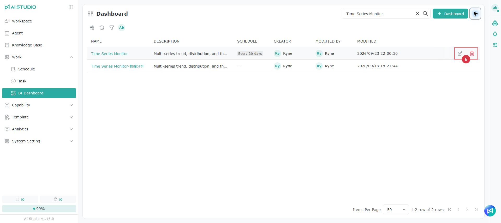
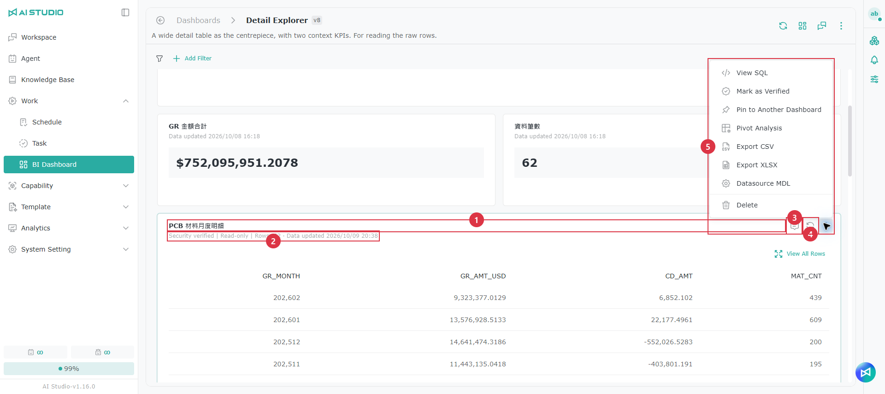
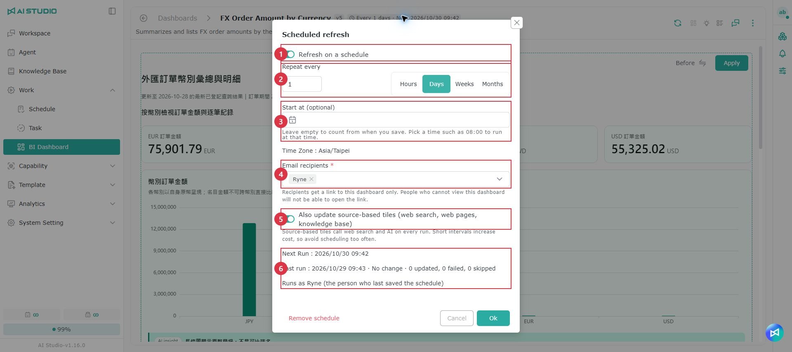
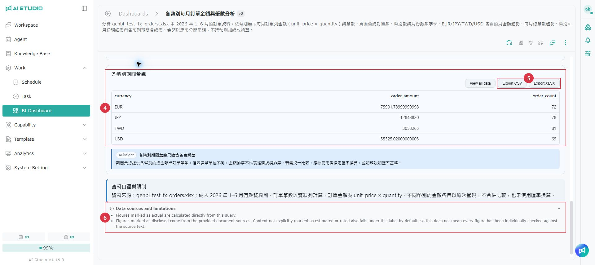
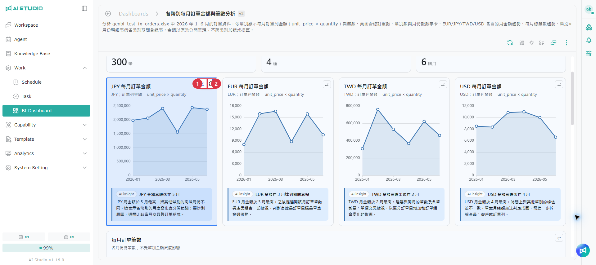
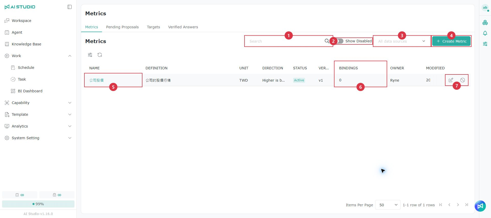
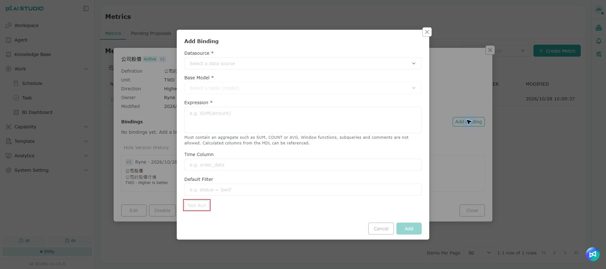

# BI Dashboard

## What is a BI Dashboard? 

A BI Dashboard organizes data into number cards, charts and detail tables, with analysis insights written by AI. A dashboard can hold two kinds of content, and both can sit on the same dashboard:

| Type               | Description                                                                                                                                         | When it is used                                                                                                         |
| ------------------ | --------------------------------------------------------------------------------------------------------------------------------------------------- | ----------------------------------------------------------------------------------------------------------------------- |
| Artifact page      | A full analysis page written by the Agent in one go, including number cards, charts, tables and insights. Once added to a dashboard, the whole page is one tile | The default output. Used for analyses that need figures from a datasource, and for analyses based on web pages or uploaded files |
| Standard dashboard | Generated from a template and made up of individual tiles — number cards, charts, detail tables, insights and section titles — each of which can be adjusted on its own | When you explicitly ask for a standard dashboard or a template                                                          |

When you ask an Agent to analyze data in a conversation, it produces an Artifact page by default; it produces a standard dashboard only when you explicitly ask for a standard dashboard or a template. If generating an Artifact page fails repeatedly, the Agent also falls back to a standard dashboard. Both kinds of content are first previewed on the canvas on the right of the conversation, and are added to a dashboard only after you pin or confirm them.

> Note: The generation behavior above is the default; administrators can change it under [Configuration - Conversational BI](../xi-tong-she-ding-zhi-nan/pei-zhi.md#dui-hua-shi-bi). For example, after **Use free-form pages for datasource questions by default** is turned off, questions that need a datasource produce a standard dashboard, and an Artifact page is produced only when the user explicitly asks for one. After **Let the Agent write pages freely** is turned off, questions based on web pages or uploaded files also use a fixed layout.

* For working with Artifact pages, see [Artifact page](bi-yi-biao-ban.md#artifact-ye-mian).
* For the business definitions AI uses when it generates SQL, see [Metrics](bi-yi-biao-ban.md#zhi-biao).

## Before you start 

To generate a BI Dashboard or an Artifact page in a conversation, the following conditions must be met:

| Condition                   | Description                                                                                                                                                                                                                                                       |
| --------------------------- | ----------------------------------------------------------------------------------------------------------------------------------------------------------------------------------------------------------------------------------------------------------------- |
| Conversational BI enabled   | An administrator must turn on **Allow BI Dashboard generation in conversations** under **Conversational BI** in **System Setting → Configuration → Global**. See [Configuration - Conversational BI](../xi-tong-she-ding-zhi-nan/pei-zhi.md#dui-hua-shi-bi). It is off by default on a new installation |
| BI permission               | The user's role must have the BI Dashboard permission                                                                                                                                                                                                             |
| Agent type and settings     | Use a Chat Agent or a Workflow Agent with its BI feature turned on. It is on by default for Chat Agents; for Workflow Agents it is off by default and must be turned on in the workflow node                                                                     |
| Data                        | The data must have a completed data model, or come from a knowledge base spreadsheet                                                                                                                                                                             |

Once these conditions are met, select **BI Dashboard** in the conversation input box and enter your analysis request.

> Note:
>
> * When **Allow BI Dashboard generation in conversations** is off, the BI entry point does not appear in the conversation input box, and no new dashboard or Artifact page can be generated in a conversation. Existing dashboards can still be changed through the ask panel.
> * Actions on a dashboard that change its content (refresh, edit layout, ask, alerts, schedule, version history, pin, share and so on) require manage permission on the dashboard. Users without manage permission can only view the dashboard and export it as PNG/PDF.

## Opening the BI Dashboard page 

Click **Work** in the left menu, then click **BI Dashboard**.

## Page overview 

<table data-search="false"><thead><tr><th width="90">Item</th><th width="157">Action</th><th>Description</th></tr></thead><tbody><tr><td>1</td><td>＋ Dashboard</td><td>Opens the <strong>Generate Dashboard with GenBI</strong> window. See <a href="bi-yi-biao-ban.md#jian-li-yi-biao-ban">Creating a dashboard</a></td></tr><tr><td>2</td><td>More</td><td>Expand it to select <strong>Metric management</strong> (opens the Metrics page; see <a href="bi-yi-biao-ban.md#zhi-biao">Metrics</a>) or <strong>Datasource MDL</strong> (opens the datasource's semantic layer settings)</td></tr><tr><td>3</td><td>Toolbar</td><td>From left to right: search, adjust visible columns, refresh, filter, and <strong>My list</strong>. Name search is not case-sensitive</td></tr><tr><td>4</td><td>Schedule</td><td>Shows how often the dashboard is updated on a schedule. Use the filter to find dashboards that <strong>have a schedule</strong> or <strong>need attention</strong></td></tr><tr><td>5</td><td>Name</td><td>Click the name to open the dashboard</td></tr><tr><td>6</td><td>Edit / Delete</td><td><strong>Edit</strong> changes the dashboard's name and description; <strong>Delete</strong> deletes the whole dashboard</td></tr></tbody></table>

The list shows each dashboard's name, description, schedule, creator, modifier and modification time.

> Note: If the screen shows **No access permission**, your role cannot use BI Dashboards; contact your administrator. If it shows "Unable to verify your BI Dashboard permission right now. Please try again later.", click **Retry**.

## Creating a dashboard 

There are two ways to create a dashboard. The list page has no entry point for creating a blank dashboard.

### Pinning from a conversation (recommended) 

Select **BI Dashboard** in the conversation input box and ask the Agent to analyze data. The Agent produces an Artifact page preview on the canvas on the right. Once you have checked the content, click the pin button on the canvas and choose to add it to an existing dashboard or create a new one. See [Pinning to a dashboard](bi-yi-biao-ban.md#ding-xuan-dao-yi-biao-ban).

### Generating a dashboard with GenBI 

1. Click **＋ Dashboard** in the upper-right corner of the list.
2. Fill in the fields as described below and submit. The system generates a complete standard dashboard from the template, showing "Generating…" while it works.

<table data-search="false"><thead><tr><th width="90">Item</th><th width="157">Field</th><th>Description</th></tr></thead><tbody><tr><td>1</td><td>Template</td><td>The structure of the dashboard. If the data model of the selected datasource cannot support a template, that template is shown as unavailable with an explanation</td></tr><tr><td>2</td><td>Datasource</td><td>Where the dashboard gets its data. The <strong>Qualitative analysis</strong> template does not need a datasource, and the screen shows "Qualitative analysis does not need a datasource; use the web and file sources below instead"</td></tr><tr><td>3</td><td>Dashboard name</td><td>The dashboard name (required)</td></tr><tr><td>4</td><td>Description</td><td>The dashboard description (optional)</td></tr><tr><td>5</td><td>Analysis focus (optional)</td><td>The analysis question you want the dashboard to focus on, for example "Compare revenue and gross profit this year with last year". Leave it blank to use the template's default content</td></tr></tbody></table>

**Web and file materials** (required for the Qualitative analysis template; optional for mixed templates that also need a datasource)

* Enter a web page URL and click **Add** (or press Enter), or upload files (multiple files allowed). The Qualitative analysis template needs at least one material.
* Each material shows its word count. If the content is too long, it is marked **Content truncated**.
* A web page added more than 25 minutes ago shows **Expiring soon**, and you can click **Re-add**; after more than 30 minutes it shows **Expired**.

> Note: When a dashboard has no content, opening it shows "There is no data to display". Users with manage permission can click **Auto-generate** to generate content.

## Inside a dashboard 

<table data-search="false"><thead><tr><th width="90">Item</th><th width="157">Action</th><th>Description</th></tr></thead><tbody><tr><td>1</td><td>Back and name</td><td>Click <strong>Dashboard</strong> to go back to the list</td></tr><tr><td>2</td><td>Version</td><td>The current version, for example v2. Each time you save a layout or apply a change, a new version is created</td></tr><tr><td>3</td><td>Schedule</td><td>Shows a summary of the schedule; click it to open the schedule settings. See <a href="bi-yi-biao-ban.md#pai-cheng-shua-xin">Scheduled refresh</a></td></tr><tr><td>4</td><td>Refresh</td><td>Updates the dashboard with the latest data. See <a href="bi-yi-biao-ban.md#geng-xin-yi-biao-ban">Updating a dashboard</a>. When some tiles are selected, <strong>Refresh selected tiles (n)</strong> is also shown</td></tr><tr><td>5</td><td>Edit layout</td><td>Drag to change the position and size of tiles. See <a href="bi-yi-biao-ban.md#bian-ji-pai-ban">Editing the layout</a></td></tr><tr><td>6</td><td>Ask this dashboard</td><td>Opens the ask panel on the right, where you can ask the Agent to change or interpret the content. See <a href="bi-yi-biao-ban.md#xun-wen-ci-yi-biao-ban">Asking this dashboard</a></td></tr><tr><td>7</td><td>⋮ More</td><td>See the table below</td></tr></tbody></table>

**The "⋮" menu**

| Item                    | Description                                                                                                          |
| ----------------------- | -------------------------------------------------------------------------------------------------------------------- |
| Datasource              | View the datasources the dashboard uses. When a datasource is out of date, a warning dot appears on the "⋮" button  |
| Datasource MDL          | Opens the datasource's semantic layer settings (manage permission required)                                         |
| Version history         | View and restore earlier versions. See [Version history](bi-yi-biao-ban.md#ban-ben-li-shi)                          |
| Scheduled refresh       | Set up regular automatic updates (manage permission required). See [Scheduled refresh](bi-yi-biao-ban.md#pai-cheng-shua-xin) |
| Export PNG / Export PDF | Export the current view as an image or a PDF. See [Exporting PNG/PDF](bi-yi-biao-ban.md#hui-chu-pngpdf)             |
| Switch theme            | Switch between the light and dark theme. This affects only the current view and is not saved                        |

When a dashboard contains only one Artifact page tile, the header buttons and the "⋮" menu also include the Artifact actions. See [Header actions](bi-yi-biao-ban.md#ye-shou-cao-zuo).

> Note: For users without manage permission, the "⋮" menu has only Datasource, export and Switch theme; they cannot change, refresh or ask.

## Tiles on a standard dashboard 

A standard dashboard is made up of individual tiles: number cards, charts, detail tables, insights and section titles.

* **Title bar**: shows the title and status icons. The subtitle shows the datasource, the period, the data cut-off time and the update time. Tiles that use a metric show a metric tag; see [Metric information shown on a dashboard](bi-yi-biao-ban.md#zai-yi-biao-ban-shang-kan-dao-de-zhi-biao-zi-xun).
* **Ask again / Refresh**: ask the Agent a follow-up question about this tile, or update this tile with the latest data. Insight and qualitative tiles have no **Refresh**.
* **AI analysis**: some tiles show a one-sentence conclusion below. While the analysis runs, "AI is analyzing the cause…" is shown; when it finishes, **AI analysis** and the conclusion appear, and you can click **Follow up**.

**The tile's "⋮" menu** (items depend on the tile type; most require manage permission)

| Item                            | Description                                                                                                                                                                       |
| ------------------------------- | --------------------------------------------------------------------------------------------------------------------------------------------------------------------------------- |
| Sources                         | View the sources cited by an insight or qualitative content. Click a source to jump to the corresponding tile or open the web page                                              |
| View SQL                        | View the query this tile uses                                                                                                                                                     |
| Mark as verified                | Register this tile's question and SQL as a verified Q&A. See [Verified Q&A](bi-yi-biao-ban.md#yi-yan-zheng-wen-da)                                                                |
| Pin to another Dashboard        | Copy the tile to another dashboard                                                                                                                                                |
| Pivot                           | Set rows, columns and values for a detail table to produce a summary table. See [Pivot analysis](bi-yi-biao-ban.md#shu-niu-fen-xi)                                                |
| Alert settings                  | Send an email notification when a figure meets a condition. See [Alert settings](bi-yi-biao-ban.md#gao-jing-she-ding)                                                              |
| Export CSV / Export XLSX        | Export the detail table's data                                                                                                                                                    |
| Change chart type               | Change to a bar, trend, pie, donut, scatter, radar or dual-axis chart                                                                                                             |
| Convert to an updatable component | Turn static content pinned from a conversation into a tile that can be updated from a datasource. See [Converting to an updatable component](bi-yi-biao-ban.md#zhuan-huan-cheng-ke-geng-xin-de-yuan-jian) |
| Re-source                       | Regenerate this tile from its materials, one tile at a time, taking up to about 5 minutes                                                                                        |
| Delete                          | Delete this tile                                                                                                                                                                  |

**Status icons**: a warning icon after a tile's title indicates one of the following situations; when more than one applies, a number is shown. Click the icon to see the reason and deal with it:

| Status           | What to do                                                       |
| ---------------- | ---------------------------------------------------------------- |
| Schedule failed  | Click **Scheduled refresh** to see the reason and set it up again |
| Alerting         | The figure meets the alert condition; click **Alert settings** to view it |
| Filter not applied | This tile cannot apply the current filter conditions           |
| Outdated         | The content may be out of date; refresh it, or click **Keep as is** |

## Asking this dashboard 

1. Click **Ask this dashboard** in the header. The ask panel opens on the right.
2. Select the Agent to use. If this dashboard already has a conversation history, the Agent is fixed to the original Agent.
3. If needed, specify the tiles to change under **Selected**. When the dashboard contains only one Artifact page tile, **Selected** does not appear and that page is included automatically.
4. Enter your question or change request and send it.

At the top of the panel, click **History** to see earlier conversations, or **New conversation** to start over. Drag the left edge of the panel to change its width.

### Viewing and applying proposals 

The Agent's changes do not take effect immediately. Instead, it creates **proposals**:

1. Click **Before / After** on a tile to compare the content, or open the preview to see the current SQL and the **Suggested SQL**.
2. Once you are satisfied, click **Apply**. Only then is the change written to the dashboard and a new version created.
3. When there are several proposals, select them and click **Apply all (n)**, then confirm in the **Confirm applying n proposals** window. Up to 20 proposals can be applied at once, and the whole batch adds only one version.

> Note:
>
> * A batch apply can take up to about 2.5 minutes. Do not leave the page while it is being applied.
> * Only one of the ask panel and the datasource panel can be open at a time.
> * Conversations opened by other people are view-only; you cannot continue typing in them.

## Updating a dashboard 

| Method            | Description                                                                                                                                  |
| ----------------- | -------------------------------------------------------------------------------------------------------------------------------------------- |
| Refresh           | Click **Refresh** in the header to update the whole dashboard. When some tiles are selected, click **Refresh selected tiles (n)** to update only those tiles |
| Re-source         | Update a single tile from its "⋮" menu                                                                                                       |
| Scheduled refresh | Update automatically at the frequency you set. See [Scheduled refresh](bi-yi-biao-ban.md#pai-cheng-shua-xin)                                |

Updates run in the background, so you can leave the page; you are notified when they finish. During an update, "Updating tiles from materials (completed/total)…" is shown at the top of the screen.

* If the data has not changed, **No change** is shown right away.
* If the data has changed, or the content uses web pages or uploaded files, the Agent rewrites the insights and the figures in the text and presents them as proposals. They are updated only after you apply them; see [Viewing and applying proposals](bi-yi-biao-ban.md#cha-kan-yu-tao-yong-ti-yi).

> Note:
>
> * **Refresh** and **Reload** on the screen are the same feature: both update the content with the latest data.
> * Updating each tile is one Agent job and uses Tokens.

### Scheduled refresh 

1. Click the schedule tag in the header, or select **Scheduled refresh** from "⋮".
2. Set the fields as described below and save.

| Field                     | Description                                                                                          |
| ------------------------- | ---------------------------------------------------------------------------------------------------- |
| Enable                    | Turn the schedule on or off. On by default                                                          |
| Every                     | Enter a number (1–9999) and select hours, days, weeks or months. The default is every 1 day        |
| Start time (optional)     | When the first run happens. The time zone follows your browser setting and cannot be changed       |
| Notification recipients   | Required, 1–50 people. Defaults to yourself                                                         |
| Also update qualitative tiles | Whether to also update tiles that use web pages or files as material. On by default; uses additional Tokens |

* When web pages or date searches are used as materials, you can set at the bottom of the window whether each material is updated too (for example **Single article** or **Page that gets updated**).
* The window shows the next and last run times, the number of tiles updated, failed or skipped, and **Tiles not updated in the last run**; click one to jump to that tile.
* If a schedule already exists, you can click **Remove schedule**.

> Note: A schedule that fails 3 times in a row is disabled automatically. It is also disabled when the BI permission is lost. Save it again to restore it. When a run fails, the window shows "It will be disabled automatically after n more failures".

### Alert settings 

This applies to number cards on a standard dashboard. Artifact pages use different alert rules; see [KPI alerts](bi-yi-biao-ban.md#kpi-gao-jing).

1. Select **Alert settings** from the number card's "⋮" menu, or click the **Alerting** icon on the tile.
2. Turn on **Enable alert**.
3. Select a condition (greater than, less than, or changes by more than %) and enter the threshold. For "changes by more than %", the threshold must be greater than 0.
4. Set the **Recipients** (required, 1–50 people, defaults to yourself) and save.

When the figure meets the condition, an email notification is sent and the **Alerting** icon appears on the tile's title. The window shows the result of the last check; if an alert is already set, you can click **Remove alert**.

> Note: Alerts work together with schedules. If the dashboard does not have a schedule enabled, the window shows a message.

## Filters 

<figure><figcaption></figcaption></figure>

The filter bar is at the top of the dashboard and filters the whole dashboard by field. Number cards, charts and tables in an Artifact page that are bound to a datasource are updated as well. You can add up to 10 filters.

**Adding a filter** (manage permission required)

1. Click **Add filter**, then select the **Datasource**, **Table** and **Field** in turn. Fields that have already been added are not listed again; calculated fields are marked **Calculated field**.
2. If needed, enter a **Filter name** (up to 64 characters). If left blank, the field name is used.
3. Click **Save**.

**Using filters**

| Filter type | How to use it                                                                                                                         |
| ----------- | ------------------------------------------------------------------------------------------------------------------------------------- |
| Text        | Select multiple values from the drop-down list. The default is **All**. Up to 200 options are listed                                 |
| Date        | Select **From** and **To**                                                                                                            |
| Number      | Enter a **Minimum** and **Maximum**. If the input format is wrong or the minimum is greater than the maximum, the filter is not applied |

Click **Clear all** to clear all conditions; click the × on a filter to remove it (manage permission required).

> Note:
>
> * Filter results are shown only in the current view. They are not saved and do not create a new version.
> * Tiles or queries that cannot apply the filter are marked **Not applied**; the other content is updated as usual.
> * The filter bar is temporarily disabled while you edit the layout, view the version history, refresh everything or open the ask panel.
> * With large amounts of data, the screen may show **Filtering**; please wait.

## Editing the layout 

1. Click **Edit layout** in the header. The ask panel closes and the current filters are cleared.
2. Drag tiles to change their position and drag a corner to change their size. You can also click **Expand to full width**, **Move up** or **Move down** on a tile.
3. Click **Save**. A new version is created.

If you click **Cancel** or leave the page with unsaved changes, the system asks whether to **Continue editing**, **Save** or **Discard**.

> Note:
>
> * You cannot edit the layout while there are proposals waiting to be applied or a re-source is in progress; the tooltip on the button explains why.
> * A dashboard that contains only one Artifact page tile has no **Edit layout**; use **Edit page layout** instead. See [Editing the page layout and changing charts](bi-yi-biao-ban.md#bian-ji-ye-mian-pai-ban-yu-huan-tu).

## Pivot analysis 

Select **Pivot** from a detail table's "⋮" menu, or click the pivot tag on the tile.

1. Describe what you need in words and click **AI generate**, or set it up manually:
   * **Row dimensions** and **Column dimensions**: up to 4 in total.
   * **Values**: up to 4. You can choose sum, average, count, distinct count, minimum or maximum. Sum and average apply only to numeric fields.
   * **Filter conditions**: text fields can use contains / does not contain; numeric fields can use equals, between and so on.
2. Click **Preview** to check the result.
3. Click **Apply**. To remove a pivot that has been applied, click **Clear pivot**.

> Note: At least one row or column dimension and one value are needed before you can apply.

## Converting to an updatable component 

Static content pinned from a conversation (such as code or documents) can be converted into a tile that can be updated from a datasource.

1. Select **Convert to an updatable component** from the tile's "⋮" menu.
2. Select at least one material: **Datasource**, **Web data**, **Files in chat** or **Knowledge base retrieval in chat**.
3. Confirm to start the conversion. A progress window shows "n components created so far…"; you can click **Continue in background** to leave.
4. When it is done, click **Go to dashboard** to see the result.

During the conversion, "This dashboard is being converted…" and the progress are shown at the top of the dashboard.

## Version history 

Select **Version history** from "⋮". The preview is on the left and the version list on the right.

* Select a version to preview its content, then click **Restore** to return to it. When you restore an Artifact page, the data used by **View all data** is restored too.
* Hover over a version to edit its **Version name** (up to 200 characters) and **Summary** (up to 500 characters), or to delete the version.
* Pin important versions so that they are not cleared automatically.

> Note: Up to 20 versions are kept. When there are 18, the message "The oldest unpinned version may be cleared" appears; beyond the limit, the oldest unpinned version is cleared automatically.

## Exporting PNG/PDF 

Select **Export PNG** or **Export PDF** from "⋮" to export the current view as an image or a PDF. Users without manage permission can also export.

* The action buttons, drag handles and status icons on tiles are hidden automatically in the export.
* The PDF is A4 landscape, and its content is an image, so the text cannot be selected. When paging, the export tries to keep each card on one page.
* If the dashboard is long, the resolution is reduced automatically and the message "The dashboard is long, so the exported image has a reduced resolution." is shown.

> Note: You cannot export while the page is still loading, while a tile has failed to load, or while you are editing an Artifact page's layout.

## Artifact page 

An Artifact page is a full analysis page that the Agent writes in one go in response to your question. The number cards, charts and tables on the page can be bound to a datasource, so the figures and charts are updated together when you refresh. Once pinned to a dashboard, the whole page is one tile on the dashboard.

The same Artifact page can appear in three places, with different features available in each:

| Feature                                   | Inside a dashboard               | Canvas on the right of the conversation | Shared page |
| ----------------------------------------- | -------------------------------- | --------------------------------------- | ----------- |
| Ask about a selected block, follow up on an insight | Yes                    | Yes                                     | No          |
| Export a regular table                    | Yes                              | Yes                                     | No          |
| Export a table bound to a datasource      | Yes                              | No                                      | No          |
| View all data                             | Yes (manage permission required) | No                                      | No          |
| Edit page layout, change charts           | Yes (manage permission required) | No                                      | No          |
| Filter and drill down by clicking a chart | Yes (manage permission required) | No                                      | No          |

### Content on the page 

<table data-search="false"><thead><tr><th width="90">Item</th><th width="157">Name</th><th>Description</th></tr></thead><tbody><tr><td>1</td><td>Number card</td><td>Shows a key figure. Alerts can be set on numeric number cards. See <a href="bi-yi-biao-ban.md#kpi-gao-jing">KPI alerts</a></td></tr><tr><td>2</td><td>Chart</td><td>Includes many chart types, such as ranking, trend, stacked, donut, funnel, scatter, waterfall and Sankey. Some charts can be changed to a compatible type. See <a href="bi-yi-biao-ban.md#bian-ji-ye-mian-pai-ban-yu-huan-tu">Editing the page layout and changing charts</a></td></tr><tr><td>3</td><td>AI insight</td><td>Attached below a block, explaining how AI interprets that block. You can ask follow-up questions about an insight</td></tr><tr><td>4</td><td>Detail table</td><td>Tables preview only the first 200 rows, with "The preview shows only the first n rows." below. For a table bound to a datasource, click <strong>View all data</strong>. See <a href="bi-yi-biao-ban.md#cha-kan-quan-bu-zi-liao">View all data</a></td></tr><tr><td>5</td><td>CSV / Excel</td><td>Export the table data. See <a href="bi-yi-biao-ban.md#hui-chu-biao-ge">Exporting tables</a></td></tr><tr><td>6</td><td>Footer statement</td><td>Explains where the figures on the page come from. It is shown at the very bottom of the page; click its title to collapse it. See below</td></tr></tbody></table>

**Data binding**: a page can bind up to 8 queries, and can use only one datasource. The datasource can be a database, an imported file, data fetched through MCP, or a knowledge base spreadsheet.

**Footer statement**: generated automatically by the system from the sources the page actually uses, and shown both inside a dashboard and on the shared page.

* When web pages, knowledge bases, uploaded files or data provided by the user are used, it states that these figures are **disclosed values from documents**.
* When there are figures derived by calculation, it states that these figures are **estimates**.
* When there are also queries bound to a datasource, it states separately that the query results are **actual values**.
* A page that uses only datasource queries does not get a footer statement.

> Note:
>
> * If "Data was updated at …; insights and key figures are from the previous version" appears at the top of the page, the figures have been refreshed but the text written by AI is still the old one. Re-source the page, or ask the Agent to rewrite the insights.
> * If a block shows "Data cannot be displayed.", that block cannot find its query. Other blocks are not affected.

### Header actions 

When a dashboard contains only one Artifact page tile, the Artifact actions are merged into the dashboard header instead of being shown in a separate toolbar.

<table data-search="false"><thead><tr><th width="90">Item</th><th width="157">Action</th><th>Description</th></tr></thead><tbody><tr><td>1</td><td>Refresh</td><td>Reload the page with the latest data. The result is presented as proposals. See <a href="bi-yi-biao-ban.md#geng-xin-yu-ti-yi">Updates and proposals</a></td></tr><tr><td>2</td><td>Insights</td><td>Show or hide AI insights</td></tr><tr><td>3</td><td>Build log</td><td>View how this page was produced and the data it used</td></tr><tr><td>4</td><td>Edit page layout</td><td>Drag to change the position and width of blocks within the page. See <a href="bi-yi-biao-ban.md#bian-ji-ye-mian-pai-ban-yu-huan-tu">Editing the page layout and changing charts</a></td></tr><tr><td>5</td><td>Ask this dashboard</td><td>Opens the ask panel on the right, where you can ask the Agent to change or interpret the page</td></tr><tr><td>6</td><td>⋮ More</td><td>In addition to the dashboard menu items, includes <strong>Pin to another Dashboard</strong>, <strong>Alert settings</strong> and <strong>Share page</strong></td></tr></tbody></table>

* The page's status icons (such as Schedule failed, Alerting, Filter not applied and Outdated) and the **Figures do not match** warning are shown next to the dashboard title.
* When a dashboard has several tiles, the Artifact tile has its own action buttons and "⋮" menu in its upper-right corner.

> Note: Artifact pages have no **Delete**. To remove a block from the page, select the block and ask the Agent to remove it.

**Canvas on the right of the conversation**: the action buttons are normally hidden. They appear when you hover over the page and stay pinned at the top of the canvas; on touch devices they are always shown. An Artifact page on the canvas has no "⋮" menu; to pin the whole page, use the pin button in the action bar.

### Selecting blocks and asking 

1. Hover over a block on the page. Two icons appear in the block's upper-right corner: **Add to selection** and **Ask about this block**.
2. To ask about several blocks at once, click **Add to selection** on each one. Selected blocks are outlined; up to 10 can be selected.
3. Click **Ask about this block**. The ask panel opens with the selected blocks; if you have not added any, it uses the block the mouse is currently over.
4. Choose **Edit** or **Ask**, enter your request and send it.

* Inside a dashboard, each selected block is shown as a tag in the ask panel and can be removed individually; removing all of them clears the selection.
* On the canvas on the right of the conversation, the tag in the floating ask window shows the first block and the number of others (for example "+2").
* Inside a dashboard, when only one block is selected, you can click **Pin this block** on the same row to pin it on its own to another dashboard.
* The Agent's changes are presented as proposals and are written only after you apply them.

> Note: The block icons do not appear on the shared page, while the page is still loading, or while you are editing the page layout.

### View all data 

Tables bound to a datasource have **View all data** below them. Click it to open the **Datasource** panel on the right of the dashboard.

<figure><figcaption></figcaption></figure>

* From top to bottom, the panel shows the query title, the datasource name, the query SQL and the full data.
* Each page shows 200 rows by default; you can switch to 50, 100, 200, 500 or 1000 rows. The data cannot be sorted or searched.
* Queries that use a metric show a metric tag in the panel, and you can also **Mark as verified** here.
* Drag the left edge of the panel to change its width. Only one of the datasource panel and the ask panel can be open at a time.

> Note:
>
> * The panel cannot be opened while the Agent is responding; the screen shows "AI is responding. Please open it later."
> * The **After** preview of a proposal has no **View all data** and no export.
> * If "This query cannot be found. It may have been replaced or deleted." is shown, the page has been updated; reload the page. If "Unable to load the full details. Please try again." is shown, try again later.

### Exporting tables 

The **CSV** and **Excel** buttons are in the upper-right corner of each table and on the datasource panel.

| Table type                     | What is exported                                       | Limit                                              |
| ------------------------------ | ------------------------------------------------------ | -------------------------------------------------- |
| Table bound to a datasource    | All data from that query                               | 100,000 rows; anything beyond is truncated with a message |
| Regular table                  | The data currently shown (after search and sorting)    | —                                                  |

* The file name is the query title (artifact-table for a regular table) plus the export time.
* When filters are applied, the exported data includes the current filter conditions.
* The shared page does not offer export.

### Filtering and drilling down by clicking a chart 

Inside a dashboard, click a data point on a chart to choose:

* **Filter the whole page by this**: filter the whole dashboard by this data point. This option appears only for fields that can be filtered.
* **Drill down**: turn the data point into a follow-up question and pre-fill it in the ask panel; send it after you confirm.

Filter results are shown only in the current view. They are not saved and do not create a new version. Blocks that cannot apply the filter are marked **Not applied**, and the other blocks are updated as usual. See [Filters](bi-yi-biao-ban.md#shai-xuan-qi).

### Editing the page layout and changing charts 

Editing the page layout and changing charts do not need the Agent. Changes are saved directly and create a new version.

#### Editing the page layout 

1. Click **Edit page layout** in the header.
2. Drag blocks to change their position and width.
3. For number card groups and items inside cards, a handle appears when you hover over them; you can reorder them within the same container or move them to a container of the same kind. While dragging, an insertion line previews the position; press `Esc` to cancel.
4. Save when you are done.

> Note:
>
> * The page must have at least two blocks for its layout to be edited. Pages laid out freely by the Agent cannot be dragged; the button is disabled with an explanation.
> * **Edit page layout** is disabled while there are proposals waiting to be applied, while a refresh is running, or while the Agent is responding.
> * While editing, you cannot use the ask panel, refresh or export. If you leave the page with unsaved changes, the system reminds you.
> * If someone else changed the dashboard at the same time, you are notified when you save and the page reloads; your unsaved layout is discarded.

#### Changing charts 

Click the change-chart button on a chart card to switch to a compatible chart type, such as ranking, bar, trend, stacked, donut, funnel, radar or dual-axis. Only chart types that suit the current data are listed (for example, dual-axis when the values differ widely, or radar when there are 3–8 categories).

Changing the chart only changes how the data is presented; the figures stay the same. Each switch creates a new version.

### Updates and proposals 

An Artifact page can be refreshed from three places. The result is always presented as proposals first and never overwrites the page directly:

| Entry point                          | Description                     |
| ------------------------------------ | ------------------------------- |
| Refresh                              | Refresh the whole dashboard     |
| Refresh selected tiles (n)           | Refresh only the selected tiles |
| **Re-source** in a tile's "More" menu | Refresh only this tile         |

* Refreshes run in the background, so you can leave the page; you are notified when they finish. Up to 10 tiles at a time.
* If the data has not changed, **No change** is shown right away. If the data has changed, or the page uses web pages or uploaded files, the Agent rewrites the insights and the figures in the text.

**Viewing and applying proposals**

1. Switch between **Before / After** to compare the content. Blocks that changed are outlined with a dashed line.
2. Once you are satisfied, click **Apply**. When there are several proposals, click **Accept all (excluding deletions)** to select all proposals that are not deletions at once; up to 20 at a time.
3. After you confirm, the whole batch adds only one dashboard version. Proposals that have expired, have already been handled or that you have no permission for are skipped, with the reason shown.

> Note: Refreshing each tile is one Agent job and uses Tokens.

### KPI alerts 

When an Artifact page has numeric number cards, you can set one alert rule for each number card (manage permission required).

1. Open **Alert settings**: when the dashboard contains only one Artifact page tile, select it from the header's "⋮"; when there are several tiles, select it from the Artifact tile's "⋮".
2. In the KPI menu at the top of the window, select the number card to set. The first card is selected by default.
3. Turn on **Enable alert**, set the condition (greater than, less than, or changes by more than %), the threshold and the **Recipients**, then save.
4. To set an alert for another number card, switch the KPI menu and repeat step 3.

When any number card meets its condition, the **Alerting** icon appears next to the title and the recipients are notified by email. Clicking **Remove alert** removes the rule only for the currently selected number card.

> Note:
>
> * Alerts on Artifact pages are checked at a different time from those on standard dashboards: they are checked only after you apply a re-source or change proposal, and the dashboard must have a schedule enabled. They are not checked, and no email is sent, right after a scheduled run.
> * If a number card no longer exists after the page is updated, the KPI menu and the alert list are updated accordingly.

### Pinning to a dashboard 

<figure><figcaption></figcaption></figure>

1. Click the pin button on the canvas on the right of the conversation to pin the whole page. To pin only a single number card, chart or table, select that block in the ask panel inside a dashboard and click **Pin this block**.
2. In the **Pin to Dashboard** window, select an existing dashboard or create a new one.
3. After you confirm, the content is added as a new tile at the bottom of the dashboard.

The pinned copy and the original page are updated separately and keep their own versions. A dashboard can hold several Artifact pages and standard tiles at the same time.

### Sharing a page 

1. Select **Share page** from "⋮" (from the header's "⋮" when the dashboard contains only one Artifact page tile), or click the share button on the canvas on the right of the conversation.
2. Confirm the share settings and create the link.

People who open the share link can only view the page, and tables show only the preview data. They cannot view all data, export tables, view the build log, select blocks or follow up on insights. There is a download button in the upper-right corner of the shared page.

> Note:
>
> * Currently only the dashboard owner can share a page. Other people see "Only the dashboard owner can share this page".
> * If the page contains a preview of query data, anyone who can open the link can see it, and the share window shows "This page contains a preview of query data that anyone who can open the share link can see."
> * When the data comes from a knowledge base spreadsheet, tables on the shared page show "Content is visible only to signed-in users with permission", but the text, KPI figures and insights on the page are still public. Check the content before sharing.

## Metrics 

A metric is a confirmed business definition, such as revenue or gross margin. It includes a name, definition, unit, direction (whether higher is better) and owner, and uses **bindings** to record the metric's formula on a given datasource.

When AI generates SQL for a dashboard, it uses confirmed metrics, so that figures are calculated the same way across dashboards, and it records the metrics and versions it used. When a metric's definition is revised, tiles that used the old definition show **Definition updated**.

### Opening the Metrics page 

On the BI Dashboard list page, click **More** in the upper-right corner and select **Metric management**. You can also click a metric tag on a dashboard tile to open that metric in a new tab.

The Metrics page has four tabs:

| Tab                    | Description                                                                                         |
| ---------------------- | --------------------------------------------------------------------------------------------------- |
| Metric list            | Create, edit and disable metrics, and manage their bindings and versions                           |
| Pending proposals      | New metrics or new bindings suggested by AI from the data model; edit and apply them, or discard them |
| Target values          | Target values for each metric in each period; add them manually or extract them from documents      |
| Verified Q&A           | Manually confirmed "question + SQL" examples that AI refers to when it meets similar questions     |

> Note: If the screen says the datasources or user list failed to load, click **Retry**.

### Metric list 

The list shows each metric's name, definition, unit, direction, status (enabled/disabled), version, number of bindings, owner and modification time.

* Search matches both the name and the definition. You can also filter by datasource.
* Disabled metrics are not listed by default; turn on **Show disabled** to see them.
* **Needs review** next to the number of bindings means a binding needs to be checked; open the metric to see why.
* **+N** next to the number of bindings means there are N more bindings from knowledge base datasources you do not have permission for.

#### Creating a metric 

1. Click **Create metric**.
2. Enter the name (required), definition, unit, direction (Not specified / Higher is better / Lower is better) and owner.
3. After saving, click the metric's name to open its details and add bindings.

> Note: Metric names must be unique.

#### Metric details and bindings 

Click a metric's name to open its details, where you can see its basic information, bindings and version history.

A binding is the metric's formula on a given datasource. When adding or editing a binding, fill in the datasource, data model, formula, time field and default filters. **A binding can be saved only after a successful Test run.** A test run may take a few seconds, and you need to run it again after changing any field.

> Note: The datasource of a binding cannot be changed after the binding is created. To use another source, remove the binding and add a new one.

#### Disabling and enabling a metric 

Click **Disable** on the right of a row and confirm to disable the metric. Once disabled, AI no longer uses the metric, and tiles that use it show **Disabled**. Click **Enable** to enable it again at any time.

> Note: For a disabled metric, only the owner can be changed.

### Pending proposals 

<figure><figcaption></figcaption></figure>

After you click **AI-suggested metrics** on a datasource's Schema page, AI suggests new metrics or new bindings based on the data model and takes you to this tab when it is done.

* The list shows the type (New metric / New binding), name, definition, datasource, data model, formula, creator and proposal time.
* You can filter by status (Pending / Applied / Discarded) and by datasource.
* **Apply**: opens a window where you can edit the content first, then submit it after a successful test run.
* **Discard**: discards the proposal after you confirm. This cannot be undone.

> Note:
>
> * Suggesting metrics with AI may take more than a minute. While the screen shows that it is processing, you do not need to click again; the proposals appear in the list when it is done.
> * "N more not listed due to permissions" means some proposals come from knowledge base datasources you do not have permission for.

### Target values 

<figure><figcaption></figcaption></figure>

The list shows the metric, period (for example "2025 Q1"), value and unit, source (Manual / Extracted from document), status (Pending / Confirmed) and creation time. Hover over the source to see where it came from; when the unit differs from the metric's, **Unit mismatch** is shown.

* **Add manually**: select a metric, period and value. A value added manually is **Confirmed** right away and replaces the older confirmed value for the same metric and period.
* **Extract from document**: upload a PDF, Word (.docx, .doc), PowerPoint (.pptx, .ppt), TXT or Markdown file (up to 20 MB per file). Extraction runs in the background and takes up to about 15 minutes; if you switch tabs and come back, it continues. When it finishes, the number of values is shown and the view switches to **Pending**.
* **Confirm and delete**: a pending value can be edited (value and unit) and then **Confirmed**, or deleted. A confirmed value can only be deleted.

### Verified Q&A 

<figure><figcaption></figcaption></figure>

Verified Q&A entries are questions and SQL that have been confirmed manually; AI refers to them when it meets similar questions. The list shows the question, SQL, metrics used, datasource, type (From tile / Manual), status, verifier and verification time.

* **Adding from a dashboard**: on a standard tile, select **Mark as verified** from its "⋮" menu; for an Artifact page, mark each query in the **Datasource** panel.
* **Adding manually**: select a datasource and enter the question (up to 500 characters) and the SQL. The system runs a test on that source, and the entry is saved only if it succeeds (returning no data also counts as success).
* **Re-verifying**: the question and datasource cannot be changed; only the SQL can be edited. You can submit even without changes.

> Note:
>
> * After a metric is revised, related Q&A entries become **Needs re-verification**, and AI does not refer to them until they are re-verified.
> * Q&A entries whose datasource has been deleted show **Source no longer exists** and can only be deleted.

### Metric information shown on a dashboard 

<figure><figcaption></figcaption></figure>

| Item                          | Description                                                                                                                                                                                                                                                          |
| ----------------------------- | -------------------------------------------------------------------------------------------------------------------------------------------------------------------------------------------------------------------------------------------------------------------- |
| Metric tag                    | For example "Revenue v3", showing the metric and version used when the tile was generated. Click it to open the metric in a new tab. On an Artifact page, metric tags are shown in the **Datasource** panel                                                         |
| Definition updated banner     | Shown when a metric's definition is updated, a metric is disabled or a target value changes. The system does not change the tile automatically; click **Ask AI to regenerate** and the system pre-fills the ask panel for you to send after confirming (there is no such button for target value changes) |
| Mark as verified              | Register the tile's question and SQL as a verified Q&A. See [Verified Q&A](bi-yi-biao-ban.md#yi-yan-zheng-wen-da)                                                                                                                                                  |

> Note: After the definition of a metric used by an Artifact page is updated, refreshing does not update the recorded version; you need to ask AI to regenerate the page.

## FAQ 

I cannot see the BI Dashboard entry point in a conversation

Check that the conditions in [Before you start](bi-yi-biao-ban.md#shi-yong-qian-zhun-bei) are met: an administrator has turned on **Allow BI Dashboard generation in conversations** in Configuration, your role has the BI permission, and the Agent you are using has its BI feature turned on.

I cannot find a button for creating a blank dashboard on the list page

On the list page you can only generate a dashboard with GenBI through **＋ Dashboard**, or create one by pinning an Artifact page from a conversation. There is no entry point for creating a blank dashboard.

The screen shows "Unable to load this. Please try again."

Click **Reload**. If it keeps happening, ask your administrator to check the status of the datasource.

The conversation shows "The connection was interrupted and the response may be incomplete. Reload the page to check the result."

The connection was interrupted while the Agent was responding. Reload the page and check whether the response and the generated content are complete.

The figures changed after refreshing, but the insights did not

The top of the page shows "Data was updated at …; insights and key figures are from the previous version". Re-source the page, or ask the Agent to rewrite the insights.

Why can't I see "View all data"?

**View all data** appears only for tables bound to a datasource inside a dashboard, and requires manage permission on the dashboard. It is not available on the canvas on the right of the conversation, on the shared page, or in the **After** preview of a proposal.

Why can't I see "Alert settings"?

On a standard dashboard, the tile must be a number card; on an Artifact page, there must be at least one numeric number card. Both require manage permission on the dashboard.

The exported data is incomplete

A table bound to a datasource can export up to 100,000 rows; anything beyond is truncated with a message. A regular table exports only the data currently shown.

The text in the exported PDF cannot be selected

The PDF is produced from a screenshot of the view, so its content is an image. If the dashboard is long, the export resolution is reduced automatically.

