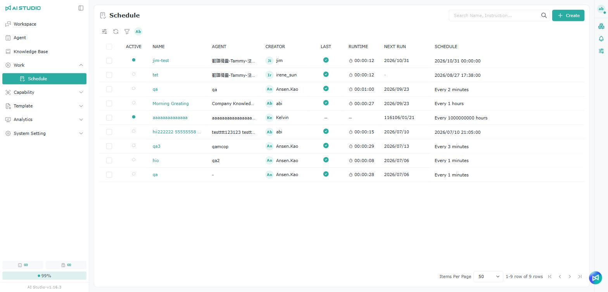
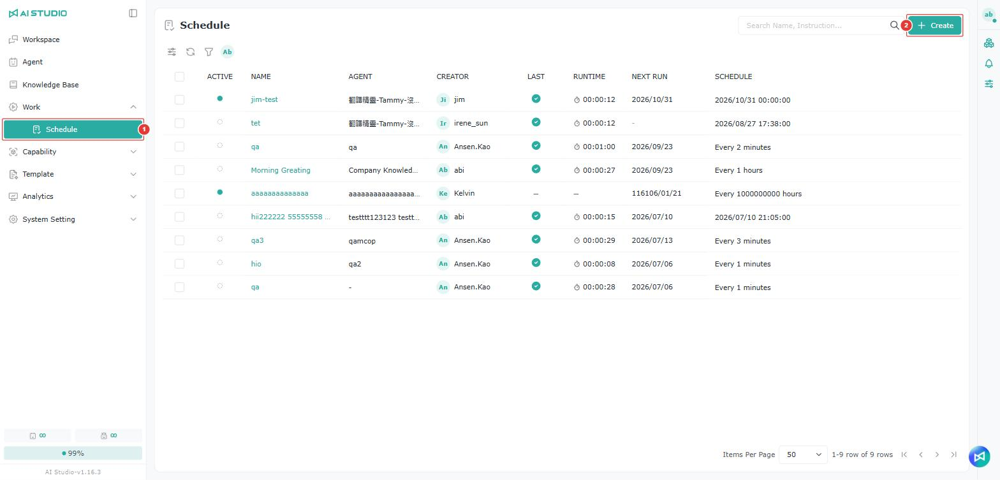
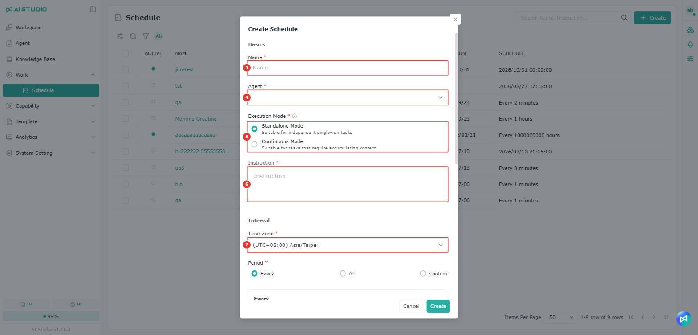
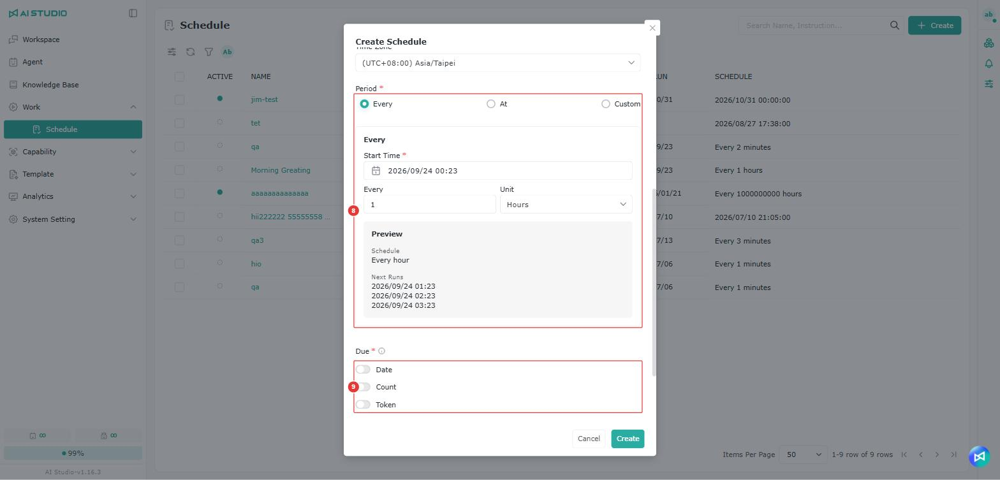
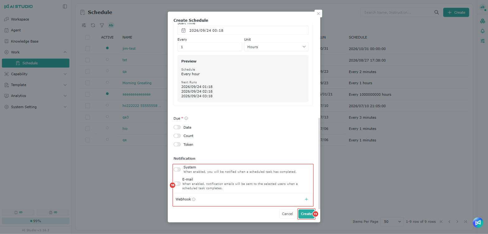
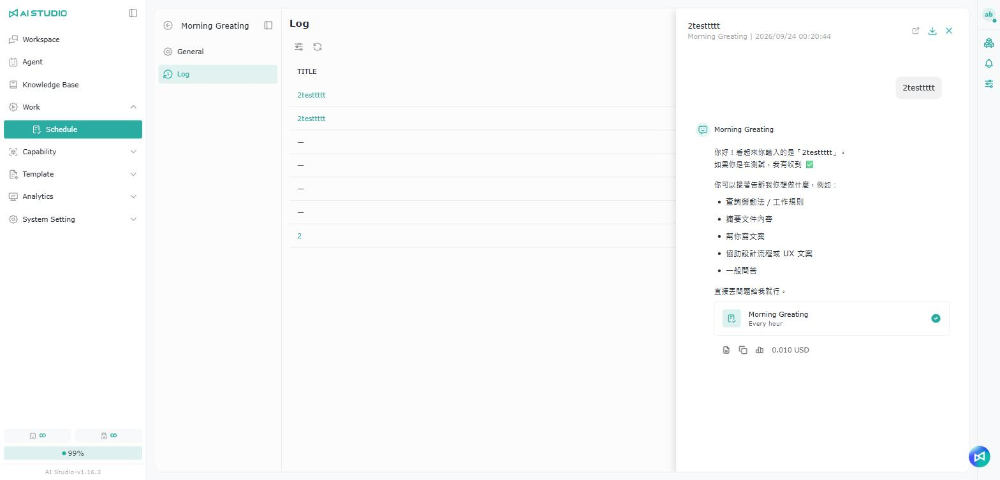

# Schedule

## Introduction

<figure><figcaption></figcaption></figure>

Schedule lets you create scheduled tasks, so that a specified Agent runs an instruction automatically at a set time or on a set recurrence. Use it for routine work such as daily summaries, timed notifications, data lookups, report generation or automated processes.

With a schedule, you do not have to open a conversation with the Agent yourself: it runs the task at the time you set, and the result and record of each run are kept.

Besides creating one on the schedule management page, you can also describe what you need in a conversation with an Agent and have the Agent create the schedule. A schedule's instruction can also state conditions and @-mention specific people, so the Agent only notifies them when the conditions are met. See Conditional notifications.

## Creating a schedule

### From the schedule management page 

<figure><figcaption></figcaption></figure>

<figure><figcaption></figcaption></figure>

<figure><figcaption></figcaption></figure>

<figure><figcaption></figcaption></figure>

1. Switch to the Schedule tab.
2. Click **Add** in the upper right to open the **Add schedule** window and create a new scheduled task.
3. Enter a schedule name.
4. Select the Agent that the schedule triggers. Once selected it cannot be changed.
   * In the Agent list, the Agents you created are shown first.
5. Select the schedule's run mode.
   * Standalone Mode: every run is treated as an independent task, which suits one-off runs that do not need accumulated context.
   * Continuous Mode: the schedule carries over and accumulates context between runs, which suits ongoing tracking, accumulating information or continuing a task's state.
   * The run mode cannot be changed after creation.
6.  Enter the task the Agent should complete on each run. The instruction should state the goal, the output format and any conditions to watch for as clearly as possible, which makes the results more consistent.

    * You can type @ in the instruction to select people. Anyone you @-mention becomes a possible recipient for this schedule, and the Agent decides whether to notify them based on the conditions in the instruction. See Conditional notifications.

    <figure><figcaption></figcaption></figure>
7. Fill in the time zone. The system calculates the run times in the time zone you select.
8.  Select the schedule's recurrence. Three modes are supported:

    * Recurring: repeats at a fixed interval. Set to **every 30 minutes**, for example, the schedule runs every 30 minutes from the **start time**.
      * The unit can be minutes, hours, days, weeks or months.
    * Specific time: runs on the date and time you choose. This suits a task that only needs to run once at a particular time, or one triggered at a set time by the system configuration.
    * Custom: for more complex rules. You can describe the rule in natural language and have the system generate a Cron expression, or enter the Cron expression directly.
      * Enter the rule in the **AI-assisted generation** field (for example "the third Monday of every month"), then press Enter, click the button on the right of the field, or leave the field, and the system generates the Cron expression and fills in the **Cron** field.

    Once the recurrence is set, the **Preview** block below shows a text description of the rule and **the upcoming run times** (up to 3). If a Date or Count limit is enabled, the preview lists only the runs that will actually happen. If a setting is wrong, the preview block shows why.

    <figure><figcaption></figcaption></figure>
9.  Select the run limits. At least one limit has to be enabled. When any enabled limit reaches its threshold, the schedule is disabled automatically. The following stop conditions are supported:

    * Date: an end date. The schedule stops running once that date is reached.
    * Count: a maximum number of runs. The schedule stops once that count is reached.
    * Token: a maximum Token usage. The schedule stops once that many Tokens have been used.

    The maximum run count is 10,000, and the maximum Token limit is 10,000,000.
10. Set the recipients. You can choose whether specified users are notified when a schedule finishes. Three methods are supported:

    * System notification: the platform notifies the specified users in-app (the notification bell in the upper right).
    * Email notification: the system notifies the recipients by email.
      * Recipients can be picked from the user list, or added by entering an email address and pressing Enter.
    * Webhook: you can set an external URL. When the schedule finishes, the system can POST the result to that external service.

    Notifications set here are sent after every run, both on success and on failure. When you add a schedule, the system notification and email recipients default to the signed-in user. To be notified only under certain conditions, see Conditional notifications.

    <figure><figcaption></figcaption></figure>
11. Click **Add** to finish.

### Schedule run modes

<figure><figcaption></figcaption></figure>

The **run mode** decides whether each run continues from the previous one:

| Mode                                        | How it works                                                                       | When to use it                                                                         |
| ------------------------------------------- | ---------------------------------------------------------------------------------- | -------------------------------------------------------------------------------------- |
| 
Standalone Mode

(Standalone)
   | Every run is independent and starts fresh, without carrying over the previous run.   | When runs are unrelated to each other — a daily summary or a timed notification, say.    |
| 
Continuous Mode

(Continuous)
   | Every run carries over and accumulates the previous content and state.               | When you need to track something across runs, accumulate information or continue progress — following the same issue over time, say. |

### From an Agent's settings page

<figure><figcaption></figcaption></figure>

The entry point is the schedule management section of an Agent's settings page, and the steps are the same as in [From the schedule management page](pai-cheng.md#cong-pai-cheng-guan-li-ye-mian-jian-li). The only difference is that you cannot select a different Agent there.

### Asking an Agent to create a schedule in a conversation

When you ask an Agent to create a schedule in a conversation and mention other users in your request, the system creates notifications for the people mentioned, which they can see under System Notification.

<figure><figcaption></figcaption></figure>

1. Describe what you need in the conversation, including the time or frequency and a run limit. For example: "Every weekday at 8 am, compile the industry news for me, and stop after 30 runs."
2. Once the Agent has enough information, it creates the schedule. If not, it asks you first, or proposes a run limit for you to confirm.
3. When it is created, a schedule card appears in the conversation showing the schedule name and recurrence.
4. Click the schedule card to open the schedule editor, where you can change its settings, disable it or delete it.

<figure><figcaption></figcaption></figure>

Notes on using this:

* A schedule created in a conversation is always in Continuous Mode and is bound to that conversation, so the result of every run comes back to it.
* To change it afterwards, just tell the Agent in the conversation — "change it to every Monday at 9 am", for example — and the Agent updates the schedule and shows a new schedule card.
* Each time the schedule runs, a schedule card also appears in that run's conversation: a green check mark on success, a red cross on failure.
* Once a schedule is deleted, its card shows "This schedule has been deleted" and can no longer be clicked.
* Only the person who created the schedule can click the card to open the editor.
* To notify other people, select them with @ in your message; to be notified yourself, just say "notify me when it's done". The default method is system notification, and if you say to send an email, email notification is used instead.
* If the notification has a condition — "only notify @王小明 when the yield is abnormal", for example — the Agent sets it up as a conditional notification.
* Webhooks cannot be set up in a conversation; use the schedule editor for those.

### Conditional notifications

If you want the Agent to notify people only in certain situations — an abnormal value or a change of status, rather than on every run — state the condition in the instruction and @-mention the people who may be notified.

An example instruction:

> On each run, check the yield of production line A over the past hour. If the yield is below 95%, notify @王小明, including the abnormal lot number and the yield figure. If the yield is normal, do not notify anyone.

<figure><figcaption></figcaption></figure>

How conditional notifications work:

* Anyone @-mentioned in the instruction becomes a possible recipient for the schedule. Whether a notification is sent is decided by the Agent on each run, based on the conditions in the instruction.
* The notification is sent as soon as the condition is met during a run, and the Agent writes its content.
* The method can be a system notification or email, as the Agent judges from the instruction. To specify it, say so in the instruction — "send an email to @王小明", for example.
* The Agent can only notify people @-mentioned in the instruction; it cannot notify other users or email addresses you type in.
* Once you remove @王小明 from the instruction and save, that person is no longer a possible recipient.

<figure><figcaption></figcaption></figure>

Conditional notifications and the notification settings you configure when creating a schedule can be used together. The differences:

<figure><figcaption></figcaption></figure>

| Item             | Notification settings (system / email / Webhook)                         | People @-mentioned in the instruction (conditional notifications) |
| ---------------- | ------------------------------------------------------------------------ | ---------------------------------------------------------------- |
| When it is sent  | After every run                                                          | Only when the condition in the instruction is met                 |
| Who decides      | The system                                                               | The Agent, based on the instruction                               |
| Content          | The schedule name, run status, run time and the Agent's response          | A message written by the Agent                                    |
| Webhook support  | Yes                                                                      | No                                                                |

For example, you can set yourself in the notification settings to receive every run's result, and @-mention your manager in the instruction so they are only notified when something is wrong. If the same person appears in both, they receive two notifications on a run where the condition is met. The Agent decides whether the condition is met, so describe conditions clearly and in measurable terms — "below 95%" rather than "not performing well". Notifications cannot be recalled once sent.

### Managing schedules 

The schedule list shows each schedule's enabled state, name, Agent, creator, last run status, run duration, next run time and rule. The run status updates in real time without refreshing the page. Hover over a schedule for these actions:

* Run: run the schedule once immediately, without affecting the next scheduled run time.
* Stop: stop the run currently in progress. See Stopping a run.
* Edit: change the schedule's settings.
* Delete: delete the schedule.

<figure><figcaption></figcaption></figure>

Click a schedule name to open its detail page, which has a **General** tab and a **Log** tab. On the **General** tab you can change the schedule directly, and use the **Enabled** toggle to pause or resume it. Click **Save** to apply your changes.

<figure><figcaption></figcaption></figure>

#### Stopping a run

While a schedule is running, click **Stop** in the schedule list or the log list to interrupt that run.

* Stopping only interrupts that run. The schedule itself is unaffected, the next run time does not change, and it continues to trigger as usual.
* A stopped run still counts toward the run count and Token limits.
* After stopping, the status shows **Stopped**, which is distinct from a failed run.
* A stopped run sends no notifications at all — no system notification, no email and no Webhook.
* You can only stop runs you triggered yourself. Runs with the **Queued** status cannot be stopped yet.

## Viewing logs

On a schedule's detail page, click **Log** to see its run history.

<figure><figcaption></figcaption></figure>

The log list shows the title and status of each run. Click a record to see that run's details.

The run status in the log list updates in real time, and can be:

| Status   | Description                                                             |
| -------- | ----------------------------------------------------------------------- |
| Queued   | Triggered and waiting for an available run slot. The time shown is when it entered the queue; once the run starts, it changes to the actual start time, and the run duration does not include time spent queued. See "Queued runs" below |
| Running  | The Agent is working on the task; click Stop to interrupt this run        |
| Completed| The run succeeded                                                        |
| Error    | The run failed; click the record to see why                              |
| Stopped  | A user stopped this run manually                                         |

The result is shown as a conversation, including the Agent's response, the cost and the related actions. You can copy the result, or go back to the log list to look at other records.

Logs help you confirm whether a schedule ran successfully, whether the Agent's response was what you expected, and whether a run's result needs follow-up.

## Queued runs

If no run slot is available when a schedule is triggered, that run becomes **Queued**. The system retries automatically at regular intervals and starts the run as soon as it gets a slot; you do not need to do anything. Creating a schedule does not change an Agent's slot type. When a schedule runs, it uses an Assistant or a Workforce slot depending on the settings of the Agent it is bound to. See [Workforce Monitor](../fen-xi-zhi-nan/workforce-jian-kong.md#assistant-yu-workforce-de-cha-yi).

Queued runs behave as follows:

* A schedule has at most one queued run at a time. If the next run time arrives while a run is queued, that trigger is skipped; it is not queued separately or run later.
* Clicking **Run** while the status is Queued does not create a new run record.
* Editing the instruction, schedule time, name or notification settings does not cancel a queued run; that run uses the updated settings.
* Disabling the schedule cancels the queued run.
* Deleting the schedule removes the queued run as well, without leaving a record.
* For an ordinary schedule, no conversation exists yet while a run is queued, so there is no conversation to view. Schedules bound to an existing conversation (for example, one you asked an Agent to create in a conversation) can be viewed.

If a queued run cannot start, its status changes to **Error** for one of the following reasons:

| Message shown | Reason | Notification sent |
| ------------- | ------ | ----------------- |
| The plan's concurrent slots are full; the run was queued for more than N minutes without getting a run slot | The run was queued longer than the waiting limit without getting a slot (10 minutes by default; N is the actual setting) | Yes |
| The schedule was disabled; the queued run was canceled | A user disabled the schedule, or it was disabled automatically after reaching a run limit (Date, Count or Token) | No |
| The schedule settings changed; the queued run was canceled | The schedule's enabled status was switched | No |
| The Agent no longer exists; the queued run was canceled | The Agent bound to the schedule was deleted | No |

## Notes

A schedule runs automatically according to the time zone and recurrence you set. Before creating one, check the time zone, start time, recurrence and run limits.

If a run fails, check the log for the error record and the result. If a schedule does not run as expected, confirm that it is enabled, that no stop condition has been reached, that the Agent still works, and whether it is still queued or timed out in the queue because run slots were full.

If a scheduled task calls an external service or sends notifications, check the Webhook URL, the notification method and the recipients.

When creating or changing a schedule, use the **Preview** block to confirm that the upcoming run times are what you expect. Disabled users do not receive notifications.

## FAQ

How do I set a schedule to run every two weeks or every two months?

The built-in Cron cannot express a rule such as "every two weeks", so use the **Recurring** mode instead, with the **interval** set to **2** and the **unit** set to weeks.

I @-mentioned someone in the instruction. Why didn't they get a notification?

People @-mentioned in an instruction are only notified when the Agent judges that the condition is met. Check the Agent's response for that run under **Log** to see whether the condition was met. If you want that person to receive every run's result, add them to the system notification or email notification settings instead. Note also that disabled users do not receive notifications.

Why did the same person receive two notifications?

Because they are both in the notification settings and @-mentioned in the instruction. The notification settings send the result after every run, while an @-mention in the instruction has the Agent send a separate message when the condition is met; the two are not combined. If you only need one of them, remove the other.

After stopping a run, will notifications still be sent, and does it count toward the run limits?

A stopped run sends no notifications, but it still counts toward the run count and Token limits.

