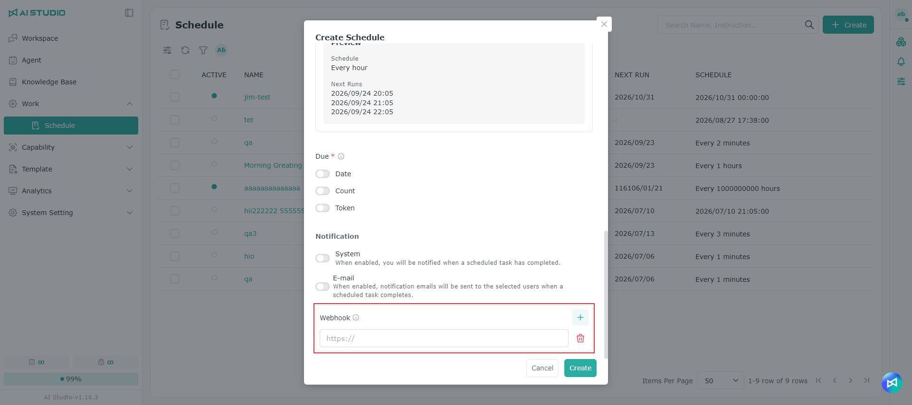

# Webhook Integration Guide

With a Webhook, the result of an Agent schedule run is sent automatically to the system you specify — an internal platform, an automation flow or a third-party service — so nobody has to sign in to check it.

Webhooks suit cases such as:

* Sending reports produced by an Agent to an internal system automatically
* Starting the next stage of an automation flow once a schedule finishes
* Recording the result of every schedule run
* Notifying the relevant people or systems when a schedule fails

## Before you start

Before configuring one, get the Webhook URL from the administrator or developer of the receiving system.

The Webhook URL has to meet the following conditions:

| Requirement              | Description                                                                 |
| ------------------------ | --------------------------------------------------------------------------- |
| Uses HTTPS               | HTTP is not supported, for data security                                     |
| Reachable from the public internet | localhost, internal company IPs and other private network addresses are not supported |
| Accepts POST requests    | The receiving end has to handle JSON data                                    |
| Responds quickly         | The receiving end should return HTTP 2xx before the timeout                  |

To test locally, use a tool such as ngrok to expose a local service as a publicly reachable HTTPS URL.

## Configuring a Webhook

### Step 1: create or edit a schedule


Create a new Agent schedule, or open an existing one to edit.

### Step 2: add the Webhook URL



Add the HTTPS URL that will receive the notifications to the schedule's `webhooks` field.

### Step 3: save and test


Save the schedule when you are done.

We recommend testing with **Run now** and confirming that the receiving end got the notification.

Both automatic runs and manual **Run now** runs trigger a Webhook notification.

## When notifications are sent

A Webhook is not sent when a schedule starts running, but after that run has finished and been finalized.

So a notification may arrive seconds to tens of seconds later than the scheduled time, which is normal.

## Run results

The system sends the following events, depending on the result:

| Result   | Event                     | Description                            |
| -------- | ------------------------- | -------------------------------------- |
| Success  | `schedule.run.completed`  | The Agent completed this schedule run   |
| Failure  | `schedule.run.failed`     | This schedule run failed                |

On success, the notification contains the Agent's final answer; on failure, it contains the relevant error message.

## What the notification contains

<table data-search="false"><thead><tr><th>Information</th><th>Description</th></tr></thead><tbody><tr><td>Schedule name</td><td>The name of the schedule that ran</td></tr><tr><td>Schedule ID</td><td>The schedule's unique identifier</td></tr><tr><td>Run ID</td><td>This run's unique identifier</td></tr><tr><td>Run status</td><td>Success or failure</td></tr><tr><td>Trigger</td><td>An automatic schedule or a manual Run now</td></tr><tr><td>Result</td><td>The Agent's answer or the error message</td></tr><tr><td>Run time</td><td>When this run was finalized</td></tr><tr><td>Next run time</td><td>When the schedule is due to run next</td></tr></tbody></table>

For a one-off or disabled schedule, **Next run time** is empty.

If the result exceeds 8,192 characters, the system truncates it. To get the full content, use the schedule or conversation views.

## Delivery and things to watch for

### How the system decides a notification succeeded

The receiving end has to return HTTP 2xx before the timeout for the system to treat a notification as successful.

The timeouts are:

* Connection timeout: 5 seconds
* Response read timeout: 10 seconds

If the receiving end returns a non-2xx status, or does not respond in time, the notification is treated as failed.

### Whether failed notifications are resent

After a failure, the system retries once automatically.

If the retry also fails, the notification is not sent again, so we do not recommend using a Webhook as your only record of run results.

If your process cannot tolerate a lost notification, set up a separate way to query schedule results or reconcile them periodically.

### Why you might receive a duplicate notification

If the receiving end processed the data successfully but responded too slowly, the system may treat the delivery as failed and send the same notification again.

The same notification uses the same `deliveryId`. The receiving end should record the `deliveryId` values it has processed, so the same data is not processed twice.

### Notification order

Notifications from different schedule run batches are not guaranteed to arrive in the order the runs happened. If the receiving end needs the order, use the run time in the notification.

### Security

Webhook notifications do not currently provide HMAC signature verification.

We recommend protecting the receiving end as follows:

* Treat the Webhook URL as confidential.
* Use a URL path or verification parameter that is hard to guess.
* Accept only HTTPS, POST and JSON requests.
* Do not publish the Webhook URL in documents, code repositories or public pages.

## Technical reference

### HTTP request format

* Method: `POST`
* Content-Type: `application/json`

### Request headers

| Header               | Description                                                   |
| -------------------- | ------------------------------------------------------------- |
| `Content-Type`       | Always `application/json`                                      |
| `User-Agent`         | Always `ProfetAI-Webhook/1.0`                                  |
| `X-Webhook-Event`    | The event type of this notification                            |
| `X-Webhook-Delivery` | This delivery's unique identifier, for deduplication            |

### Example success event

```
{
  "event": "schedule.run.completed",
  "deliveryId": "9f8c1a2b-3d4e-5f60-7182-9a0b1c2d3e4f",
  "deliveredAt": "2026-06-09T08:00:01",
  "data": {
    "scheduleId": "ac150044-...",
    "scheduleName": "Daily Report",
    "runId": "ac17f001-...",
    "assistantId": "agent-001",
    "sessionId": "ac150044-...",
    "status": "COMPLETED",
    "reason": "SCHEDULE_TRIGGERED",
    "content": "Today's key points: ...",
    "executedAt": "2026-06-09T08:00:00",
    "nextRunDate": "2026-06-10T08:00:00"
  }
}
```

### Key fields

<table data-search="false"><thead><tr><th>Field</th><th>Description</th></tr></thead><tbody><tr><td><code>event</code></td><td>The success or failure event</td></tr><tr><td><code>deliveryId</code></td><td>This delivery's unique ID, for deduplicating notifications</td></tr><tr><td><code>deliveredAt</code></td><td>When the notification was sent</td></tr><tr><td><code>data.scheduleId</code></td><td>The schedule ID</td></tr><tr><td><code>data.scheduleName</code></td><td>The schedule name</td></tr><tr><td><code>data.runId</code></td><td>This run's ID</td></tr><tr><td><code>data.assistantId</code></td><td>The ID of the Agent that ran</td></tr><tr><td><code>data.sessionId</code></td><td>The conversation ID of this run; may be empty</td></tr><tr><td><code>data.status</code></td><td><code>COMPLETED</code> or <code>ERROR</code></td></tr><tr><td><code>data.reason</code></td><td>An automatic schedule or a manual Run now</td></tr><tr><td><code>data.content</code></td><td>The Agent's final answer or the error message</td></tr><tr><td><code>data.executedAt</code></td><td>When this run was finalized</td></tr><tr><td><code>data.nextRunDate</code></td><td>When the schedule is due to run next; may be empty</td></tr></tbody></table>

## FAQ

<details>

<summary>Why am I not receiving notifications after configuring one?</summary>

Check the following in order:

1. The URL uses HTTPS.
2. The URL is reachable from the public internet.
3. The receiving end supports POST and JSON.
4. The receiving end returns HTTP 2xx before the timeout.
5. The schedule is enabled and ran successfully.

`localhost`, private IPs and internal company addresses are not supported.

</details>

<details>

<summary>Why doesn't the notification arrive exactly at the scheduled time?</summary>

A Webhook is only sent after the Agent has finished and the run has been finalized, so a delay of seconds to tens of seconds is normal.

</details>

<details>

<summary>Why did I receive two notifications for the same run?</summary>

Probably because of a system retry. Compare the `deliveryId` of the two notifications; if they are the same, it is the same notification and the receiving end only needs to process it once.

</details>

<details>

<summary>Why is the result incomplete?</summary>

`content` holds at most 8,192 characters and is truncated beyond that. Use the schedule or conversation views to get the full content.

</details>

<details>

<summary>How can I confirm a notification came from ProfetAI?</summary>

The current version does not provide signature verification. Keep the Webhook URL safe, and restrict the receiving end to the expected request method and data format.

</details>
