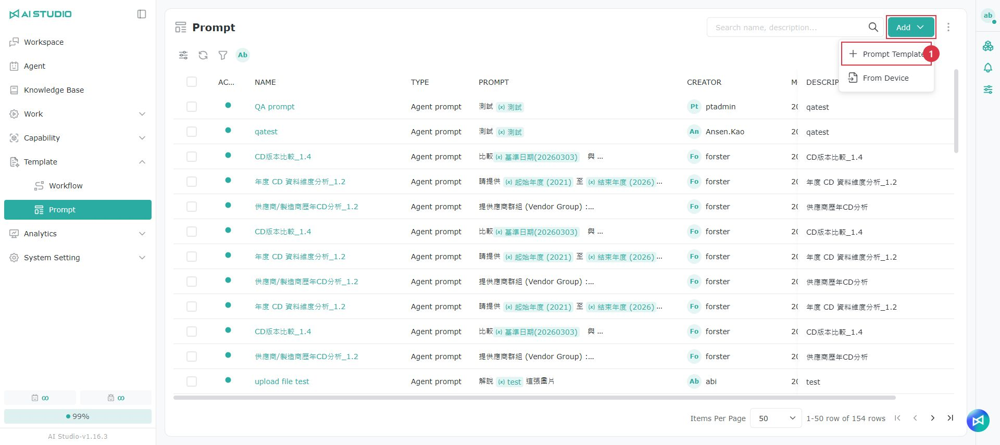
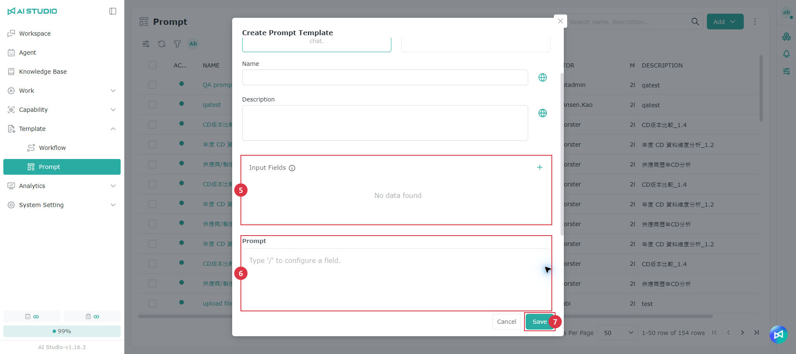
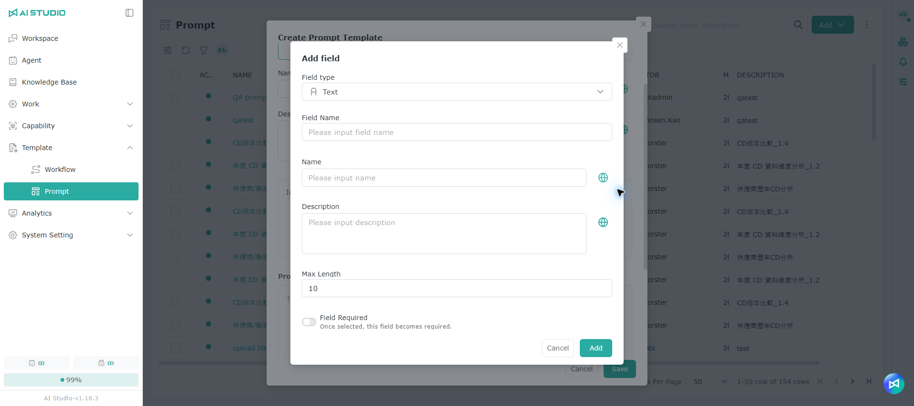

# Prompt Template

## Introduction

Prompt templates simplify how users ask questions. Frequently asked questions, or a standard way of retrieving information, can be turned into a template, so users only provide the key information and get a high-quality answer without writing a prompt. Companies can use this to make responses more consistent and to keep generative AI answers in line with company policy.

> Note: By default, only AI Studio Admins can change these settings.

## **Adding a prompt template**

1. Click **Add** to open the create prompt template window.
2. Select the prompt template type.
3. Enter a name in the **Name** field, then click the button on the right to add multilingual labels. See [Multilingual settings](ti-shi-mu-ban-guan-li.md#duo-guo-yu-yan-she-ding).
4. Enter a description in the **Description** field, then click the button on the right to add multilingual labels. See [Multilingual settings](ti-shi-mu-ban-guan-li.md#duo-guo-yu-yan-she-ding).
5. Create the **fields**.
6. Write the prompt.
7. Click **OK** to finish.

### Multilingual settings 

1. Click the globe button to translate automatically. You can also edit the content manually.
2. When the automatic translation is done, click **OK** to save.

> Note: The large language models available in the **Model** menu depend on the configuration of your installed environment. The options shown in this manual are for reference only.

### **Prompt template types**

* **Chat Prompt:** can be used in any Agent conversation.
* **Agent Prompt:** a prompt template bound to a specific Agent, and usable only in that Agent.

### **Fields**

A _field_ is a variable in the prompt, where users supply the information the prompt needs for their situation. The field types are:

* **Text:** a single-line input, with a configurable length.
* **Multi-line text:** a multi-line input, with a configurable length.
* **List:** a set of options for the user to choose from.
* **Number:** a numeric input, with configurable minimum and maximum values.
* **File upload:** a field where the user can upload a file.

## Uploading a prompt template

1. Click **Add** and select **From device**.
2. Upload the file.
3. Click **Upload**.

## Permissions

For list permissions, see [Module Permission Roles - Prompt Template list permissions](../ru-men-zhi-nan/quan-xian-gong-neng-jie-shao.md#ti-shi-ci-mu-ban-qing-dan).

For permission settings, see [Permission Actions - Root permissions](../ru-men-zhi-nan/quan-xian-cao-zuo-gong-neng-jie-shao.md#root-quan-xian).

### Prompt Template permissions

For role permissions, see [Module Permission Roles - Prompt Template permissions](../ru-men-zhi-nan/quan-xian-gong-neng-jie-shao.md#ti-shi-ci-mu-ban).

For permission settings, see [Permission Actions - Object role permissions](../ru-men-zhi-nan/quan-xian-cao-zuo-gong-neng-jie-shao.md#jue-se-quan-xian).
