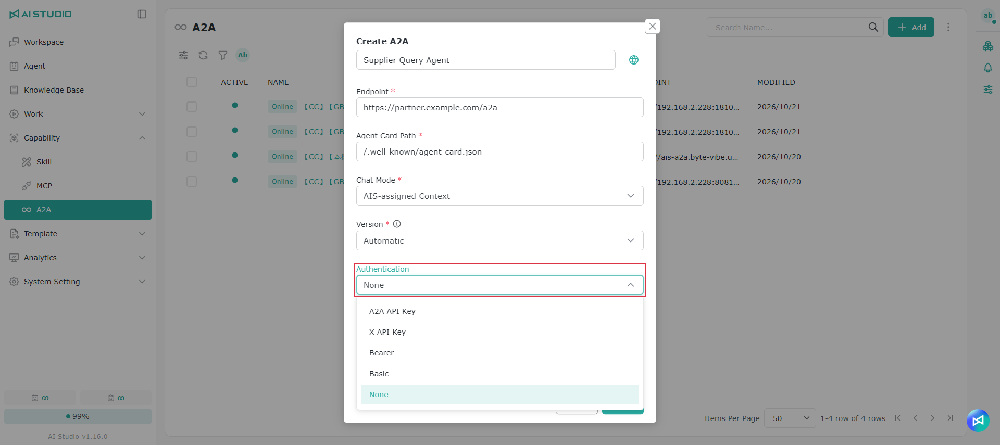
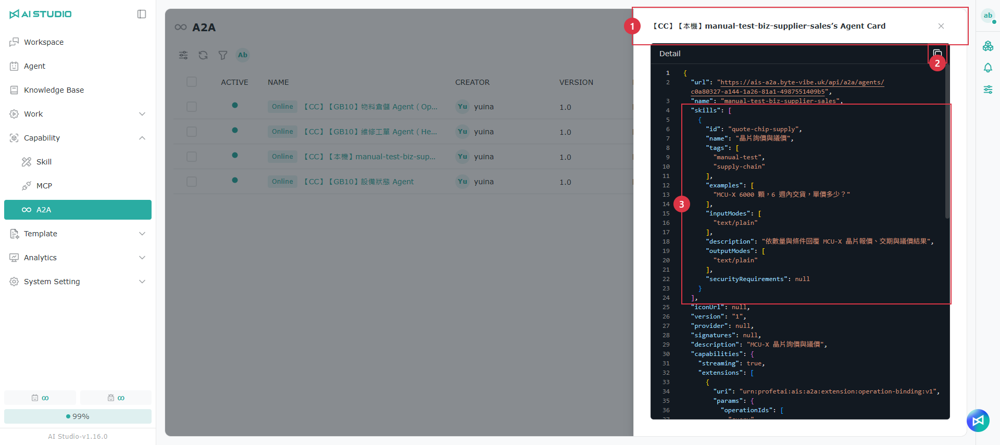
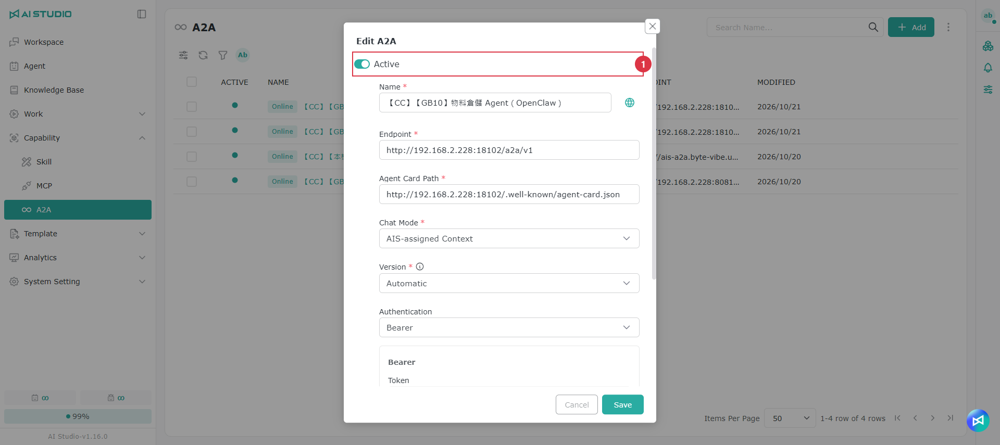
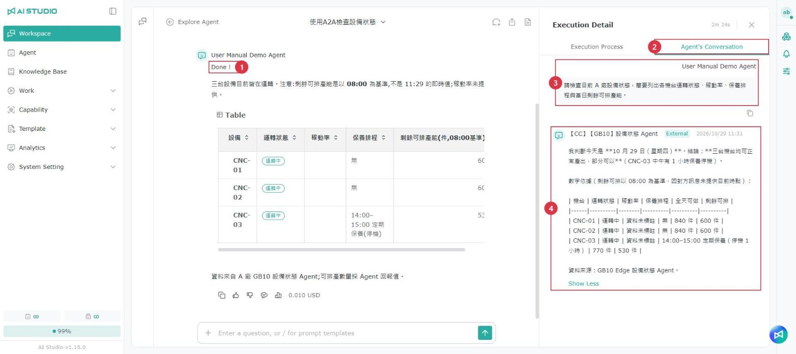

# A2A

## What is A2A?

A2A (Agent-to-Agent) is an open standard that lets AI Agents on different platforms call one another. Each Agent that supports A2A has an **Agent Card** describing its name, capabilities and authentication requirements. With its URL and Agent Card, you can exchange questions whether the Agent was built with Dify, LangGraph, n8n or AI Studio.

AI Studio supports A2A in two directions:

| Direction | Description | Where to configure it |
| --- | --- | --- |
| Call an external Agent | Let an AI Studio Agent forward a question to an external Agent and present the answer to the user. For example, a procurement Agent can ask a supplier's inquiry Agent about delivery lead times. | Capability → A2A (this page) |
| Publish your own Agent | Let external systems call an AI Studio Agent. For example, publish an equipment diagnostics Agent so a partner's system can ask questions using a key. | Agent settings → Integration → A2A. See [Integration - A2A](../agent-zhi-nan/zheng-he.md#a2a). |

> Note: Published Agents are restricted by the system to read-only query operations. When delegating to an external Agent, AI Studio sends only a text question. The external system determines what it actually executes; AI Studio cannot restrict those actions.


Before using A2A, a system administrator must configure the allowed hosts and public URL under **System Setting → Configuration → Capability**. See [Configuration - A2A Public Base URL and allowed hosts](../xi-tong-she-ding-zhi-nan/pei-zhi.md#a2a-dui-wai-wang-zhi-yu-yun-xu-lian-xian-de-zhu-ji). A message asking you to contact an administrator usually means these settings have not been configured.


## Opening the A2A page

<figure><figcaption></figcaption></figure>

In the left menu, click **Capability**, then **A2A** to register and manage external Agents.

## Page overview

<table data-search="false"><thead><tr><th width="90">No.</th><th width="157">Action</th><th>Description</th></tr></thead><tbody><tr><td>1</td><td>Add</td><td>Add an external Agent.</td></tr><tr><td>2</td><td>Search</td><td>Search by name.</td></tr><tr><td>3</td><td>Toolbar</td><td>From left to right: adjust visible columns, refresh, filter, and show items from a specific creator.</td></tr><tr><td>4</td><td>Active</td><td>A green dot means the item is active. Inactive external Agents do not appear in the list of Agents available for delegation.</td></tr><tr><td>5</td><td>Online / Offline</td><td>The result of periodic connection checks. An offline status usually means the remote service is not running, the URL is incorrect, or the host is not allowed.</td></tr><tr><td>6</td><td>More (⋮)</td><td>Set permissions for the A2A page itself. Only administrators can see this action. See Permissions below.</td></tr></tbody></table>

The list shows each external Agent's active status, name, creator, version, endpoint and modification date.

## Adding an external Agent

1. Click **Add** in the upper-right corner.
2. Enter the name, endpoint and Agent Card path. Obtain the endpoint and path from the provider.
3. Select the required authentication method and enter a key if necessary.
4. Click **Create**. An **Online** status in the list means the connection succeeded.

<figure><figcaption></figcaption></figure>

<table data-search="false"><thead><tr><th width="90">No.</th><th width="157">Field</th><th>Description</th></tr></thead><tbody><tr><td>1</td><td>Name</td><td>The name displayed in AI Studio. Click the globe button on the right to configure names in multiple languages.</td></tr><tr><td>2</td><td>Endpoint</td><td>The URL of the remote A2A service, provided by its operator.</td></tr><tr><td>3</td><td>Agent Card Path</td><td>The location of the remote Agent Card, commonly <code>/.well-known/agent-card.json</code>. AI Studio reads it to learn what the Agent can do.</td></tr><tr><td>4</td><td>Chat Mode</td><td>Determines which system remembers the context in a multi-turn conversation. See the options below.</td></tr><tr><td>5</td><td>Version</td><td>Normally, leave this set to Automatic. The system connects using the protocol version declared in the Agent Card. If the card declares 1.0 but the service supports only 0.3, the connection may succeed without returning answers. In that case, select 0.3.</td></tr><tr><td>6</td><td>Authentication</td><td>Select the method required by the provider. See the options below. If authentication is not required, select None.</td></tr><tr><td>7</td><td>Instructions for use</td><td>Notes for colleagues, such as when this external Agent should be used.</td></tr><tr><td>8</td><td>Create</td><td>Save the entry and immediately test the connection. The list shows whether it is online or offline.</td></tr></tbody></table>

### Chat mode

| Option | Description |
| --- | --- |
| AIS-assigned Context | AI Studio creates a Context ID on the first turn and reuses it for subsequent turns. Use this default option if you are unsure. |
| Server-assigned Context | The remote server creates the Context on the first turn, and subsequent turns reuse its returned Context ID. Choose this when the provider requires the server to manage context, as with LangGraph. |

Changing the chat mode closes the existing Context and starts a new conversation on the next turn.

### Authentication

Selecting a method that requires a key displays a key field below. The original key is no longer shown after it is saved. Enter a new value to replace it.

<figure><figcaption></figcaption></figure>

| Authentication | What AI Studio sends | What to enter in the key field |
| --- | --- | --- |
| None | No credentials | Leave blank. |
| X API Key | The <code>x-api-key</code> header | The key provided by the remote service (required). |
| Bearer | <code>Authorization: Bearer …</code> | The token itself (required). |
| Basic | <code>Authorization: Basic …</code> | The complete <code>username:password</code> string. |
| A2A API Key | The <code>X-A2A-API-Key</code> header | Optional. Most external platforms do not recognize this header. Do not select it unless the provider specifies it. |

## Day-to-day management

Hover over a row to show its action buttons on the right:

<table data-search="false"><thead><tr><th width="90">No.</th><th width="157">Action</th><th>Description</th></tr></thead><tbody><tr><td>1</td><td>Reconnect</td><td>Retry the connection immediately and update the online/offline status.</td></tr><tr><td>2</td><td>Agent Card</td><td>View the complete remote Agent Card, including its capabilities and supported inputs and outputs.</td></tr><tr><td>3</td><td>Edit</td><td>Modify the settings or turn off Active.</td></tr><tr><td>4</td><td>Delete</td><td>After deletion, your Agents can no longer delegate to this external Agent.</td></tr><tr><td>5</td><td>Name</td><td>Click the name to open the detail page and manage permissions for this external Agent.</td></tr></tbody></table>

### Viewing the Agent Card

<figure><figcaption></figcaption></figure>

The Agent Card window displays the remote card as JSON. The <code>skills</code> section lists its capabilities, and <code>examples</code> contains sample questions. Your Agent uses this information to decide whether to delegate to it. Click the copy button in the upper-right corner to copy the entire JSON.

If the window says the Agent Card cannot be read, open its URL directly in a browser to check it. See the FAQ below.

### Pausing use

<figure><figcaption></figcaption></figure>

To temporarily stop your Agents from using an external Agent, turn off **Active** in its edit window. You do not need to delete it.

### Bulk actions

<figure><figcaption></figcaption></figure>

<table data-search="false"><thead><tr><th width="90">No.</th><th width="157">Action</th><th>Description</th></tr></thead><tbody><tr><td>1</td><td>Select</td><td>Select multiple entries. The checkbox in the header selects all entries.</td></tr><tr><td>2</td><td>Bulk activate / deactivate</td><td>Change the active status of the selected entries at once.</td></tr><tr><td>3</td><td>Bulk delete</td><td>A confirmation is required before deletion.</td></tr><tr><td>4</td><td>N items selected</td><td>Click × to clear all selections.</td></tr></tbody></table>

## Permissions

Each external Agent has its own permissions list. A user must be on that list to use the Agent in a conversation.

<figure><figcaption></figcaption></figure>

Click an entry's name to open its detail page:

* **General**: the same settings as the edit window. After making changes, click **Save** in the lower-right corner.
* **Permission**: determine which colleagues can view, use or modify the external Agent. The creator automatically becomes an A2A Administrator and is marked as the owner.

Click **Add** to add an organization, company, department, role or individual and assign a permission:

| Permission | Allowed actions |
| --- | --- |
| A2A Administrator | Modify, delete and manage members. |
| A2A Collaborator | Modify settings. |
| A2A User | Use the external Agent in conversations. |

The A2A page itself also has permissions controlling who can open it and add entries. Administrators configure these from **⋮** in the list's upper-right corner. Page permissions are separate from the permissions for each external Agent.

## Letting an Agent use it in conversations

1. Open the settings of the Agent that will delegate questions and add the external Agent under **Coordination**. You can add only external Agents registered under **Capability → A2A** that you have permission to use.
2. During a conversation, the Agent uses the external Agent Card's description and skill examples to decide whether to forward a question.
3. You do not need to hard-code the external Agent's name in the instructions. To guide your Agent, use a description such as “For questions about supplier delivery lead times, ask the external supplier inquiry Agent.”

> Your Agent can delegate only to the external Agents added under Coordination. If it selects the wrong Agent, first check whether the remote Agent Card's description and skill examples are clear.

For other collaboration actions, see [Chat Agent - Coordination](../agent-zhi-nan/liao-tian-agent.md#agent-xie-zuo).

### Viewing the conversation between Agents 

When an Agent delegates a question to an external Agent, you can see what the two sides actually said, to check what your Agent asked and how the other Agent answered.

<figure><figcaption></figcaption></figure>

1. In the conversation, click the execution status above the response. **Execution Details** opens on the right.
2. Switch to the **Conversation between Agents** tab.

<table data-search="false"><thead><tr><th width="90">No.</th><th width="157">Name</th><th>Description</th></tr></thead><tbody><tr><td>1</td><td>Execution status</td><td>Click it to open <strong>Execution Details</strong></td></tr><tr><td>2</td><td>Conversation between Agents</td><td>This tab appears only for responses that were delegated to an external Agent</td></tr><tr><td>3</td><td>Your Agent</td><td>The question sent to the external Agent, shown with your Agent's name</td></tr><tr><td>4</td><td>External Agent</td><td>The other side's reply, shown with its name, an <strong>External</strong> tag and the reply time. Long content is collapsed first; expand it to read the full text</td></tr></tbody></table>

* If the other side's reply failed, it is marked with a warning style. If no reply was received, "No reply received from the other Agent" and an error summary are shown.
* If the same response is delegated several times, each round is listed in time order.

> Note: The execution status appears above a response only if **Execution process** is turned on under the Agent's **Chat panel → Chat Display**. See [Chat Agent - Execution process](../agent-zhi-nan/liao-tian-agent.md#zhi-xing-guo-cheng). This tab is not shown in conversations opened through a Web App.

## FAQ

Adding an external Agent asks me to contact a system administrator to allow the host

The remote host is not on the allowed list. Ask an administrator to add it under **System Setting → Configuration → A2A Allowed Hosts**, for example <code>partner.example.com</code> or <code>partner.example.com:8443</code>. The change takes effect as soon as it is saved.

The entry keeps showing Offline

Click **Reconnect** for that entry. If it is still offline, check the endpoint URL, whether the remote service is running, whether the host is allowed, and the authentication method and key.

Clicking Agent Card says the card cannot be read

The browser reads the card directly. This message can appear if the remote service does not allow cross-origin access, the card requires authentication, or the response is not JSON. It does not necessarily mean AI Studio cannot connect to the service. Check the online/offline status in the list, or open the card's URL directly in a browser.

Adding an entry says the address is already registered

An endpoint can be registered only once across the entire system. Someone else may have registered it without sharing it with you. Ask that person to add you to the entry's permissions list.

