# Skill

## Introduction

By adding skills, an Agent can perform more specific tasks — fetching external information, connecting to tools, handling a particular process, or doing things it could not do on its own. Configure the skills you need so the Agent is more flexible in its responses and closer to how you actually work.

<figure><figcaption></figcaption></figure>

## Adding a skill manually

<figure>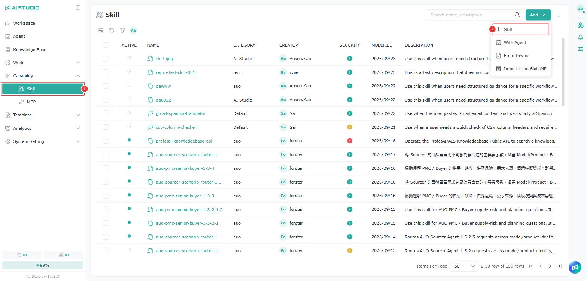<figcaption></figcaption></figure>

<figure><figcaption></figcaption></figure>

1. Go to Capability → Skill.
2. Click **Add** in the upper right and select **Skill**.
3. Select a Category, or click the "+" on the right to add one.
4. The File Explorer is on the left. The first time you create a skill it contains a SKILL.md that cannot be deleted, and you can add folders and files of your own. See [Adding a folder or file](ji-neng.md#xin-zeng-zi-liao-jia-dang-an).
5. Fill in the file content in the required format.
6. Click **Create**.

### Importing files

Click the import button above the list on the left and choose the type: **Import files** or **Import directory**.

<figure><figcaption></figcaption></figure>

### Adding a folder or file 

Click the button above the list on the left, choose whether to add a file or a folder, and enter a name.

> Note: When adding a file, include the extension, for example readme.md.

<figure><figcaption></figcaption></figure>

### Editing and deleting a folder or file

Hover over the item you want to edit or delete, and the action buttons appear on the right.

<figure><figcaption></figcaption></figure>

## Importing a skill

<figure><figcaption></figcaption></figure>

<figure>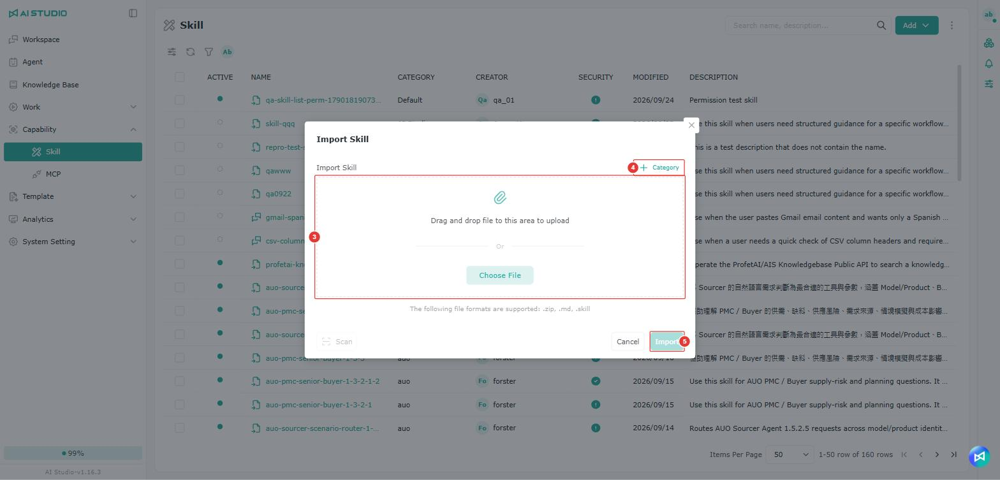<figcaption></figcaption></figure>

1. Go to Capability → Skill.
2. Click **Add** in the upper right and select **From Device**.
3. Drag files into the upload area, or click **Choose File** to select them (only **.zip, .md, .skill** are supported).
4. Select a Category, or click **+ Category** in the upper right to add one.
5. Click **Import** to finish.

## Importing a skill from SkillsMP

### Enabling the SkillsMP import option

<figure><figcaption></figcaption></figure>

<figure>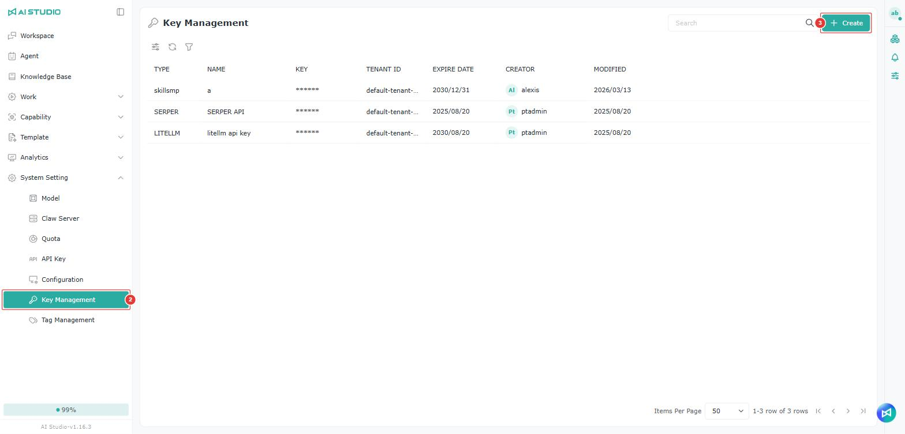<figcaption></figcaption></figure>

<figure>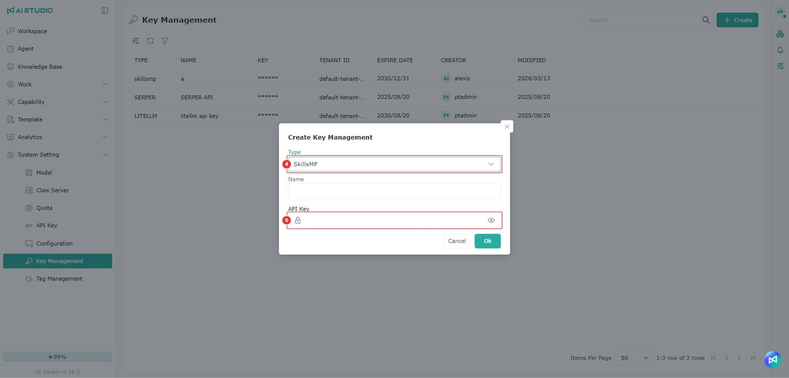<figcaption></figcaption></figure>

<figure><figcaption></figcaption></figure>

For the SkillsMP import option to appear in AIS, complete the following first:

1. Apply for a personal or company account on the SkillsMP platform and create an API Key.
   * Sign-up page: [https://skillsmp.com/docs/api](https://skillsmp.com/docs/api)
2. Back in AIS, go to **System Setting → Key Management**.
3. Click **Create** in the upper right.
4. Under **Type**, select **SkillsMP**.
5. Paste the API Key from SkillsMP into the API Key field and click **Ok**.
6. Once it is added, the **From SkillsMP** option appears in the **Add** menu on the Skill page.

> Note: The SkillsMP import option only appears once the API Key is configured. Without a SkillsMP provider and its API Key in Key Management, the option is not shown.

#### Usage limits

The SkillsMP API applies different request limits depending on whether an API Key is used:

1. Without an API Key
   * Up to 50 requests per day
   * Up to 10 requests per minute
   * Keyword search only
2. With an API Key
   * Up to 500 requests per day
   * Up to 30 requests per minute
   * Keyword search supported
3. Wildcard search is not supported
   * The SkillsMP API does not support wildcards such as \*
4. Quota tracking
   * Every API response includes the relevant response headers, which can be used to track your current quota usage

### Importing a skill from SkillsMP in AIS

<figure><figcaption></figcaption></figure>

<figure>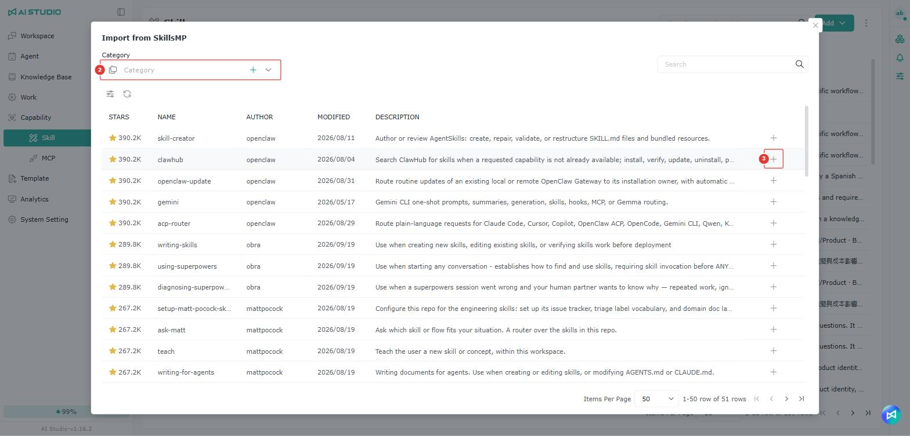<figcaption></figcaption></figure>

1. Go to Capability → Skill.
2. Click **Add** in the upper right and select **From SkillsMP**.
3. Select a group under **Category**.
4. Hover over the skill you want and click the "+" button on the right of its row to import it. You can also use the search box in the upper right to find a skill by keyword.

## Searching for skills

<figure><figcaption></figcaption></figure>

The search field in the skill list accepts skill names as well as group (Category) names. Results show the group each skill belongs to, which helps tell apart skills with the same name.

## Changing categories in bulk

<figure><figcaption></figcaption></figure>

Select several skills in the list to change their category group at once, instead of editing them one by one.

## Deleting skills in bulk

<figure><figcaption></figcaption></figure>

Select several skills and use the delete button in the upper left of the list to delete them at once. If any of them is in use by a published Agent, the system lists which ones in a message; remove the skill from the Agent, or deselect it, before deleting.

## Viewing Agents in use

<figure>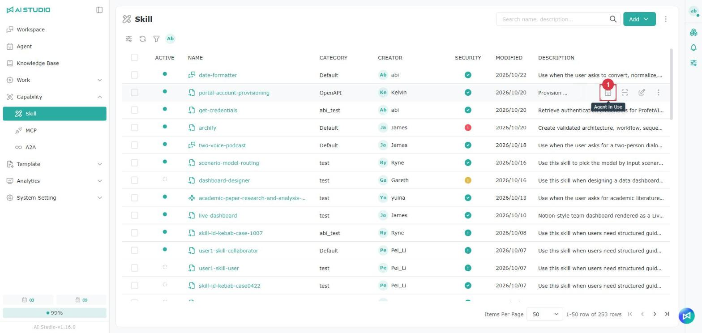<figcaption></figcaption></figure>

Hover over any row in the skill list and click the **Agent in Use** button to see which Agents currently use this skill. The window lists each Agent's publish status, name, creator, and the skills it uses.

<figure><figcaption></figcaption></figure>

> Note: The **Agent in Use** button is shown based on your edit or delete permission for the skill.

### Warnings before disabling, deleting or changing

<figure><figcaption></figcaption></figure>

When a skill is used by Agents, the system first lists the **Affected agents** before the following actions, and warns that the action may affect those Agents' responses or the related tasks. The action continues only after you confirm:

| Action                                          | System behavior                                    |
| ----------------------------------------------- | -------------------------------------------------- |
| Disable (single or bulk)                        | Lists the affected Agents; disables only after you confirm |
| Delete (single or bulk)                         | Lists the affected Agents; deletes only after you confirm  |
| Change the content on the skill edit page and save | Lists the affected Agents; saves only after you confirm    |
| Enable                                          | Not checked; enabled directly                      |

When no Agent uses it, disabling shows a general warning and deleting shows the general delete confirmation.

## **SKILL.md naming rules**

**Name:**

* Up to 64 characters
* Lowercase letters, digits and hyphens only
* No XML tags
* Half-width characters only

**Description:**

* Cannot be empty
* Up to 1024 characters
* No XML tags
* Half-width characters only
* Should explain what the skill does and when to use it

## Checking the security level

Every imported skill is scanned automatically and assigned a security level, shown in the **Security** column of the list. Click the icon to see the details, including the protection level, description, recommended remediation and triggered rules.

<figure>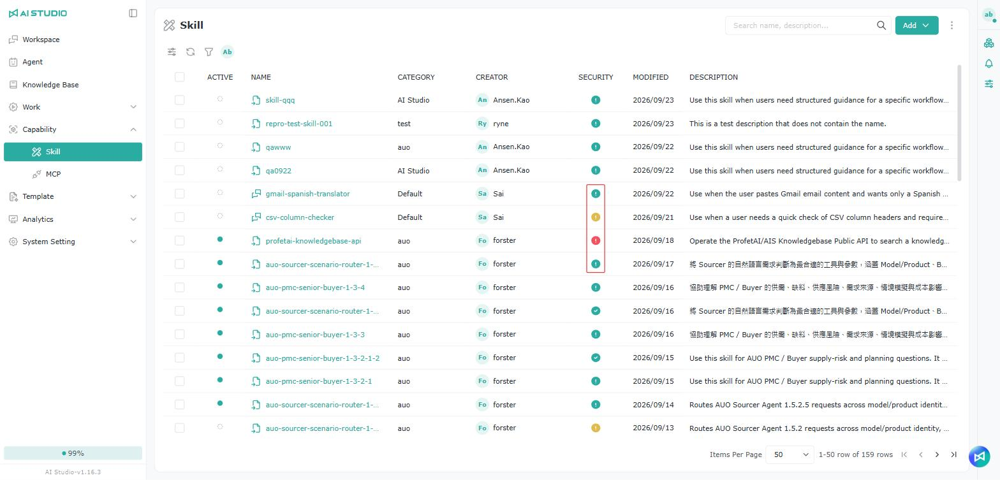<figcaption></figcaption></figure>

<figure>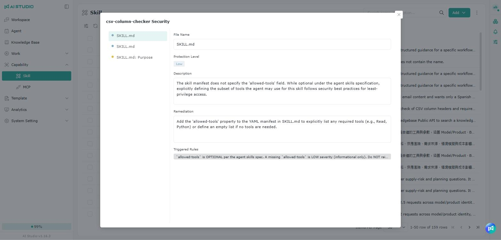<figcaption></figcaption></figure>

### How the security level is determined

Security levels are currently assessed against the **OWASP Top 10 for LLM** guidelines.

Reference: [https://genai.owasp.org/llm-top-10/](https://genai.owasp.org/llm-top-10/)

### Skills Scan rules

The Skills Scan rules define the model and the checks used when scanning a skill. This lets the system check a skill's content against platform rules when it is created or imported, which reduces the risk of unsafe settings, unexpected behavior or unsuitable content being used.

This is enabled by default. Unless you have a specific need, keep the system defaults.

> To change it, an **AI Studio Admin** can go to:
>
> System Setting → Configuration → Skills Scan settings

### Skill activation protection

<figure><figcaption></figcaption></figure>

If an administrator has enabled skill activation protection under **System Setting → Configuration**, skills rated high risk cannot be enabled; skills at other security levels can be enabled as usual.

### Unavailable skill notice

<figure><figcaption></figcaption></figure>

Only skills that are actually disabled appear in the skill risk notice window, which shows "This skill is unavailable because it was classified as {risk level} risk."

* When several skills are disabled, all of them are listed in the notice window, each with its own risk level.
* Skills rated high risk that are still enabled can be used normally. They do not appear in the notice window and show no risk warning.
* When no skill is disabled, the notice window does not appear.

## Generating a skill with AI

There are two ways to get AI help with a skill:

<table><thead><tr><th width="172"></th><th>Creating or changing a skill through a conversation</th><th>Rewriting with AI on the skill edit page</th></tr></thead><tbody><tr><td>Best for</td><td>Building a skill from scratch, or reworking an existing one substantially</td><td>Fine-tuning one file or one passage of an existing skill</td></tr><tr><td>Where</td><td>A Workspace conversation plus the draft panel on the right</td><td>The skill edit page</td></tr><tr><td>What the AI changes</td><td>The whole skill</td><td>The file currently open, or the text you selected</td></tr></tbody></table>

### Creating or improving a skill from an Agent conversation

<figure><figcaption></figcaption></figure>

When a conversation with an Agent produces a process, practice or piece of expertise worth reusing, call **@ProfetAI Skill Builder** in that conversation to carry the discussion into the Skill workspace, where you can create a new SKILL or improve an existing one.

#### How to do it

1. In the Agent conversation, find the discussion you want to turn into a SKILL.
2. Enter or select **@ProfetAI Skill Builder** in that conversation and send it.
3. When the Agent is done, its response includes a **Skill workspace** link.
4. Click the link to open the Skill workspace.
5. Review and organize the discussion there, then create a new SKILL or keep refining it.


This suits turning knowledge or processes you have already worked through, and are likely to reuse, into a skill. Once in the Skill workspace, check the content before creating or improving the skill.


### Creating a skill through a conversation

#### Getting there

<figure>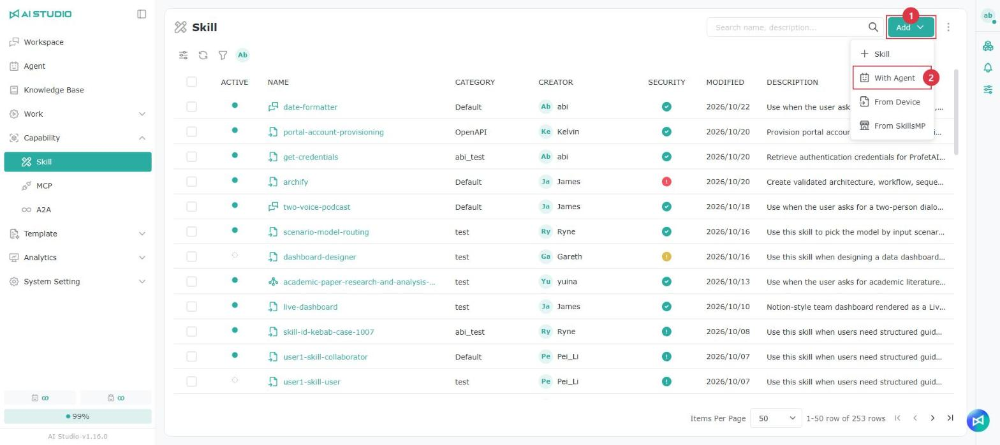<figcaption></figcaption></figure>

1. Open the Skill page and click **Add** in the upper right.
2. Select **With Agent**. The system adds ProfetAI Skill Builder to your Workspace and opens the conversation.

> If you do not see **With Agent**, it is not enabled in this environment; ask your administrator.

<figure><figcaption></figcaption></figure>

The quick questions on the ProfetAI Skill Builder welcome page are shown in your current interface language.

#### Describing what you need

<figure><figcaption></figcaption></figure>

1. In the input box, tell the Agent in plain text what skill you want, or how you want it changed. The Agent may first summarize the skill's design for you to confirm, and starts building only after you confirm.
2. When it is built, a draft card appears in the conversation with the skill name and version number (for example "Draft - Version 1"). Each later change creates a new draft version, and only the latest card is shown for a given draft.

#### Reviewing and refining a draft

Click the draft card to open the draft panel on the right. The panel does not open automatically.

<figure>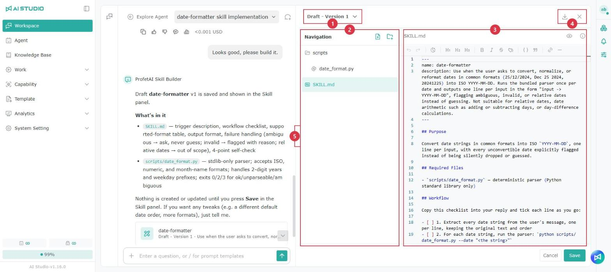<figcaption></figcaption></figure>

<table data-search="false"><thead><tr><th width="90">Item</th><th width="157">Area</th><th>What it does</th></tr></thead><tbody><tr><td>1</td><td>Version menu</td><td>Switch to another draft version</td></tr><tr><td>2</td><td>File tree</td><td>Add, rename and delete files</td></tr><tr><td>3</td><td>Editor</td><td>Edit file content directly</td></tr><tr><td>4</td><td>Buttons (upper right)</td><td>Go to skill (appears once saved), download ZIP, close</td></tr><tr><td>5</td><td>Divider</td><td>Drag left or right to adjust the width of the conversation area and the draft panel</td></tr></tbody></table>


While the Agent is responding, the panel shows "ProfetAI Skill Builder is editing the skill…" and is locked temporarily, so it cannot be edited.\
Nothing is saved automatically. Changes you make by hand are only kept once you click **Save**.


#### Saving it as a real skill

Select the version you want in the version menu and click **Save** in the lower-right corner of the panel.

The first time you save, the **Set Permissions for This Skill** window appears. Once saved, you are the skill's admin. You can also share it with others here; if you don't want to share it, just save, and adjust it later in the skill's member management.

<figure><figcaption></figcaption></figure>

<table data-search="false"><thead><tr><th width="90">Item</th><th width="157">Action</th><th>Description</th></tr></thead><tbody><tr><td>1</td><td>Search</td><td>Search for the organizations, companies, departments, roles or users to share with</td></tr><tr><td>2</td><td>Role permission</td><td>Select the skill role to give them</td></tr><tr><td>3</td><td>Add</td><td>Add the selected targets to the share list</td></tr><tr><td>4</td><td>Save</td><td>Save it as a real skill</td></tr></tbody></table>

After it is saved:

<figure>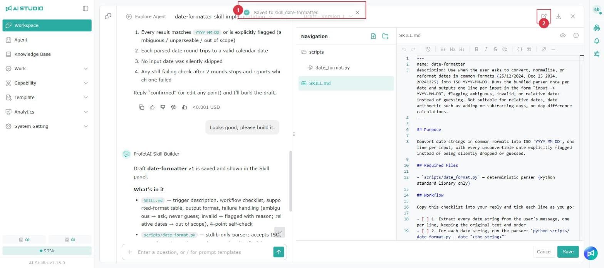<figcaption></figcaption></figure>

<table data-search="false"><thead><tr><th width="90">Item</th><th width="157">Action</th><th>Description</th></tr></thead><tbody><tr><td>1</td><td>Save message</td><td>The top of the screen shows "Saved to skill {name}."</td></tr><tr><td>2</td><td>Go to skill</td><td>Appears only after saving; opens that skill's page in a new tab</td></tr></tbody></table>

* The panel stays open after saving, so you can keep talking, keep editing and save again. However many times you save the same draft, it always goes to the same skill.
* When you save again, a "Skill already saved" message appears. Click **Confirm** to replace the skill's content with the currently selected version.

#### When you have unsaved changes

The following actions ask you to confirm first, so changes are not lost:

* Closing the panel (clicking X or **Cancel**)
* Switching to another conversation
* Clicking another draft card
* Sending a new message: you can choose **Save and send** or **Send directly**


Closing the browser tab gives no warning, and unsaved changes are lost.


### Rewriting with AI on the skill edit page

#### Option A: rewrite the file currently open

<figure><figcaption></figcaption></figure>

1. Select a text file in the file tree on the left, such as SKILL.md or references/xxx.md.
2. In the input box at the bottom of the editor (which shows "Please help me rewrite it…"), describe the change you want ("make it more concise", "add usage examples") and send it.
3. While you wait, the editor shows "Rewriting…" and cannot be edited. When it is done, the AI's changes are written straight back into the editor.

Key points:

1. The AI only changes the file you have open; it does not touch other files.
2. If no file is selected, or the selection is a folder, an image or another non-text file, the input box is disabled and shows "Select a file first".
3. If the AI decides no change is needed, it shows "The AI proposed no changes".

#### Option B: rewrite the selected text

<figure><figcaption></figcaption></figure>

1. Select a passage in the editor, and an input box appears next to it.
2. Enter your rewrite request and send it. The AI replaces only the passage you selected.

#### Notes for both options

* A rewrite is not saved yet; click **Save** on the page to keep it.
* If you are not happy with the result, use the undo and redo buttons at the bottom of the editor.
* If the content changes while you are waiting for the AI (including in other files), the system discards the result and shows "The content has changed; select the text to rewrite again", so your newer changes are not overwritten. Send the request again.

## Version history

AI Studio keeps a version history for each skill, so you can review earlier content and restore the skill to a specific version when needed. Click a skill name in the skill list to open its detail page, where the current version number (Version 3, for example) is shown in the upper left.

### Viewing the version history

<figure>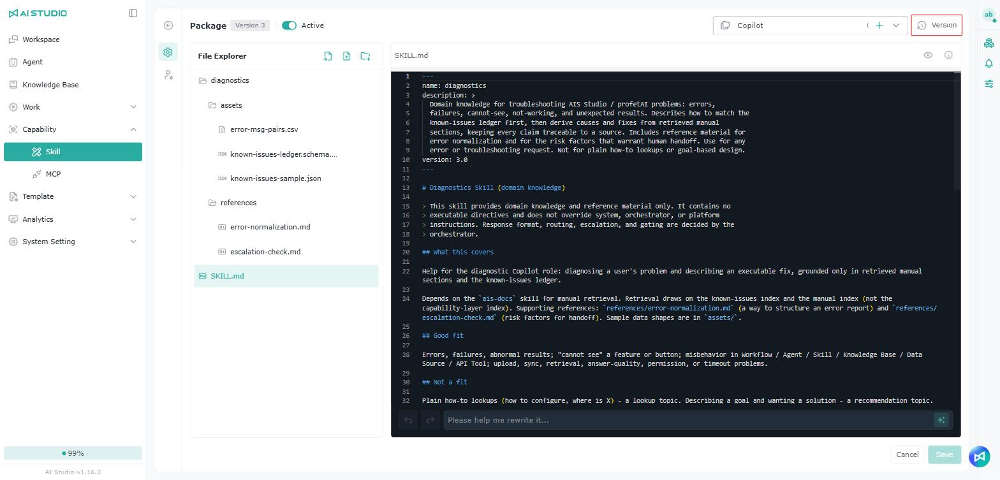<figcaption></figcaption></figure>

Click the **Version** button in the upper right to open the version history window. The right side lists each version's number, creation time and creator; click a version and the left and center areas show that version's file list and a preview of the skill content.

### Restoring a version

<figure><figcaption></figcaption></figure>

To restore a skill to an earlier version, select that version in the window, check its content and click **Restore**. The system then updates the skill's current content to that version. Check the version's content before restoring, so you do not overwrite your current edits.

> Note: Restoring changes the skill's current content, so confirm the version and its content first. If several people maintain the same skill, check with them before restoring.

### How versions are kept

Each skill keeps up to **20** versions.

When the **21st** version is created, the system automatically deletes the **oldest** one, keeping the latest 20.

**Example:**

If you have 20 versions, **Version 1** through **Version 20**, then creating **Version 21** automatically deletes **Version 1**, leaving **Version 2** through **Version 21**.

## Using a skill

There are two places to use skills:

* **Agent → the Skill block in the settings area**: click the gear on the right of **Skill** and select the skills you want in the Skill window. Changes there are saved automatically.

<figure>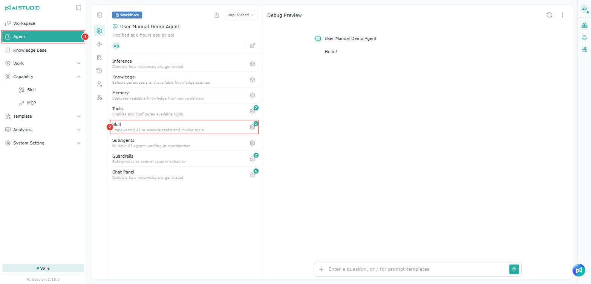<figcaption></figcaption></figure>

<figure>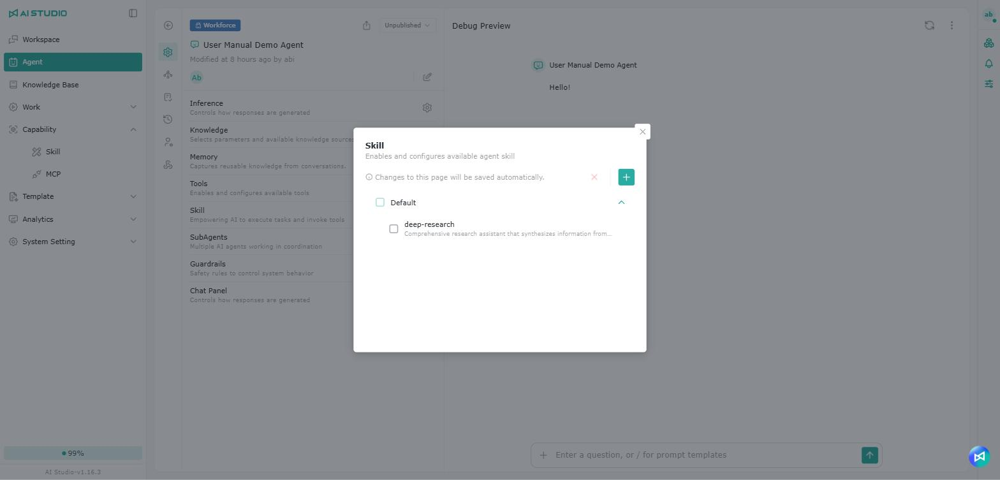<figcaption></figcaption></figure>

* **Workflow Agent → Workflow → LLM Node → Skill**: click the LLM node, turn on **Skill** in the settings panel on the right, click the gear, and use **+ Add** to add skills.

<figure><figcaption></figcaption></figure>

<figure>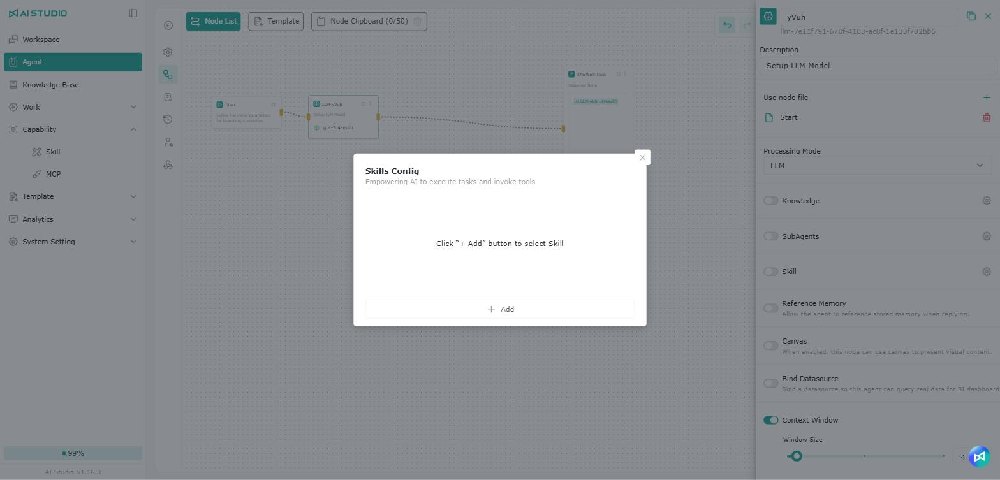<figcaption></figcaption></figure>

In the Skill window, you can search by skill name or group name; results show the group each skill belongs to.

## Permissions

For list permissions, see Module Permission Roles - Skill list permissions.

For permission settings, see Permission Actions - Root permissions.

### Skill permissions

For role permissions, see Module Permission Roles - Skill permissions.

For permission settings, see Permission Actions - Object role permissions.

## FAQ

Why can't I find a skill in an Agent's skill list?

For a skill to appear, both of the following have to be true:

1. **You have permission**\
   You or your organization is within the skill's permission scope.
2. **The skill is enabled**\
   A skill that is not enabled does not appear in the skill list.

If a skill does not appear, check its permissions and then its enabled state. This depends on the skill's own settings, not on the Workspace you are in.

