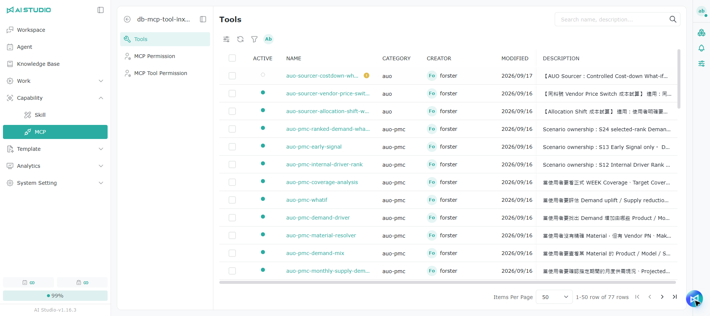
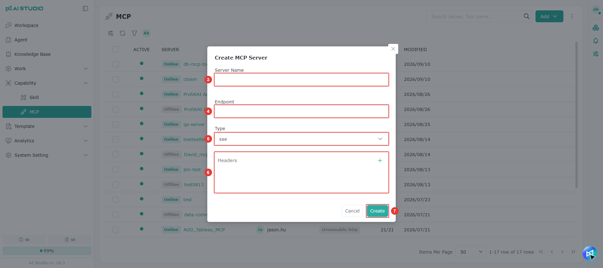
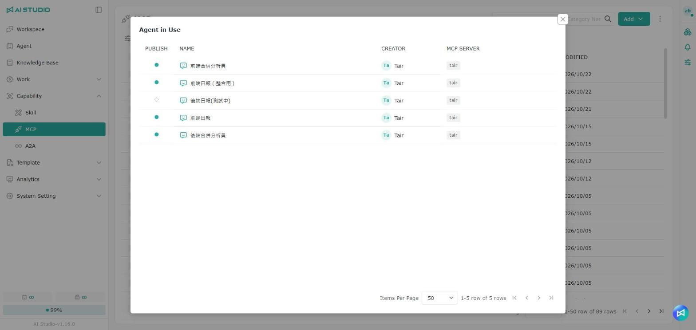

# MCP

## Introduction

The **MCP Tool** page shows the update history of every integrated tool that extends what an LLM can do — live search or file parsing, for example.

You can:

* **See** each tool's group, name, description, creator, creation time and last modified date
* **Track** the tools developers have added
* **Review** the available tools and what they do

<figure><figcaption>
The MCP Server list
</figcaption></figure>

> Note: The tool count in the MCP Server list is shown as "enabled / total", so you can see at a glance how many of a server's tools are enabled.

### Opening a server's page

<figure><figcaption></figcaption></figure>

Click a server name in the MCP Server list to open that server's page, which shows the tool list by default. A server's full settings are also edited on its page; the edit button in the list offers quick edit only.

### Searching for servers or categories

<figure><figcaption></figcaption></figure>

The search field in the MCP Server list accepts server names, tool names, and tool group (category) names. The system lists the servers that contain matching tools and shows the number of matching tools next to each server name, which helps you find the right server when there are many tools — when setting permissions for a tool, for example.

## Adding an MCP Server

### Adding a server manually

1. Go to the MCP page.
2. Click the add button and select **External**.
3. Enter the server name.
4. Enter the endpoint.
5. Select the HTTP or SSE type.
6. Enter the header information; several entries are allowed.
7. Click submit to finish.

### Importing from MCPHub

1. Go to the MCP page.
2. Click the add button and select **MCPHub**.
3. Enter the server name.
4. Select the target folder.
   * The folders come from what you created in MCPHub. If the list is empty, set one up in MCPHub first.
5. Click import to finish.

## Enabling tools

1. A newly created MCP Server loads all its tools, but they are disabled, so select the ones you want to enable first.
2. Click the toggle button.
3. Select **Enable** and click **Save**.

> Note: A tool has to have a category before it can be enabled. When enabling in bulk, if a selected tool has no category yet, the category dialog appears; the tools are enabled once you fill it in, and stay disabled if you do not.

### Changing categories in bulk

Select several tools in the tool list to change their categories at once, instead of editing them one by one.

## Refreshing tools

When the tools on an MCP Server change, refresh to get the latest information:

* **Refresh the tool list**: click the refresh button above the list, and the system syncs the tools added or removed on the MCP Server.
* **Refresh a single tool**: if only one tool's name, description or schema changed, click the refresh button on its row to get its latest information.

## Tool default parameters

Some tools have a settings button to the left of the single-tool refresh button, where you can set the tool's default parameter values. Once set, the defaults apply to that tool wherever it is used:

* An Agent's tool settings
* A workflow LLM node's tool settings
* A workflow template's tool settings

The order of precedence is: the setting in the Agent or node > the tool's default parameters > the default in the tool schema.

> Note: Changing a tool's default parameters does not override values already changed in an Agent or node. For example, if the default is A, a user changes it to B in an Agent, and the tool's creator later changes the default to C, the Agent keeps B. Click **Reset** in the Agent's tool settings to apply the new default C.

## Testing a tool

You can test a single tool directly in the tool list, to confirm that it runs and returns what you expect before using it in an Agent or workflow.

1. In the tool list, click the **Test** button on the tool you want.
2. Enter test values in the tool's parameter fields.
3. Click run and look at the result the tool returns.

> Note: A test really calls the tool. If the tool writes data or acts on an external system, use test parameters. If a run fails, use the error message to check the parameters, the connection and the authentication settings.

## Viewing Agents in use

<figure><figcaption></figcaption></figure>

On every row of the MCP Server list and the tool list, you can click the **Agent in Use** button to see which Agents currently use this server's tools or this tool. The window lists each Agent's publish status, name, creator, and the MCP server it uses.

<figure><figcaption></figcaption></figure>

> Note: The **Agent in Use** button is shown based on your edit or delete permission.

### Warnings before disabling, deleting or changing

<figure><figcaption></figcaption></figure>

When an MCP server or tool is used by Agents, the system first lists the **Affected agents** before the following actions, and warns that the action may affect those Agents' responses or the related tasks. The action continues only after you confirm:

| Target     | Actions that show a warning first                    |
| ---------- | ---------------------------------------------------- |
| MCP Server | Disable, delete, save after changing server settings |
| MCP Tool   | Disable (single or bulk), delete invalid tools       |

Enabling is not checked. When no Agent uses it, disabling shows a general warning and deleting shows the general delete confirmation.

> Note: Only invalid MCP tools can be deleted. If a bulk delete includes tools that are still usable, the system first tells you how many will be skipped.

## Permissions

For list permissions, see [Module Permission Roles - MCP list permissions](../ru-men-zhi-nan/quan-xian-gong-neng-jie-shao.md#mcp-qing-dan).

For permission settings, see [Permission Actions - Root permissions](../ru-men-zhi-nan/quan-xian-cao-zuo-gong-neng-jie-shao.md#root-quan-xian).

### MCP permissions

For role permissions, see [Module Permission Roles - MCP permissions](../ru-men-zhi-nan/quan-xian-gong-neng-jie-shao.md#mcp).

For permission settings, see [Permission Actions - Object role permissions](../ru-men-zhi-nan/quan-xian-cao-zuo-gong-neng-jie-shao.md#jue-se-quan-xian).

### MCP Tool permissions

For role permissions, see [Module Permission Roles - MCP Tool permissions](../ru-men-zhi-nan/quan-xian-gong-neng-jie-shao.md#mcp-gong-ju).

For permission settings, see [Permission Actions - Object access permissions](../ru-men-zhi-nan/quan-xian-cao-zuo-gong-neng-jie-shao.md#cun-qu-quan-xian).
