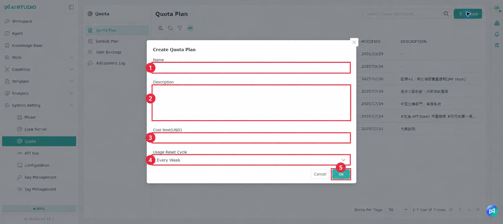

# Quota

The **Quota** page is where you manage the system resources and cost limits available to users, and track plan creation, assignment and usage resets.

Path: **System Setting > Quota**

The page has the following tabs:

* **Quota plans**: create and manage quota plans.
* **Default plan**: set the plan applied to users by default.
* **User bindings**: assign a plan to specific users and see their current usage.
* **Adjustment log**: look up changes to plans and usage.

## Shared actions

Every list page offers:

* **Search**: find data by name, description or another displayed column.
* **Create**: add a quota plan or a user binding.
* **Column settings**: choose which columns to show or hide, and pin a column to the left or right of the table.
* **Refresh**: reload the current list.
* **Filter**: select a column and set a condition; several filters can be combined.
* **Rows per page**: change how many rows are shown per page.
* **Pagination**: go to the first, previous, next or last page.

## Quota plans

This tab is where you create and manage the quota plans that can be assigned to users.

<figure><figcaption></figcaption></figure>

### Columns

| Column               | Description                                          |
| -------------------- | ---------------------------------------------------- |
| Name                 | The quota plan's name.                                |
| Usage reset period   | How often the system recalculates usage.               |
| Cost limit (USD)     | The maximum budget allowed within each reset period.   |
| Creator              | The user who created the plan.                          |
| Modified             | When the plan was last modified.                        |
| Description          | What the plan is for, or additional information.         |

### Creating a quota plan

1. Click **Create**.
2. Enter the plan name.
3. Enter a description if you want one.
4. Enter the cost limit (USD).
5. Select the usage reset period.
6. Click **OK** to finish, or **Cancel** to discard it.

The available reset periods are:

* Monthly
* Weekly
* Daily
* Every 6 hours
* Every 2 hours
* Hourly
* No reset

With **No reset** selected, the system does not reset usage on a fixed cycle.

### Editing and deleting a plan

The following actions are available on the right of a plan's row:

* **Edit**: change the plan's name, description, cost limit or reset period.
* **Delete**: remove the quota plan.


Before deleting, confirm that the plan is not still set as the default plan or assigned to users.


## Default plan

This tab is where you set the quota plan applied to users by default.

### How to set it

1. Select a quota plan in the **User** field.
2. Check your selection.
3. Click **Save** to apply it.

The **Save** button stays disabled until you change the plan.


To use a new default plan, create it on the **Quota plans** tab first, then come back to this tab and select it.


## User bindings

This tab is where you see which quota plan each user currently has, and assign plans to specific users.

<figure><figcaption></figcaption></figure>

### Columns

| Column      | Description                                                |
| ----------- | ---------------------------------------------------------- |
| Name        | The user's name or account.                                 |
| Quota plan  | The plan currently assigned to that user.                    |
| Usage       | The current usage, shown as a progress bar and a percentage.  |
| Description | Additional information about the user or the binding.          |

### Creating a user binding

1. Click **Create**.
2. In the plan list in the **Dataset** area on the left, select the quota plan to apply.
3. Select users in the user menu on the right.
4. Click **Add** to add them to the pending binding list.
5. To add more people, select more users and click **Add** again.
6. If you selected the wrong user, remove them from the pending list.
7. Check the plan and the users, then click **OK** to finish, or **Cancel** to discard it.

### Resetting usage

Click **Reset usage** in a user's row to reset the usage they have accumulated.

1. Find the user whose usage you want to reset.
2. Click **Reset usage** in their row.
3. Enter a reason in the confirmation dialog.
4. Check the user and the reason, and complete the reset.


A reset affects the user's quota calculation. Confirm the user and the reason before doing it. Afterwards you can find the usage reset (`USAGE_RESET`) entry in the **Adjustment log**.


## Adjustment log

This tab records changes to quota plans, user bindings and usage resets, so administrators can trace what was done.

### Columns

| Column                 | Description                                        |
| ---------------------- | -------------------------------------------------- |
| User                   | The user who performed the action.                   |
| Change type            | The type code of the action.                          |
| Name                   | The plan or account involved.                          |
| Budget before (USD)    | The budget before the action.                           |
| Budget after (USD)     | The budget after the action.                            |
| Usage reset reason     | The reason entered when usage was reset.                 |
| Target user            | The user affected by the assignment or reset.              |
| Created                | When the record was created.                              |

### Change types

| Change type        | System code     | Description                                  |
| ------------------ | --------------- | -------------------------------------------- |
| Create quota plan  | `PLAN_CREATE`   | A new quota plan was created.                  |
| Update quota plan  | `PLAN_UPDATE`   | An existing quota plan was updated.             |
| Delete quota plan  | `PLAN_DELETE`   | A quota plan was deleted.                       |
| Assign quota plan  | `PLAN_ASSIGN`   | A quota plan was assigned to a user.             |
| Reset usage        | `USAGE_RESET`   | A user's accumulated usage was reset.             |

Use search, filters and the column settings to find records by user, change type, target user or creation time.
