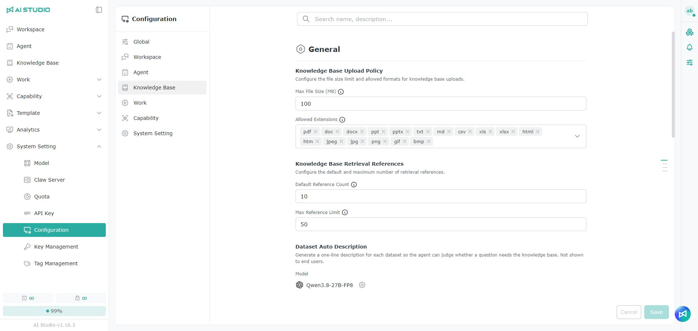
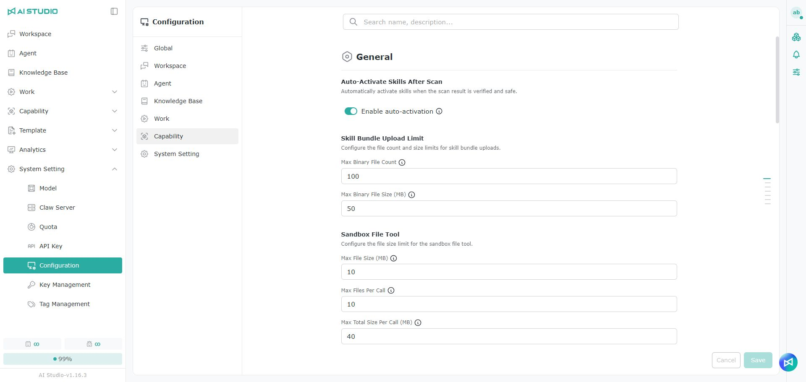
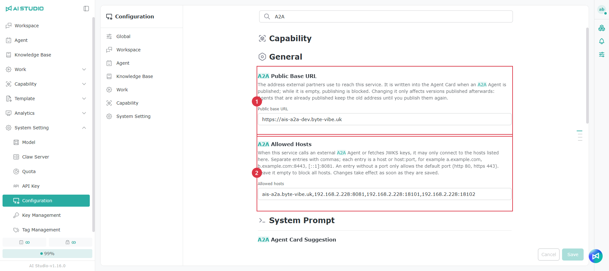
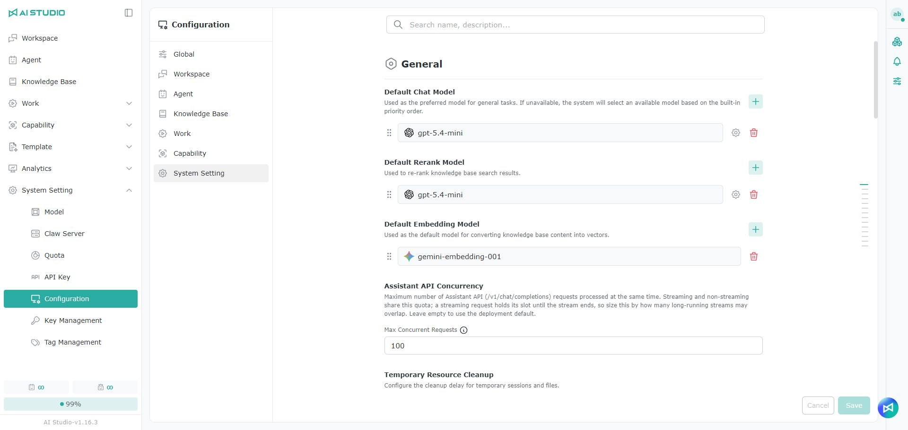

# Configuration

The **Configuration** page brings together the models, limits, toggles and system prompts for every AI Studio feature.

Path: **System Setting > Configuration**


Use the left side to switch between the seven categories: Global, Workspace, Agent, Knowledge Base, Work, Capability and System Setting. After changing a setting, click **Save** in the lower right of the page, or **Cancel** to discard your changes.


## Shared actions

* **Search**: find a setting by name or description.
* **Model**: select the model a feature uses; some items let you open **Parameters** to adjust the model parameters further.
* **Toggle**: turn a feature on or off.
* **Limits**: set a maximum number of files, a size, a run count, a wait time or another limit.
* **System prompt / Prompt / Instruction**: the rules the model follows when running that feature. Where an item says it can be left blank, leaving it blank means only the built-in rules apply.
* **Reset**: restore an editable prompt to its default content.
* **Save**: apply your changes.
* **Cancel**: discard unsaved changes.


Models, prompts and limits affect the output and behavior of system features. Consider your use case before changing them, and test afterwards.


## Global

Global settings apply to all of AI Studio, covering translation, memory, conversational BI, Canvas, content summarization and more.

### Supported language translation

The model used for multilingual translation tasks.

### Memory language model

The reasoning model used to extract, consolidate and manage memory content.

### Memory vector model

The embedding model that turns memory text into vectors, which supports semantic similarity search.

### Conversational BI

Controls whether users can create a new BI Dashboard in a conversation.

When it is off, the BI Dashboard creation entry point is hidden in the main conversation and the system does not offer the related generation tools. Existing BI Dashboards can still be edited through the ask panel or by selecting a tile.

### User memory tools

How an Agent decides which user information is worth remembering, and how it safely adds, updates, deletes or ignores memory content.

### Agent memory extraction

How the system extracts verified, reusable task experience from conversations and turns it into procedural memory.

### Canvas

The Canvas settings are:

* **Canvas**: whether Canvas is enabled, which Canvas Skill it uses, and the request dispatch rules.
* **Canvas generation rules**: custom rules to follow when generating Canvas content.
* **Canvas rewriting**: the model and additional rules used when improving or rewriting Canvas content.

### Keywords and summaries

The model and custom rules used to generate keywords and summaries.

## Workspace

Workspace settings manage chat attachments, tool media, and how titles and related questions are generated in the Workspace.

### Chat attachments

The maximum number of files that can be attached per chat, and the total size limit (MB) for all attachments.

### Tool media limits

Limits the number and total size of images, audio files and PDFs a tool can provide to the model in a single answer.

When the limit is exceeded, the system removes the oldest media first and tells the model how many items were omitted. The chat history, audit records and tool result cards still keep the original content in full.

### Related questions

The model and additional rules used to generate follow-up questions from the current question and answer. The system generates 3 to 5 questions the user can continue with.

### Title generation

The model and additional rules used to generate conversation titles automatically. The system detects the input language and produces a short, on-topic title in the same language.

### Structured query routing

Whether a natural language question against an Excel knowledge base should be routed to the structured query flow, and the model and additional rules used to decide.

## Agent

Agent settings manage speech transcription, input and output guardrails, and instruction rewriting.

### Chunked transcription of long audio

Controls whether long audio is split before transcription. You can set:

* Whether chunking is enabled.
* The maximum length of a single chunk, in seconds.
* The maximum number of chunks.
* The maximum total audio length.
* The STT models allowed.
* The maximum file size that can be transcribed directly.
* The overlap between adjacent chunks, in seconds.

### Audio upload limits

The number of audio files that can be uploaded per request in transcription mode and in single-file mode.

### System guardrail rules

The input and output safety rules every Agent chat has to follow. An Agent's own guardrails apply alongside the system rules, and the system-level rules cannot be disabled.

Rules can be set separately on the **Input** and **Output** tabs, and **Test** confirms they work as expected.

### Voice

The model used for speech transcription, the maximum audio length the model can handle, the system prompt and the Instruction.

Voice also includes:

* **Faithful transcription**: the Prompt and Instruction used to preserve the original meaning faithfully.
* **Voice summary**: the Prompt and Instruction used to summarize spoken content.

### Instruction rewriting

The model and additional rules used to turn a user's raw input into a clear, structured, actionable LLM instruction.

### Guardrail expression generation

The model and additional rules used to generate guardrail rule expressions.

## Knowledge Base

Knowledge Base settings manage file uploads, the number of retrieval references, dataset descriptions and query expansion.

### Knowledge base upload policy

The maximum size (MB) of a single file uploaded to a knowledge base, and the file extensions allowed.

### Knowledge base retrieval references

The default number of references used in knowledge base retrieval, and the maximum users can set.

### Automatic dataset descriptions

Generates a one-line description for each dataset, which helps an Agent decide whether a question needs the knowledge base. This description is not shown to ordinary users.

You can set the model, whether descriptions are generated automatically on import, whether existing datasets are backfilled, and limits such as the sample content, description length, batch size and timeout.

### Knowledge base query expansion

Controls whether the system rewrites a user's question into several query versions by default, including an English version, and retrieves with each one, which improves search across languages.


Query expansion adds one LLM call and runs several retrieval rounds, one per generated query version.


## Work

Work settings manage task planning, result evaluation, run limits and schedule rules.

### Task planning Agent model

The model the task planning Agent uses to break a goal into steps and completion criteria. This model has to be specified separately; it does not fall back to the default chat model.

### Task evaluation Agent model

The model the task evaluation Agent uses to check step results and decide what to do next. This model has to be specified separately; it does not fall back to the default chat model.

### Task run limits

For a single task, you can set:

* The maximum number of runs.
* The timeout, in seconds.
* The number of failures allowed.
* The cost budget (USD).

These limits are fixed when a task is created, so changing them does not affect tasks already running.

### AI Cron

The model and system prompt used when AI converts a natural language scheduling request into a valid Spring CronExpression.

## Capability

Capability settings manage skill scanning and activation, upload limits, Sandbox file tools, and the A2A Public Base URL, allowed hosts and Agent Card suggestions.

### Enable skills automatically after scanning

Controls whether a Skill that passes the scan and is confirmed safe is enabled automatically.


Before turning this on, confirm that the Skill scan rules are configured correctly. A Skill assessed as high risk should not be enabled automatically. For how security levels are determined, see Skill - Checking the security level.


### Skill package upload limits

The number of binary files a Skill package may contain, and the maximum size (MB) of a single binary file.

### Sandbox file tools

The maximum size of a single file, the number of files per call, and the total size (MB) per call for the Sandbox file tools.

### Skill Builder model

The model the Skill Builder Agent uses.

### Skills Scan

Controls whether scanning runs when a Skill is uploaded, to detect security risks, hidden behavior and content that violates policy.

### A2A Public Base URL and allowed hosts 

<figure><figcaption></figcaption></figure>

Before using A2A, a system administrator must configure these two settings. A message asking an A2A user to contact an administrator usually means they have not been configured.

<table data-search="false"><thead><tr><th width="90">No.</th><th width="190">Setting</th><th>Description</th></tr></thead><tbody><tr><td>1</td><td>A2A Public Base URL</td><td>The URL external partners use to reach this AI Studio instance, for example <code>https://ais-a2a.example.com</code>. Agents cannot be published if this is blank. After changing it, save each published Agent again (republish it) for the new URL to take effect.</td></tr><tr><td>2</td><td>A2A Allowed Hosts</td><td>AI Studio connects only to hosts on this list. Separate multiple hosts with commas and use <code>host</code> or <code>host:port</code>, for example <code>partner.example.com</code> or <code>partner.example.com:8443</code>. Without a port, only ports 80 and 443 are allowed. A blank value allows no hosts.</td></tr></tbody></table>

### A2A Agent Card Suggestion

Configure the model and prompt used by **Auto Gen** to generate a published Agent's name, description and skill examples.

<table data-search="false"><thead><tr><th width="90">No.</th><th width="190">Setting</th><th>Description</th></tr></thead><tbody><tr><td>1</td><td>Enable Agent Card suggestions</td><td>When this is off, Auto Gen fails when publishing an Agent and does not call the model. Enable it first, then select a model.</td></tr><tr><td>2</td><td>Model</td><td>The language model used to generate suggestions. Click the gear icon to change it.</td></tr><tr><td>3</td><td>Prompt</td><td>Normally, no changes are needed. If your edits cause problems, click Reset in the upper-right corner to restore the default.</td></tr></tbody></table>

### Skill package rewriting

The model and additional rules used when rewriting Skill files in the editor.

## System Setting

System Setting manages default models, API concurrency, temporary resources, run limits, record retention and public file sharing.

### Default models

The default model settings are:

| Setting                  | Description                                                                                       |
| ------------------------ | ------------------------------------------------------------------------------------------------- |
| Default chat model       | The model preferred for general tasks. If it is unavailable, the system picks another available model by its built-in priority. |
| Default embedding model  | The model a knowledge base uses by default to turn text into vectors.                               |
| Default rerank model     | The model used to reorder search results during knowledge base retrieval.                            |

### Assistant API concurrency

The maximum number of requests the Assistant API can handle at once. Streaming and non-streaming requests share this limit, and a streaming request occupies a slot until the stream ends.

### Temporary resource cleanup

How many minutes before temporary sessions and files are cleaned up.

### Tool run limits

The maximum number of tool calls per model inference.

### Agent run queue

How many seconds interactive and background requests wait for an available slot when all Agent run slots are in use.

### Run slot card details

Controls whether the run slot panel shows the conversation title and a summary of the user's input.


Run capacity may be shared by several organizations. With this on, a card may show text entered by users from another organization, so evaluate it against your data management policy.


### Knowledge base retrieval record retention

How many days the cited text in knowledge base retrieval records is kept, plus the batch size and maximum number of batches per cleanup.

With removal enabled, cited text past the retention period is cleared from the records.

### Audit record retention

How many days entity audit records are kept. The system deletes them once that period has passed.

### Public file sharing

Controls whether public share links that allow downloads without signing in can be created. You can set:

* How many share links can be created per hour.
* The number of public reads per minute.
* The number of public downloads per minute.
* The maximum file size (MB) that can be shared.
* The default validity, in days, of a share link.


Anyone with a public share link can access it. Confirm the file content and your sharing policy before enabling this.


### dMID risk assessment budget

The maximum number of seconds each round of automatic risk assessment may take. A tool whose assessment does not finish in time is treated as high risk and requires approval.

### dMID target lookup budget

The maximum number of seconds each round of read-only target lookup may take. If the target cannot be resolved in time, the raw identifier is shown, which does not affect subsequent approval.

### Log analysis

The model and system prompt used when AI analyzes logs, which helps the system assess overall health from errors, trends, availability, saturation and performance information.
