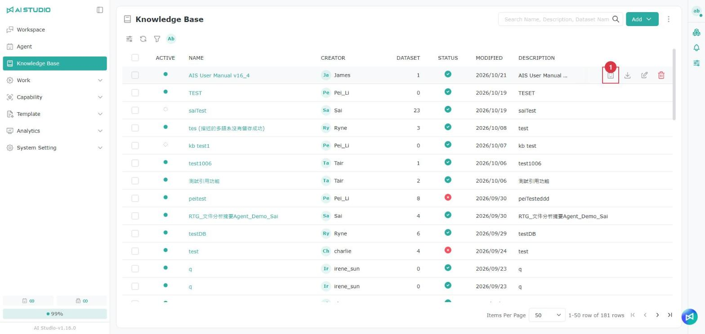
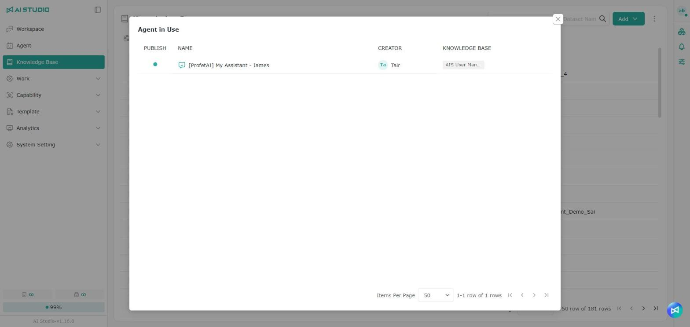

# Managing the Knowledge Base

## Introduction

> Note: By default, only AI Studio Admins, AI Studio Domain Users and users with Knowledge Base list permissions (Knowledge Base List Admin, Knowledge Base List User) can use the Knowledge Base. If you cannot use it, check your permissions with your administrator.

The Knowledge Base is the top-level container. It holds multiple pieces of **knowledge**, and **datasets** are configured under each piece of knowledge. The name "Knowledge Permission" is used to match the object actually being managed and to keep the naming consistent, and the English name follows the same logic.

The diagram below shows how datasets are organized within knowledge:

<figure><figcaption></figcaption></figure>

## **Creating new knowledge**

### **Creating knowledge manually**

<figure><figcaption></figcaption></figure>

<figure><figcaption></figcaption></figure>

1. Click **Knowledge Base** in the menu on the left.
2. Click the **Add** button in the upper right and select **+ Knowledge Base**.
3. Enter a name in the **Name** field, then click the button on the right to add multilingual labels. See [Multilingual settings](guan-li-zhi-shi-ku.md#duo-guo-yu-yan-she-ding).
4. Enter a description in the **Description** field, then click the button on the right to add multilingual labels. See [Multilingual settings](guan-li-zhi-shi-ku.md#duo-guo-yu-yan-she-ding).
5. Click the **Embedding Model** menu and select the model this knowledge uses to turn text into semantic vectors.
6. Click **Add** to finish.

### Multilingual settings 

<figure><figcaption></figcaption></figure>

1. Click the globe button to translate automatically. You can also edit the content manually.
2. When the automatic translation is done, click **Save** to save.

### **Importing knowledge**

<figure><figcaption></figcaption></figure>

<figure><figcaption></figcaption></figure>

1. Click **Knowledge Base** in the menu on the left.
2. Click the **Add** button in the upper right and select **+ From device**.
3. Select a model under Embedding Model.
4. Select the files to upload.
5. Click the import button to finish.

> Note: When you click the import button, the system tests the selected model. If the test succeeds, the upload proceeds with that model. If it fails, choose another available model, or confirm that the model is configured correctly, that you have permission to use it, and that the model service is reachable. Then click the close button to close the window.

## Searching knowledge

<figure><figcaption></figcaption></figure>

The search field in the Knowledge Base list accepts both knowledge names and dataset names. The system lists the knowledge that contains the dataset, which helps you find where a file lives when you only remember the file name — when setting access permissions for a dataset, for example.

## Opening a knowledge page

<figure><figcaption></figcaption></figure>

Click a knowledge name in the Knowledge Base list to open that knowledge's page, which shows **Dataset** by default. The knowledge's full settings are also edited on this page.

## Quick-editing knowledge

<figure><figcaption></figcaption></figure>

Click the edit button on a row in the Knowledge Base list to open the "Edit (knowledge name)" quick edit window, where you can view or change the following fields:

| Field              | Description                                                                 |
| ------------------ | --------------------------------------------------------------------------- |
| Knowledge Base ID  | This knowledge's unique identifier. It cannot be changed; click the copy button on the right to copy it. |
| Name               | The knowledge's name. Click the globe button on the right to set it in other languages. |
| Description        | The knowledge's description. Click the globe button on the right to set it in other languages. |

### Viewing and copying the Knowledge Base ID 

<figure><figcaption></figcaption></figure>

When integrating with the Knowledge Base API, some endpoints need the Knowledge Base ID (kbId) or the dataset ID (datasetId).

1. In the Knowledge Base list, click the edit button of the knowledge you want.
2. At the top of the "Edit (knowledge name)" window, find the **Knowledge Base ID** field — a string starting with `kb_`.
3. Click the copy button on the right of the field to copy the ID.

Dataset IDs work the same way: open the dataset's edit window in the dataset list to see it.

## Enabling and disabling knowledge

<figure><figcaption></figcaption></figure>

Every row in the Knowledge Base list has an enable toggle, so you can change a knowledge's enabled state directly in the list without opening its settings page. You can also select several pieces of knowledge and change their state at once.

## Viewing Agents in use

<figure><figcaption></figcaption></figure>

Hover over any row in the Knowledge Base list and click the **Agent in Use** button to see which Agents currently use this knowledge. The window lists each Agent's publish status, name and creator.

<figure><figcaption></figcaption></figure>

> Note: The **Agent in Use** button is shown based on your edit or delete permission for the knowledge.

### Warnings before disabling, deleting or changing the embedding model

<figure><figcaption></figcaption></figure>

When knowledge is used by Agents, the system first lists the **Affected agents** before the following actions. The action continues only after you confirm:

| Action                    | System behavior                                                                                                  |
| ------------------------- | ---------------------------------------------------------------------------------------------------------------- |
| Disable (single or bulk)  | Lists the affected Agents and warns that disabling may affect those Agents' responses or the related tasks         |
| Delete (single or bulk)   | Lists the affected Agents and warns that deleting may affect those Agents' responses or the related tasks          |
| Change the embedding model | Lists the affected Agents and warns that, while the vectors are rebuilt, those Agents cannot retrieve content from this knowledge |
| Enable                    | Not checked; enabled directly                                                                                    |

When no Agent uses it, disabling shows a general warning and deleting shows the general delete confirmation.

## Permissions

For list permissions, see [Module Permission Roles - Knowledge Base list permissions](../ru-men-zhi-nan/quan-xian-gong-neng-jie-shao.md#zhi-shi-ku-qing-dan).

For permission settings, see [Permission Actions - Root permissions](../ru-men-zhi-nan/quan-xian-cao-zuo-gong-neng-jie-shao.md#root-quan-xian).

### Knowledge permissions

For role permissions, see [Module Permission Roles - Knowledge permissions](../ru-men-zhi-nan/quan-xian-gong-neng-jie-shao.md#zhi-shi).

For permission settings, see [Permission Actions - Object role permissions](../ru-men-zhi-nan/quan-xian-cao-zuo-gong-neng-jie-shao.md#jue-se-quan-xian).

### Dataset permissions

For role permissions, see [Module Permission Roles - Dataset permissions](../ru-men-zhi-nan/quan-xian-gong-neng-jie-shao.md#shu-ju-ji).

For permission settings, see [Permission Actions - Object access permissions](../ru-men-zhi-nan/quan-xian-cao-zuo-gong-neng-jie-shao.md#cun-qu-quan-xian).
