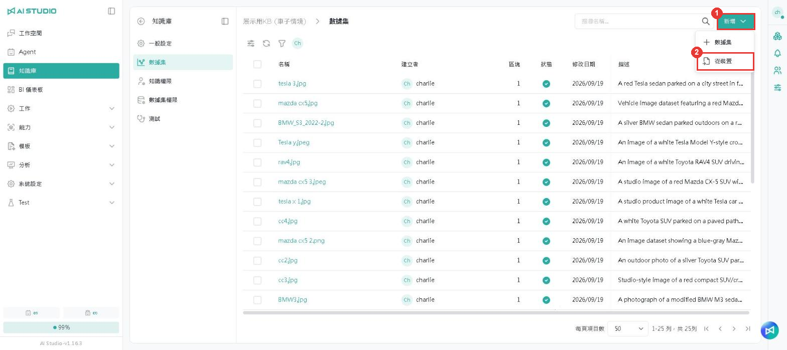
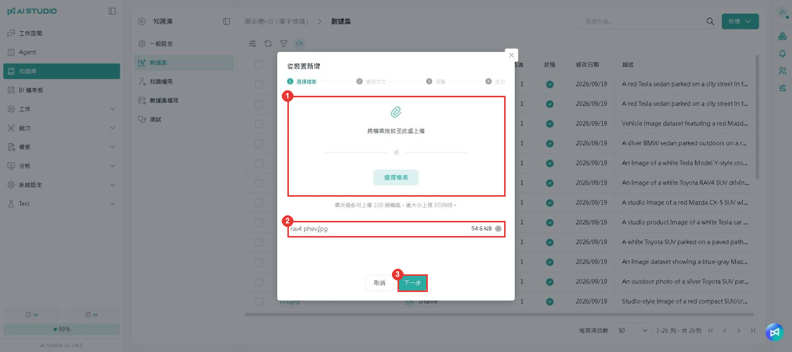
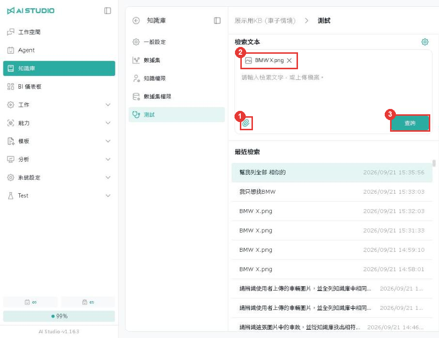

# Image Search

## Introduction

A knowledge base can hold images as well as documents. Once images are uploaded, you can find visually similar images with **an image**, or find images matching **a text description**.

## Choosing an embedding model that supports images

When creating a knowledge base, the **Embedding Model** has to be one labeled **multimodal embedding** for image search to work. Models labeled **embedding** support text only.

<figure><figcaption></figcaption></figure>

| Item | Description                                                                                                                             |
| ---- | --------------------------------------------------------------------------------------------------------------------------------------- |
| 1    | Models labeled multimodal embedding support images, for example gemini-embedding-2-image and gemini-embedding-2-preview. The models actually available depend on your system configuration. |

## Uploading images

Open the knowledge base and click **Dataset** on the left.

<figure><figcaption></figcaption></figure>

| Item | Description                                  |
| ---- | -------------------------------------------- |
| 1    | Click **Add**                                 |
| 2    | Select **From device** to open the upload dialog |

### Step 1: select files

<figure><figcaption></figcaption></figure>

| Item | Description                                                                                          |
| ---- | ---------------------------------------------------------------------------------------------------- |
| 1    | Drag images into this area, or click **Select files**. Up to 100 files per upload, 300 MB in total     |
| 2    | The files you have selected                                                                           |
| 3    | Click **Next**                                                                                        |

### Step 2: processing

<figure><figcaption></figcaption></figure>

| Item | Description                                                                              |
| ---- | ---------------------------------------------------------------------------------------- |
| 1    | Select **Automatic**. Use **Automatic** for image uploads                                  |
| 2    | Select the model the system uses to generate a text description for each image             |
| 3    | Click **Next**. With **Automatic** selected, step 3 (Preview) is skipped and you go to step 4 |

### Step 4: submit

<figure><figcaption></figcaption></figure>

| Item | Description                                        |
| ---- | -------------------------------------------------- |
| 1    | Check the file names and the estimated Token usage  |
| 2    | Click **Upload**                                    |

### Upload complete

<figure><figcaption></figcaption></figure>

| Item | Description                                                                                       |
| ---- | ------------------------------------------------------------------------------------------------- |
| 1    | Once processing is complete, the status shows a green check mark and the **Description** column shows the image description the system generated |

## Searching with an image

Open the knowledge base and click **Testing** on the left.

<figure><figcaption></figcaption></figure>

| Item | Description                                       |
| ---- | ------------------------------------------------- |
| 1    | Click the paperclip icon and upload the image to search with |
| 2    | The uploaded image appears in the input box        |
| 3    | Click **Query**                                    |

<figure><figcaption></figcaption></figure>

| Item | Description                                                     |
| ---- | --------------------------------------------------------------- |
| 1    | A summary of this search, including the number of results and the time taken |
| 2    | The recall results, ordered from most to least similar            |
| 3    | The similarity score; the closer to 1, the more similar           |

Example: searching with a photo of a BMW SUV puts three BMW models at the top (0.85, 0.83, 0.81), while models from other brands score around 0.76–0.78.

## Searching for images with text

Enter a text description in the input box and click **Query** to find images matching it.

<figure><figcaption></figcaption></figure>

| Item | Description                                                    |
| ---- | -------------------------------------------------------------- |
| 1    | Recent searches; click one to see its results again              |
| 2    | The images matching the description, with their similarity scores |

Example: entering "white SUV" puts an image of a white Tesla SUV first (tesla x.jpg, 0.67).

## Notes

* **Image-to-image and text-to-image scores are on different scales.** In the examples in this chapter, image search results score around 0.76–0.85 and text search around 0.48–0.67. Test each query type separately when setting a similarity threshold, rather than reusing the same value.
* **Visually similar items from other categories can also appear.** In the BMW example, SUVs from other brands still score 0.76–0.78, so judge by the order and the gaps between scores.
* Scores vary with the embedding model and the content of the knowledge base, so the numbers in this chapter are for reference only.
